# RouteMind AI: System Architecture Specification

**Document Identifier:** RMA-ARCH-2026-v1.0  
**System Classification:** Enterprise Maritime Predictive Logistics Platform  
**Architecture Pattern:** 4-Tier Decoupled Micro-Layered Service Architecture  

---

## 1. Architectural Overview

RouteMind AI operates across four distinct architectural tiers designed to provide end-to-end predictability, automated anomaly detection, human-in-the-loop exception governance, and real-time operational decision support.

```mermaid
flowchart TD
    %% Tier 1: Data & Ingestion
    subgraph Tier1 ["Tier 1: Data Acquisition & Ingestion Layer"]
        D1["DataCo Supply Chain Historical Archive (180,519 records)"]
        D2["Maritime EDI & Port Telemetry Feed (AIS, Berthing, Terminal Gates)"]
        D3["Live Order Placement & Manual Dispatch CSV Uploads"]
        ING["Ingestion Engine & Ingestion Validator (Schema Enforcement, Date Standardization)"]
        D1 --> ING
        D2 --> ING
        D3 --> ING
    end

    %% Tier 2: Feature Store & ML Pipelines
    subgraph Tier2 ["Tier 2: Feature Store & ML Intelligence Pipelines"]
        FS[("RouteMind Feature Store\n(Order-time, Dwell, Route Variance)")]
        ING --> FS
        
        M1["Model 01: Order-Creation Risk\n(Logistic Regression | Threshold: 0.34-0.40)"]
        M2["Model 02: Dispatch-Stage Late Risk\n(XGBoost Classifier | 97.52% Acc | 0.9985 ROC-AUC)"]
        M3["Model 03: Delay Estimation Regressor\n(CatBoost Regressor | Continuous Days Delay)"]
        SHAP["SHAP TreeExplainer & LinearExplainer\n(Feature Attributions & Top Risk Factors)"]
        
        FS --> M1
        FS --> M2
        FS --> M3
        M1 --> SHAP
        M2 --> SHAP
    end

    %% Tier 3: Application & AI Services
    subgraph Tier3 ["Tier 3: Core Application & AI Governance Services"]
        FlaskCore["Flask Core Web Application (Application Factory, Session, CSRF)"]
        AuthRBAC["Authentication & Security Gate (Role Permissions, Email OTP, Bcrypt)"]
        ShipSvc["Shipment Lifecycle Service (1-8 Milestone Transitions)"]
        ExcSvc["Exception Management Desk (Open, Investigating, In Progress, Resolved)"]
        EscSvc["Manager Escalation Service (Human-in-the-Loop Supervisory Workflow)"]
        
        GenAI["GenAI Resolution Recommender (BRD 5-Part Structured Strategy Engine)"]
        CommHub["Communication Approval Hub (Prompt Versioning 'v1.0.0', Drafts, Logging)"]
        AIAssist["RouteMind AI Copilot (Intent Detection, Typo Normalization, Multi-turn Context)"]
        
        FlaskCore --> AuthRBAC
        FlaskCore --> ShipSvc
        FlaskCore --> ExcSvc
        FlaskCore --> EscSvc
        FlaskCore --> GenAI
        FlaskCore --> CommHub
        FlaskCore --> AIAssist
        
        M1 --> ShipSvc
        M2 --> ShipSvc
        M3 --> ShipSvc
        SHAP --> AIAssist
    end

    %% Tier 4: Presentation & UI
    subgraph Tier4 ["Tier 4: Presentation UI & Interactive Copilot"]
        Dash["Executive Control Tower Dashboard (Fleet Metrics, Status Counters, Visuals)"]
        ShipExplorer["Shipment Detail & Milestone Explorer (Chronological Timeline, SHAP Chart)"]
        ExcDesk["Operational Exception Desk & Resolution Staging"]
        EscDesk["Supervisory Manager Escalations Desk"]
        ChatCopilot["RouteMind AI Copilot (Floating Widget & Dedicated Full-Screen Screen)"]
        
        FlaskCore --> Dash
        FlaskCore --> ShipExplorer
        FlaskCore --> ExcDesk
        FlaskCore --> EscDesk
        FlaskCore --> ChatCopilot
    end

    %% Persistence
    subgraph Persistence ["Persistence & Storage Tier"]
        MySQL[("MySQL 8.0 Primary Store (routemind_db)\nShipments, Exceptions, Escalations, Audits")]
        SQLite[("SQLite 3 Fallback & Local Test Store\n(routemind_control_tower.db)")]
        AuditLogStore[("Immutable Audit Trail & Model Registry")]
        
        Tier3 <--> MySQL
        Tier3 <--> SQLite
        Tier3 --> AuditLogStore
    end
```

---

## 2. Granular Tier Breakdown

### Tier 1: Data Acquisition & Ingestion
- **Standardized Ingestion Pipeline:** Consumes raw multi-modal shipping telemetry, standardizing order timestamps, port identifiers (UN/LOCODE), container formats (TEU/FEU), and carrier codes.
- **Leakage Prohibition Filter:** Strictly bars post-order actuals (`Days for shipping (real)`, `Delivery Status`, `Order Status`) from entering initial inference pipelines.
- **Data Integrity Auditing:** Validates numeric ranges, currency values, discount bounds, and scheduled transit windows prior to feature store persistence.

### Tier 2: Feature Store & Machine Learning Intelligence
- **Model 01 (Order-Creation Classifier):** Implements regularized Logistic Regression ($L_2$ penalty, $C=0.01$, balanced weights). Evaluates baseline risk at order placement using origin/destination port pairs, shipping mode, sales value, and category.
- **Model 02 (Dispatch-Stage Classifier):** High-precision XGBoost gradient-boosted tree ensemble evaluating confirmed warehouse dwell time, dock handling speed, and early milestone timestamps ($97.52\%$ test accuracy).
- **Model 03 (Delivery Delay Regressor):** CatBoost regressor computing continuous predicted delay duration ($\Delta \text{Days}$) for scheduling contingency.
- **SHAP Attribution Engine:** Generates exact log-odds feature contributions for every scored consignment, highlighting top positive and negative risk contributors.

### Tier 3: Core Application & AI Governance Services
- **Role-Based Access Control (RBAC):** Strict operational segregation across `Administrator`, `Operations Manager`, and `Dispatcher` roles.
- **Human-in-the-Loop Escalation Hub:** Direct dispatcher-to-manager escalation workflow with priority levels, assignment routing, and status transitions.
- **GenAI 5-Part Resolution Engine:** Produces structured mitigation strategies (`summary`, `possible_causes`, `resolution_options`, `assumptions`, `message_draft`).
- **Prompt Versioning & Communication Governance:** Persists prompt iterations (`prompt_version='v1.0.0'`) and enforces supervisor sign-off before dispatching external customer advisories.

### Tier 4: Presentation UI & Interactive Copilot
- **Navy-Blue / Cyan Logistics Cockpit:** Cohesive Bootstrap responsive UI maintaining industrial control-room aesthetics.
- **Timeline Milestone Progress:** Stepwise progression tracking from `CREATED` $\to$ `BOOKING_CONFIRMED` $\to$ `READY_FOR_DISPATCH` $\to$ `DISPATCHED` $\to$ `IN_TRANSIT` $\to$ `ARRIVED_AT_DESTINATION` $\to$ `OUT_FOR_DELIVERY` $\to$ `DELIVERED` $\to$ `COMPLETED`.
- **Conversational Copilot:** Real-time natural language query interface with multi-turn session persistence, typo tolerance, and grounded SQL telemetry.
