# RouteMind AI: Database Entity-Relationship Specification (ERD)

**Document Identifier:** RMA-ERD-2026-v1.0  
**Database Engines Supported:** MySQL 8.0 (Production) & SQLite 3 (Fallback/Testing)  
**Schema Version:** 2.4.0 (Includes Prompt Versioning & Escalation Audit Trail)  

---

## 1. Entity-Relationship Diagram

```mermaid
erDiagram
    USERS ||--o{ SHIPMENTS : "creates / dispatches"
    USERS ||--o{ AUDIT_LOGS : "triggers"
    USERS ||--o{ MANAGER_ESCALATIONS : "escalates / assigned"
    USERS ||--o{ EMAIL_OTPS : "authenticates"
    
    CUSTOMERS ||--o{ SHIPMENTS : "receives"
    PRODUCTS ||--o{ SHIPMENTS : "contained_in"
    
    SHIPMENTS ||--o{ SHIPMENT_EVENTS : "tracks"
    SHIPMENTS ||--o{ MODEL_SCORES : "scored_by"
    SHIPMENTS ||--o{ RISK_FACTORS : "features"
    SHIPMENTS ||--o{ SHIPMENT_EXCEPTIONS : "flags"
    SHIPMENTS ||--o{ MANAGER_ESCALATIONS : "escalated_via"
    SHIPMENTS ||--o{ COMMUNICATION_LOGS : "notified_for"
    
    SHIPMENT_EXCEPTIONS ||--o{ EXCEPTION_ACTIONS : "triggers"
    SHIPMENT_EXCEPTIONS ||--o{ COMMUNICATIONS : "generates"
    
    MANAGER_ESCALATIONS ||--o{ ESCALATION_HISTORY : "logs_history"

    USERS {
        int id PK
        string username UK
        string email UK
        string password_hash
        string role "Admin | Operations Manager | Dispatcher"
        boolean is_active
        datetime created_at
    }

    CUSTOMERS {
        int customer_id PK
        string customer_name
        string customer_email
        string customer_segment "Consumer | Corporate | Home Office"
        string customer_city
        string customer_country
    }

    PRODUCTS {
        int product_id PK
        string product_name
        string category_name
        string department_name
        decimal product_price
    }

    SHIPMENTS {
        int id PK
        string shipment_number UK
        string carrier_name
        string shipping_mode "Standard Class | Second Class | First Class | Same Day"
        string origin_port
        string destination_port
        string vessel_name
        string imo_number
        string container_number
        int scheduled_days
        decimal order_amount
        string order_status "CREATED -> DELIVERED -> COMPLETED"
        decimal order_creation_prob
        decimal dispatch_prob
        decimal predicted_delay_days
        string risk_level "LOW | MEDIUM | HIGH | CRITICAL"
        int created_by FK
        datetime created_at
        datetime updated_at
    }

    SHIPMENT_EVENTS {
        int event_id PK
        int shipment_id FK
        string event_type "STATUS_CHANGE | DWELL_ALERT | GATE_IN"
        string milestone_name
        string location
        string description
        string user_name
        datetime created_at
    }

    SHIPMENT_EXCEPTIONS {
        int id PK
        int shipment_id FK
        string exception_type "PORT_CONGESTION | CUSTOMS_HOLD | WEATHER"
        string severity "LOW | MEDIUM | HIGH | CRITICAL"
        string status "OPEN | ASSIGNED | IN_PROGRESS | RESOLVED | CLOSED"
        string root_cause
        int assigned_to FK
        datetime created_at
        datetime resolved_at
    }

    EXCEPTION_ACTIONS {
        int action_id PK
        int exception_id FK
        string action_type "CARRIER_EXPEDITE | HUB_REROUTE | PROACTIVE_NOTICE"
        string description
        decimal estimated_cost
        string approval_status "PENDING | APPROVED | REJECTED"
        int approved_by FK
        datetime approved_at
    }

    MANAGER_ESCALATIONS {
        int id PK
        int shipment_id FK
        int exception_id FK
        string priority "LOW | MEDIUM | HIGH | URGENT"
        string escalation_reason
        string remarks
        string status "PENDING | UNDER_REVIEW | IN_PROGRESS | RESOLVED"
        string escalated_by
        int assigned_to FK
        text resolution_notes
        datetime escalation_date
        datetime resolved_at
    }

    ESCALATION_HISTORY {
        int id PK
        int escalation_id FK
        string action
        string user
        string notes
        datetime timestamp
    }

    COMMUNICATIONS {
        bigint communication_id PK
        bigint exception_id FK
        bigint action_id FK
        string audience "CUSTOMER | INTERNAL"
        string communication_type
        string subject
        text generated_draft
        text final_text
        string ai_model_name
        string prompt_version "v1.0.0"
        string approval_status "PENDING | APPROVED | REJECTED"
        int created_by FK
        int approved_by FK
        datetime approved_at
        string delivery_status "DRAFT | APPROVED | SENT_SIMULATED"
        datetime created_at
    }

    COMMUNICATION_LOGS {
        int id PK
        int shipment_id FK
        string recipient
        string channel "EMAIL | SMS | EDI"
        string subject
        text message_body
        string prompt_version "v1.0.0"
        datetime sent_at
    }

    MODEL_SCORES {
        int score_id PK
        string shipment_id FK
        string model_id
        string prediction_stage "order_creation | dispatch"
        float late_delivery_probability
        int predicted_class
        float selected_threshold
        string risk_category
        string alert_level
        datetime scored_at
    }

    AUDIT_LOGS {
        int id PK
        int user_id FK
        string action
        string entity
        int entity_id
        string details
        string ip_address
        datetime timestamp
    }

    CHAT_CONVERSATIONS {
        int id PK
        int user_id FK
        string session_id UK
        text last_context_json
        datetime created_at
        datetime updated_at
    }

    CHAT_MESSAGES {
        int id PK
        int conversation_id FK
        string sender "user | assistant"
        text message_text
        string intent
        text references_json
        datetime created_at
    }
```

---

## 2. Table Descriptions & Key Constraints

### 1. `shipments`
- **Primary Key:** `id` (Auto-increment).
- **Unique Constraint:** `shipment_number` (`SHP-XXXXX`).
- **Domain Constraints:** Strictly enforces maritime vessel names, container TEU/FEU numbers, and UN seaports.
- **Audit Columns:** `created_by` (FK to `users.id`), `created_at`, `updated_at`.

### 2. `manager_escalations` & `escalation_history`
- **Purpose:** Manages human-in-the-loop operational escalation from Dispatchers to Operations Managers.
- **Statuses:** `PENDING` $\to$ `UNDER_REVIEW` $\to$ `IN_PROGRESS` $\to$ `RESOLVED`.
- **Audit & Governance:** Every state change, assignment, and resolution note is immutably mirrored into `escalation_history`.

### 3. `communications` & `communication_logs`
- **Prompt Versioning:** Includes mandatory column `prompt_version VARCHAR(50) DEFAULT 'v1.0.0' NOT NULL` to track prompt template provenance across GenAI draft iterations.
- **Manager Approval Gate:** `approval_status` (`PENDING`, `APPROVED`, `REJECTED`) prevents unapproved customer communications from being transmitted.

### 4. `chat_conversations` & `chat_messages`
- **Multi-Turn Context:** `last_context_json` stores persistent JSON dictionaries (`last_shipments`, `last_focus_shipment`, `last_intent`) enabling seamless conversational follow-ups.
