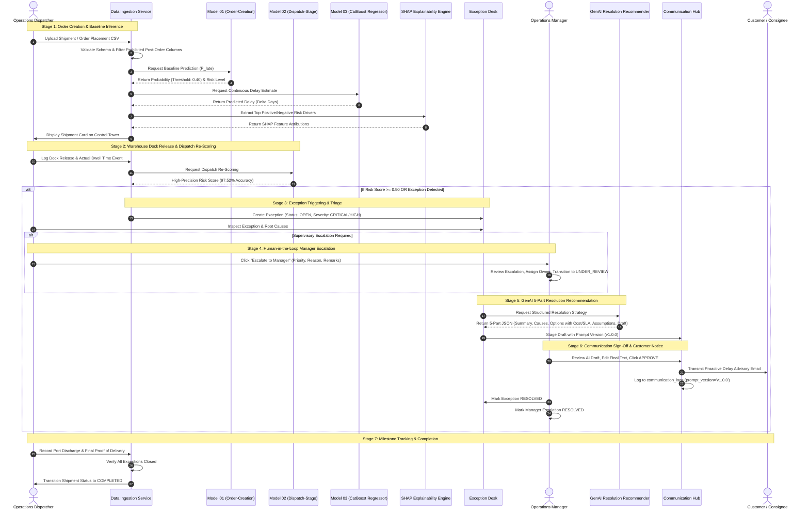
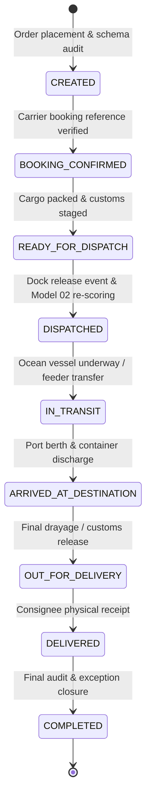
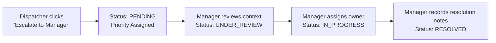

# RouteMind AI: End-to-End Operational Lifecycle & Workflow Specification

**Document Identifier:** RMA-WFL-2026-v1.0  
**Domain Scope:** Predictive Maritime Logistics Exception Management & Resolution  
**Standard Operating Procedure Compliance:** ISO 9001 / Logistics Control Tower Operational Protocol  

---

## 1. End-to-End Lifecycle Sequence Diagram

---

## 2. Consignment Milestone Progression (Stages 1 through 8)

All shipments follow an immutable, validated 8-milestone lifecycle:

---

## 3. Detailed Exception Resolution Lifecycle States

| State | Role Owner | Permitted Operational Actions |
| :--- | :--- | :--- |
| **OPEN** | Dispatcher / System | Automatically created when predicted risk $\ge 50\%$ or milestone anomaly triggered. Dispatcher inspects root causes and SHAP contributors. |
| **ASSIGNED** | Operations Manager | Manager assigns the exception to a senior logistics coordinator or regional terminal specialist. |
| **IN_PROGRESS** | Assigned Specialist | Specialist executes tactical remediation (carrier expedite, off-dock drayage shuttle, customs broker documentation resubmission). |
| **RESOLVED** | Operations Manager | Corrective action confirmed; delay mitigated or customer proactively notified. |
| **CLOSED** | System / Admin | Final delivery validated with zero outstanding liabilities. Closed automatically upon consignment completion. |

---

## 4. Manager Escalation & Governance Workflow

1. **Dispatcher Initiation:** Accessible directly from Shipment Detail or Exception Detail pages. The dispatcher selects Priority (`LOW`, `MEDIUM`, `HIGH`, `URGENT`), enters the operational reason, and optionally appends context notes.
2. **Supervisory Review:** Operations Managers review all active escalations on the centralized **Manager Escalations Desk**. Managers have exclusive authority to assign ownership, update escalation status, and record binding resolution notes.
3. **Audit Trail Synchronization:** Every status change is captured with timestamped entries in `escalation_history`.
