# RouteMind AI – Complete Master Implementation & System Audit Report

**Platform Name:** RouteMind AI – Predictive Maritime Shipment Intelligence & Exception Management System  
**Date of Audit & Implementation:** 19 November 2026  
**Status:** Complete, Integrated, Verified & Production-Ready

---

## 1. Executive Summary

This report documents the end-to-end audit, engineering corrections, machine learning integrations, role-based security enforcement, and verification testing performed on **RouteMind AI**.

The application operates strictly within the **Maritime Logistics** domain, managing ocean shipments through international seaport corridors, tracking container telemetry, executing verified multi-stage machine learning inference (Logistic Regression, XGBoost, CatBoost Regressor, and SHAP explainability), and enforcing human-in-the-loop exception resolution and communication approval workflows.

---

## 2. Existing Project Inspection Findings

1. **Model Source Configuration:**
   - Previous iterations referenced disparate internal model directories (`anomaly_detection`, `clustering`, `_backup_...`).
   - The user mandated using **ONLY** the models in `C:\gowtham_mithraz\python\Logistics-Control-Tower\files\models`.
   - **Resolution:** Purged all legacy and unapproved models; bound `.env`, `config.py`, and inference loaders directly to `C:\gowtham_mithraz\python\Logistics-Control-Tower\files\models`.

2. **Maritime Domain Strictness:**
   - Addressed generic freight references by enforcing seaport-to-seaport routing (e.g., Port of Rotterdam, Port of Singapore, Port of Hamburg, Port of Shanghai), intermodal container specifications (TEU, FEU, 40ft High Cube Dry), and vessel designations.
   - Removed all air cargo, truck tracking, moving vessel maps, and simulated live GPS widgets.

3. **Lifecycle & Milestone Sequence:**
   - The consignment milestone tracker previously rendered fragmented telemetry events.
   - **Resolution:** Re-engineered the milestone component into a complete **9-stage maritime lifecycle**:
     `1. CREATED` ➔ `2. BOOKING_CONFIRMED` ➔ `3. READY_FOR_DISPATCH` ➔ `4. DISPATCHED` ➔ `5. IN_TRANSIT` ➔ `6. ARRIVED_AT_DESTINATION` ➔ `7. OUT_FOR_DELIVERY` ➔ `8. DELIVERED` ➔ `9. COMPLETED`.

4. **Multi-Stage Machine Learning Pipeline:**
   - **Stage 1:** Model 01 (Logistic Regression Pipeline) evaluates order-creation late delivery probability and risk classification.
   - **Stage 2:** Model 02 (XGBoost Pipeline) evaluates dispatch-stage late delivery probability when genuine warehouse processing dwell time (`Order-to-Ship Time`) is confirmed.
   - **Stage 3:** Model 03 (CatBoost Regressor) estimates transit delay duration: `Delay_Days = Days for shipping (real) - Days for shipment (scheduled)`.
   - **Explainability:** SHAP feature attribution calculates real positive and negative risk contributors.

5. **Communication Approval Hub & Manager Escalations:**
   - Provided both a database-driven **Manager Escalations Desk** and a 4-stage **Communication Approval Hub**:
     `Dispatcher Draft` ➔ `Submitted for Review` ➔ `Manager Verification (Approve / Reject / Changes Requested)` ➔ `Gated Transmission`.
   - Administrators cannot approve operational communications; only Operations Managers hold approval authority.

---

## 3. Inventory of Files

### A. Files Preserved & Reused
- `src/models/user_model.py`: User entity with role definitions.
- `src/models/customer_model.py`: B2B customer accounts.
- `src/models/product_model.py`: Product catalog and cargo categories.
- `src/models/model_score_model.py`: Historical model prediction scores.
- `src/models/risk_factor_model.py`: Contributing risk factors.
- `src/models/otp_model.py`: Secure OTP hash storage.
- `src/models/audit_log_model.py`: System-wide audit log trail.
- `src/models/escalation_model.py`: Database-driven manager escalation logs.
- `src/security/permissions.py`: Exact role decorators and authorization logic.
- `src/services/otp_service.py`: Passwordless 6-digit Email OTP with cryptographic hashing and attempt limits.
- `src/ai/chatbot.py`: Grounded operational assistant.

### B. Files Created
- `src/delay_prediction.py`: Standalone Model 03 CatBoost Delay Regressor inference module.
- `templates/ai_communications.html`: Communication Approval Hub template.
- `tests/test_delay_model.py`: Unit test verifying CatBoost delay prediction.
- `tests/test_milestones.py`: Unit test verifying the 9-stage milestone cycle.
- `tests/test_lifecycle_and_comms.py`: Integration test verifying delivery confirmation, completion gating, and communication approvals.
- `reports/ROUTEMINDAI_IMPLEMENTATION_REPORT.md`: This comprehensive report.

### C. Files Modified & Enhanced
- `config.py`: Explicitly pointed `DEFAULT_EXTERNAL_MODELS` to `C:\gowtham_mithraz\python\Logistics-Control-Tower\files\models`.
- `.env`: Configured `MODELS_DIR` environment override.
- `src/load_data.py`: Resolved models directory to the external path.
- `src/prediction.py`: Updated model path resolution and feature validation for Stage 1.
- `src/dispatch_prediction.py`: Updated Model 02 XGBoost loader and fallback handling.
- `src/services/prediction_service.py`: Added `estimate_delay()` and integrated Model 03 CatBoost into `score_control_tower_unified()`.
- `src/services/shipment_service.py`: Added manager/admin global visibility scoping and milestone update services.
- `src/routes/shipment_routes.py`: Added `build_milestone_cycle()`, `update-status`, `confirm-delivery`, and `complete` endpoints.
- `src/routes/__init__.py`: Registered `comm_bp` at `/communications`.
- `templates/base.html`: Added Communication Approval / Drafts navigation tab for Dispatchers and Managers.
- `templates/shipment_detail.html`: Integrated 9-stage milestone timeline, CatBoost delay display, SHAP attribution bars, and action modals.

---

## 4. Machine Learning Model Architecture & Integration

All models load exclusively from `C:\gowtham_mithraz\python\Logistics-Control-Tower\files\models`:

| Model ID | Target / Task | Algorithm | Input Feature Set | Decision Cutoff / Threshold |
|---|---|---|---|---|
| **Model 01** | Late Delivery Risk at Order Creation | Logistic Regression Pipeline | `Days for shipment (scheduled)`, `Order Item Quantity`, `Sales`, `Shipping Mode`, `Order Region`, `Type`, `Market`, `Primary Category` | `0.40` (Optimal F1 Threshold) |
| **Model 02** | Late Delivery Risk at Warehouse Dock Dispatch | XGBoost Classifier Pipeline | `Days for shipment (scheduled)`, `Order-to-Ship Time`, `Shipping Mode`, `Order Region`, `Market`, `Department Name`, `Customer Segment` | `0.39` (Optimal Dock Threshold) |
| **Model 03** | Transit Delay Duration Estimation | CatBoost Regressor (`.cbm`) | `Days for shipment (scheduled)`, `Order-to-Ship Time`, `Shipping Mode`, `Customer Segment`, `Order Region` | Continuous days (`Delay_Days >= 0.5d` flags delay) |
| **SHAP Explainer** | Local & Global Feature Attribution | TreeSHAP / Log-Odds attribution | Live feature vector | Positive (risk-increasing) & Negative (risk-reducing) SHAP weights |

---

## 5. Authentication & Role-Based Access Control (RBAC)

### A. Passwordless Email OTP Login
- User submits registered email address.
- Generic response returned for non-existent emails to prevent account enumeration.
- Secure 6-digit OTP generated via `secrets.randbelow(1000000)`.
- SHA-256 hashed OTP stored in database with a 5-minute expiration timestamp.
- Max 5 incorrect verification attempts before the token is locked.
- 60-second cooldown between resend requests.

### B. Role Matrix
1. **Dispatcher / Operations Analyst:**
   - Scope: Created or assigned shipments only.
   - Permissions: Create/edit authorized shipments, view predictions & SHAP explanations, log exceptions, draft customer communications, submit drafts for manager review.
   - Restrictions: Cannot approve communications, assign exceptions, resolve exceptions, or access user management.
2. **Operations Manager:**
   - Scope: System-wide global control tower visibility.
   - Permissions: Assign/reassign exceptions, resolve exceptions, review communication drafts, approve/reject communications, update manager escalations, view audit logs.
   - Restrictions: Cannot create or edit shipments by default; cannot access user management.
3. **Administrator:**
   - Scope: System governance and configuration.
   - Permissions: Manage user accounts, assign roles, configure thresholds, monitor system health, inspect audit logs.
   - Restrictions: Cannot approve customer communications; cannot resolve operational exceptions.

---

## 6. Complete 12-Stage Shipment Lifecycle

```mermaid
flowchart LR
    S1["1. Creation<br/>(Status: CREATED)"] --> S2["2. Order Prediction<br/>(Model 01 LogReg)"]
    S2 --> S3["3. SHAP Explanation<br/>(Risk Factors)"]
    S3 --> S4["4. Booking Confirmed<br/>(Slot Allocated)"]
    S4 --> S5["5. Ready for Dispatch<br/>(Staged at Quay)"]
    S5 --> S6["6. Dispatch Prediction<br/>(Model 02 XGBoost)"]
    S6 --> S7["7. Delay Estimation<br/>(Model 03 CatBoost)"]
    S7 --> S8["8. Dispatched & In Transit<br/>(Sea Passage)"]
    S8 --> S9["9. Arrived at Destination<br/>(Container Discharge)"]
    S9 --> S10["10. Out for Delivery<br/>(Customs Drayage)"]
    S10 --> S11["11. Delivery Confirmed<br/>(POD Reference)"]
    S11 --> S12["12. Completion<br/>(Exceptions Closed)"]
```



1. **Stage 1: Creation:** Unique `SHP-XXXXX` generated, initial status `CREATED`, creator logged in database.
2. **Stage 2: Order Prediction:** Model 01 executed automatically upon creation.
3. **Stage 3: SHAP Explanation:** Key positive/negative feature impacts displayed.
4. **Stage 4: Booking Confirmation:** Carrier booking reference recorded.
5. **Stage 5: Ready for Dispatch:** Container staged at origin terminal.
6. **Stage 6: Dispatch Prediction:** Model 02 executed using recorded `Order-to-Ship Time`.
7. **Stage 7: Delay Duration Estimation:** Model 03 CatBoost predicts real shipping days and computes delay.
8. **Stage 8: Dispatched & In Transit:** Cargo loaded aboard vessel and steaming across maritime sea lane.
9. **Stage 9: Arrived at Destination:** Vessel berthed, container discharge logged.
10. **Stage 10: Out for Delivery:** Customs release verified, drayage transfer initiated.
11. **Stage 11: Delivery Confirmation:** POD reference and delivery verification notes recorded.
12. **Stage 12: Shipment Completion:** Lifecycle audit closed after verifying delivery and ensuring all open exceptions are resolved.

---

## 7. Verification Test Results

All test suites were executed against the virtual environment (`RouteMind_AI_venv`):

| Test Suite File | Test Count | Result | Key Verified Behaviors |
|---|:---:|:---:|---|
| `tests/test_master_integration.py` | 8 | **8/8 PASSED** | Workflows A through F, Manager Escalation, AI Chatbot, Reports |
| `tests/test_email_otp_auth.py` | 13 | **13/13 PASSED** | OTP generation, cooldown, single-use, max attempts, expiration |
| `tests/test_lifecycle_and_comms.py` | 1 | **1/1 PASSED** | Delivery confirmation, exception completion gating, communication approvals |
| `tests/test_milestones.py` | 1 | **1/1 PASSED** | 9-stage milestone cycle rendering and state transitions |
| `tests/test_delay_model.py` | 1 | **1/1 PASSED** | Model 03 CatBoost loading and delay inference |
| `test_rbac_matrix.py` | 5 Suites | **ALL PASSED** | Public routes, Dispatcher, Manager, Admin, Deactivated accounts |
| `test_system_flow.py` | 13 Checks | **ALL PASSED** | Database persistence, authenticated routes, health check, sign out |

**Total Tests Executed:** 24 Pytest unit/integration cases + RBAC Matrix + System Flow Suite  
**Failures / Regressions:** **0**

---

## 8. Windows CMD Instructions to Run and Migrate

### A. Environment Setup & Dependency Installation
Open Windows Command Prompt (`cmd.exe`):
```cmd
cd /d C:\gowtham_mithraz\RouteMind_AI
python -m venv RouteMind_AI_venv
RouteMind_AI_venv\Scripts\activate.bat
pip install -r requirements.txt
```

### B. Environment Configuration (`.env`)
Ensure your `.env` contains:
```ini
FLASK_APP=src/app.py
FLASK_ENV=development
SECRET_KEY=routemind-super-secret-production-key-2026
DATABASE_URL=sqlite:///instance/routemind.db
MODELS_DIR=C:\gowtham_mithraz\python\Logistics-Control-Tower\files\models

# SMTP Email Configuration for OTP Login
MAIL_SERVER=smtp.gmail.com
MAIL_PORT=587
MAIL_USE_TLS=true
MAIL_USE_SSL=false
MAIL_USERNAME=your-email@gmail.com
MAIL_PASSWORD=your-app-password
MAIL_DEFAULT_SENDER="RouteMind AI <no-reply@routemind.ai>"
MAIL_SUPPRESS_SEND=false

# LLM Configuration
LLM_API_KEY=your-gemini-api-key
LLM_MODEL=gemini-1.5-pro
```

### C. Database Setup and Migration
```cmd
flask db init
flask db migrate -m "Maritime control tower schema"
flask db upgrade
python -c "from src.app import create_app; from extensions import db; app=create_app('config.DevelopmentConfig'); app.app_context().push(); db.create_all()"
```

### D. Running the Application
```cmd
python run.py
```
*Application URL:* `http://localhost:5000`

### E. Executing Verification Tests
```cmd
pytest tests\test_master_integration.py tests\test_email_otp_auth.py tests\test_lifecycle_and_comms.py tests\test_milestones.py tests\test_delay_model.py -v
python test_rbac_matrix.py
python test_system_flow.py
```

---

## 9. External Configuration Requirements

1. **SMTP Mail Credentials:**  
   Configure `MAIL_USERNAME` and `MAIL_PASSWORD` in `.env` to send live emails to registered users. When testing locally or offline, OTPs are logged safely in test debug contexts without leaking to client responses.
2. **Gemini LLM API Key:**  
   Set `LLM_API_KEY` in `.env` to connect live Google Gemini inference. The system automatically falls back to grounded rule-based operational explanations if external network access is offline.
