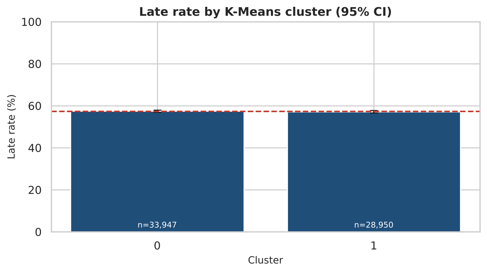

# Advanced pattern analysis

## Scope

Unit: **order** (n = 62,897 valid orders); overall late rate = **57.31%**.

Methods run: distribution/outlier analysis, class imbalance, chi-square + Cramer's V for every categorical field (BH-corrected), Kruskal-Wallis/Mann-Whitney, a **within-mode residual-signal search**, subgroup stability, K-Means clustering and association-rule mining. Hierarchical clustering and DBSCAN were not run (no benefit expected on mostly discrete, signal-free inputs).

## Class imbalance

Late = 36,048 (57.31%), not late = 26,849 (42.69%); ratio 1.34:1. Moderate; no resampling is required. A majority-class baseline accuracy would be 57.31%. By mode the target is highly separated: First Class 100% late, Standard Class 39.9%.

## Distribution and outlier analysis (orders)

Outliers are flagged, **not removed**.

| variable             |   mean |   median |    P1 |     P99 |   skew |   excess kurtosis |   IQR outliers |   % outliers |   robust z>3.5 (MAD) |
|:---------------------|-------:|---------:|------:|--------:|-------:|------------------:|---------------:|-------------:|---------------------:|
| order total quantity |   5.84 |     5.00 |  1.00 |   17.00 |   0.66 |             -0.25 |             85 |         0.14 |                   33 |
| order value          | 503.12 |   456.87 | 11.08 | 1349.54 |   0.62 |             -0.03 |            292 |         0.46 |                   22 |
| gross sales          | 559.87 |   509.87 | 11.54 | 1500.00 |   0.61 |             -0.05 |            144 |         0.23 |                   20 |
| discount amount      |  56.76 |    47.40 |  0.00 |  199.50 |   1.28 |              2.89 |           1284 |         2.04 |                  543 |
| avg discount rate    |   0.10 |     0.10 |  0.00 |    0.25 |   0.32 |             -0.05 |           1060 |         1.69 |                    0 |
| items per order      |   2.75 |     3.00 |  1.00 |    5.00 |   0.20 |             -1.38 |              0 |         0.00 |                    0 |
| delay days           |   0.57 |     1.00 | -2.00 |    4.00 |   0.03 |             -0.30 |          12518 |        19.90 |                    0 |

## Chi-square and Cramer's V: every categorical variable vs late (overall)

Country and state restricted to groups with n>=100. Cramer's V is biased upward for variables with many groups and few observations.

| variable             |   orders |   groups |        chi2 |   dof |         p |   Cramer V | strength   |      p_BH |
|:---------------------|---------:|---------:|------------:|------:|----------:|-----------:|:-----------|----------:|
| Shipping Mode        |    62897 |        4 |   1.453e+04 |     3 | 0         |  0.4807    | strong     | 0         |
| Order hour           |    62897 |       24 | 259.5       |    23 | 6.323e-42 |  0.06423   | weak       | 4.216e-41 |
| Ordered after noon   |    62897 |        2 | 236.7       |     1 | 2.065e-53 |  0.06135   | weak       | 2.065e-52 |
| Order state          |    44554 |      151 | 161.5       |   150 | 0.2457    |  0.06021   | weak       | 0.6142    |
| First category       |    62897 |       50 |  90.29      |    49 | 0.0003002 |  0.03789   | negligible | 0.001501  |
| Order country        |    60087 |       62 |  69.57      |    61 | 0.2113    |  0.03403   | negligible | 0.6037    |
| Order region         |    62897 |       23 |  30.67      |    22 | 0.1031    |  0.02208   | negligible | 0.3438    |
| First department     |    62897 |       11 |  19.78      |    10 | 0.03145   |  0.01773   | negligible | 0.1258    |
| Order month          |    62897 |       12 |   7.446     |    11 | 0.7619    |  0.01088   | negligible | 0.9297    |
| Market               |    62897 |        5 |   3.175     |     4 | 0.5289    |  0.007105  | negligible | 0.9049    |
| Year                 |    62897 |        4 |   3.116     |     3 | 0.3741    |  0.007039  | negligible | 0.8313    |
| Items per order      |    62897 |        5 |   2.949     |     4 | 0.5664    |  0.006847  | negligible | 0.9049    |
| Value quartile       |    62897 |        4 |   2.788     |     3 | 0.4255    |  0.006657  | negligible | 0.8511    |
| Weekday              |    62897 |        7 |   1.687     |     6 | 0.9461    |  0.00518   | negligible | 0.9786    |
| Payment type         |    62897 |        4 |   1.442     |     3 | 0.6958    |  0.004788  | negligible | 0.9297    |
| Customer segment     |    62897 |        3 |   1.062     |     2 | 0.5882    |  0.004108  | negligible | 0.9049    |
| Order-size group     |    62897 |        4 |   0.8571    |     3 | 0.8358    |  0.003691  | negligible | 0.9297    |
| Daily volume tercile |    62897 |        3 |   0.3565    |     2 | 0.8367    |  0.002381  | negligible | 0.9297    |
| Quarter              |    62897 |        4 |   0.194     |     3 | 0.9786    |  0.001756  | negligible | 0.9786    |
| Customer country     |    62897 |        2 |   0.05588   |     1 | 0.8131    |  0.0009425 | negligible | 0.9297    |

## Residual-signal search: does anything predict lateness *within* Second Class and Standard Class?

Because shipping mode explains most variation (Pattern 2) and Same Day / First Class are deterministic, the remaining question is whether any other variable carries signal **inside** the two probabilistic modes (n = 49,888 orders). Categorical variables: chi-square computed within each mode and pooled (sum of chi2 and dof); numeric: Mann-Whitney AUC per mode, Fisher-combined p-values. BH correction across all variables.

| variable                                         |   orders (2 modes) |   pooled chi2 |   pooled dof |      p |   pooled Cramer V (approx.) |   pooled Cramer V |   mean within-mode AUC |   p_BH |
|:-------------------------------------------------|-------------------:|--------------:|-------------:|-------:|----------------------------:|------------------:|-----------------------:|-------:|
| customer prior late rate (numeric, Mann-Whitney) |              49888 |         6.65  |            4 | 0.1556 |                  nan        |               nan |                 0.5014 | 0.9553 |
| Customer segment                                 |              49888 |         6.543 |            4 | 0.1621 |                    0.01145  |               nan |               nan      | 0.9553 |
| category prior late rate (numeric, Mann-Whitney) |              49888 |         5.836 |            4 | 0.2117 |                  nan        |               nan |                 0.5036 | 0.9553 |
| First department                                 |              49888 |        23.22  |           20 | 0.278  |                    0.02158  |               nan |               nan      | 0.9553 |
| Customer country                                 |              49888 |         2.515 |            2 | 0.2844 |                    0.0071   |               nan |               nan      | 0.9553 |
| customer latitude (numeric, Mann-Whitney)        |              49888 |         5.02  |            4 | 0.2853 |                  nan        |               nan |                 0.4948 | 0.9553 |
| Order state                                      |              49888 |       229.4   |          220 | 0.3185 |                    0.06781  |               nan |               nan      | 0.9553 |
| region prior late rate (numeric, Mann-Whitney)   |              49888 |         3.955 |            4 | 0.4121 |                  nan        |               nan |                 0.4994 | 0.9553 |
| customer longitude (numeric, Mann-Whitney)       |              49888 |         3.032 |            4 | 0.5524 |                  nan        |               nan |                 0.5023 | 0.9553 |
| items per order (numeric, Mann-Whitney)          |              49888 |         2.834 |            4 | 0.5859 |                  nan        |               nan |                 0.4967 | 0.9553 |
| order value (numeric, Mann-Whitney)              |              49888 |         2.825 |            4 | 0.5875 |                  nan        |               nan |                 0.4972 | 0.9553 |
| Order region                                     |              49888 |        40.51  |           44 | 0.6221 |                    0.0285   |               nan |               nan      | 0.9553 |
| avg discount rate (numeric, Mann-Whitney)        |              49888 |         2.525 |            4 | 0.6402 |                  nan        |               nan |                 0.5032 | 0.9553 |
| Value quartile                                   |              49888 |         4.06  |            6 | 0.6686 |                    0.009021 |               nan |               nan      | 0.9553 |
| total quantity (numeric, Mann-Whitney)           |              49888 |         2.17  |            4 | 0.7045 |                  nan        |               nan |                 0.4977 | 0.9553 |
| Year                                             |              49888 |         3.528 |            6 | 0.7402 |                    0.00841  |               nan |               nan      | 0.9553 |
| Payment type                                     |              49888 |         3.312 |            6 | 0.7687 |                    0.008148 |               nan |               nan      | 0.9553 |
| Quarter                                          |              49888 |         3.287 |            6 | 0.7721 |                    0.008117 |               nan |               nan      | 0.9553 |
| avg unit price (numeric, Mann-Whitney)           |              49888 |         1.769 |            4 | 0.7781 |                  nan        |               nan |                 0.5022 | 0.9553 |
| Daily volume tercile                             |              49888 |         1.672 |            4 | 0.7957 |                    0.00579  |               nan |               nan      | 0.9553 |
| Order country                                    |              49888 |        95.71  |          110 | 0.8323 |                    0.0438   |               nan |               nan      | 0.9553 |
| Order month                                      |              49888 |        14.75  |           22 | 0.8728 |                    0.01719  |               nan |               nan      | 0.9553 |
| Items per order                                  |              49888 |         3.677 |            8 | 0.885  |                    0.008585 |               nan |               nan      | 0.9553 |
| First category                                   |              49888 |        80.85  |           98 | 0.8955 |                    0.04026  |               nan |               nan      | 0.9553 |
| Weekday                                          |              49888 |         6.283 |           12 | 0.9012 |                    0.01122  |               nan |               nan      | 0.9553 |

*(showing 25 of 28 rows; full table in `residual_signal_search.csv`)*

**Variables significant after BH correction: 0 of 28.**

## Kruskal-Wallis: delay days across groups

eta^2_H is the effect size (0.01 small, 0.06 medium, 0.14 large).

| grouping         |   groups |   Kruskal H |      p |    eta^2_H |
|:-----------------|---------:|------------:|-------:|-----------:|
| Shipping Mode    |        4 |   1.465e+04 | 0      |  0.2329    |
| Market           |        5 |   3.57      | 0.4673 | -6.84e-06  |
| Customer segment |        3 |   1.478     | 0.4775 | -8.294e-06 |
| Order-size group |        4 |   1.317     | 0.725  | -2.675e-05 |
| Value quartile   |        4 |   3.243     | 0.3557 |  3.86e-06  |
| Weekday          |        7 |   1.958     | 0.9235 | -6.427e-05 |
| Month            |       12 |   5.205     | 0.9209 | -9.216e-05 |

## Subgroup stability: late rate (%) by mode and year

A stable subgroup keeps the same late rate across years. (Cells: n = 112 to 12,576.)

| mode           |   2015 |   2016 |   2017 |   2018 |
|:---------------|-------:|-------:|-------:|-------:|
| First Class    | 100.00 | 100.00 | 100.00 | 100.00 |
| Same Day       |  47.00 |  45.20 |  53.00 |  44.60 |
| Second Class   |  80.10 |  80.10 |  79.70 |  80.70 |
| Standard Class |  39.70 |  40.40 |  39.40 |  40.80 |

Same Day noon-cutoff rule agreement by year: 2015: 100.0%, 2016: 100.0%, 2017: 100.0%, 2018: 100.0%.

## Clustering (K-Means)

Inputs (standardised; **no target-derived columns**): total quantity, items, order value, average discount rate, average unit price (n = 62,897). k chosen by silhouette on a 10,000-order sample: k=2: 0.364, k=3: 0.339, k=4: 0.334, k=5: 0.286, k=6: 0.282, k=7: 0.265 -> **k = 2**. Cluster-late-rate association: chi2 p = 0.621, Cramer's V = 0.002.

|   cl |        n |   qty |   items |   value |   disc_rate |   avg_price |   late_rate_% |   ci95_low_% |   ci95_high_% |
|-----:|---------:|------:|--------:|--------:|------------:|------------:|--------------:|-------------:|--------------:|
| 0.00 | 33947.00 |  2.82 |    1.57 |  286.05 |        0.10 |      164.92 |         57.40 |        56.88 |         57.93 |
| 1.00 | 28950.00 |  9.39 |    4.12 |  757.66 |        0.10 |       99.18 |         57.21 |        56.63 |         57.77 |

Interpretation: clusters describe order *size/value profiles* (largest differences in quantity/value columns). Their late rates do not differ meaningfully, so the clusters are descriptive only and have no predictive use. Silhouette values are low-to-moderate, so cluster boundaries are not sharp.

*Cluster late rate*

## Association rules (support, confidence, lift)

Transactions = orders (n = 62,897); items = mode, market, order-size group, value quartile, segment, order time (before/after noon), payment type; antecedents of 1-2 items with support >= 1%; consequent LATE (base rate 57.3%) or NOT LATE. Rules show co-occurrence, **not causation**. Implemented directly (no mlxtend).

**Top LATE rules (any antecedent):**

| antecedent                             | consequent   |   support |   antecedent support |   confidence |   lift |   orders in antecedent |
|:---------------------------------------|:-------------|----------:|---------------------:|-------------:|-------:|-----------------------:|
| Mode=First Class                       | LATE         |     0.153 |                0.153 |        1.000 |  1.745 |                   9602 |
| Mode=First Class & Market=LATAM        | LATE         |     0.040 |                0.040 |        1.000 |  1.745 |                   2498 |
| Mode=First Class & Market=Pacific Asia | LATE         |     0.040 |                0.040 |        1.000 |  1.745 |                   2543 |
| Mode=First Class & Market=Europe       | LATE         |     0.044 |                0.044 |        1.000 |  1.745 |                   2753 |
| Mode=Same Day & Time=12:00-23:59       | LATE         |     0.026 |                0.026 |        1.000 |  1.745 |                   1648 |
| Mode=First Class & Pay=TRANSFER        | LATE         |     0.037 |                0.037 |        1.000 |  1.745 |                   2325 |
| Mode=First Class & Pay=DEBIT           | LATE         |     0.062 |                0.062 |        1.000 |  1.745 |                   3921 |
| Mode=First Class & Segment=Home Office | LATE         |     0.028 |                0.028 |        1.000 |  1.745 |                   1785 |
| Mode=First Class & Segment=Consumer    | LATE         |     0.079 |                0.079 |        1.000 |  1.745 |                   4938 |
| Mode=First Class & Segment=Corporate   | LATE         |     0.046 |                0.046 |        1.000 |  1.745 |                   2879 |

**Top LATE rules without shipping mode in the antecedent** (shows whether anything else matters):

| antecedent                             | consequent   |   support |   antecedent support |   confidence |   lift |   orders in antecedent |
|:---------------------------------------|:-------------|----------:|---------------------:|-------------:|-------:|-----------------------:|
| Market=USCA & Time=12:00-23:59         | LATE         |     0.040 |                0.064 |        0.614 |  1.071 |                   4054 |
| Market=Pacific Asia & Time=12:00-23:59 | LATE         |     0.081 |                0.133 |        0.612 |  1.067 |                   8372 |
| Qty=11+ & Time=12:00-23:59             | LATE         |     0.045 |                0.074 |        0.610 |  1.064 |                   4665 |
| Value=Q3 & Time=12:00-23:59            | LATE         |     0.076 |                0.124 |        0.609 |  1.063 |                   7827 |
| Time=12:00-23:59 & Pay=DEBIT           | LATE         |     0.123 |                0.202 |        0.609 |  1.062 |                  12708 |
| Segment=Home Office & Time=12:00-23:59 | LATE         |     0.054 |                0.088 |        0.607 |  1.058 |                   5556 |
| Value=Q1 low & Time=12:00-23:59        | LATE         |     0.076 |                0.126 |        0.605 |  1.055 |                   7953 |
| Qty=1-2 & Time=12:00-23:59             | LATE         |     0.087 |                0.143 |        0.605 |  1.055 |                   9025 |
| Segment=Consumer & Time=12:00-23:59    | LATE         |     0.158 |                0.262 |        0.604 |  1.054 |                  16461 |
| Value=Q2 & Time=12:00-23:59            | LATE         |     0.075 |                0.125 |        0.604 |  1.054 |                   7853 |

Best lift without mode = 1.071 (a lift near 1.0 means no association). Rules including mode simply restate Pattern 2 (e.g. First Class => LATE with confidence 1.0).

## Interpretation

- Only shipping mode (and the Same Day noon cutoff) shows strong structure. After mode is controlled, 0 of 28 tested variables are significant.
- Clusters and association rules without mode have no predictive structure.
- Statistical significance with ~63k orders can flag tiny effects; effect sizes (V, AUC) are reported next to p-values.

## Candidate ML features

Per the residual search, only features that remain significant *and* meaningful within mode should be added beyond mode and order time.

## Limitations

Rule mining restricted to 7 categorical items; DBSCAN/hierarchical not run.
