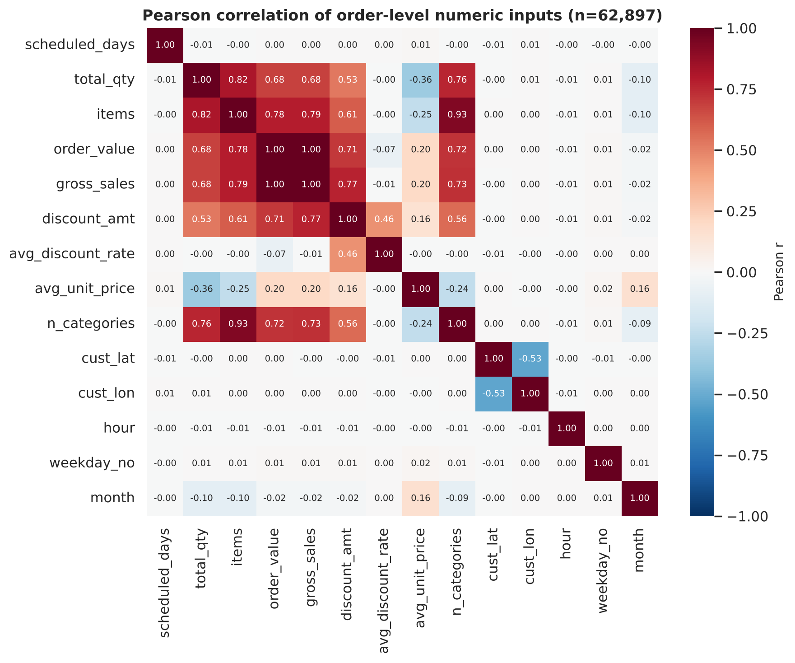
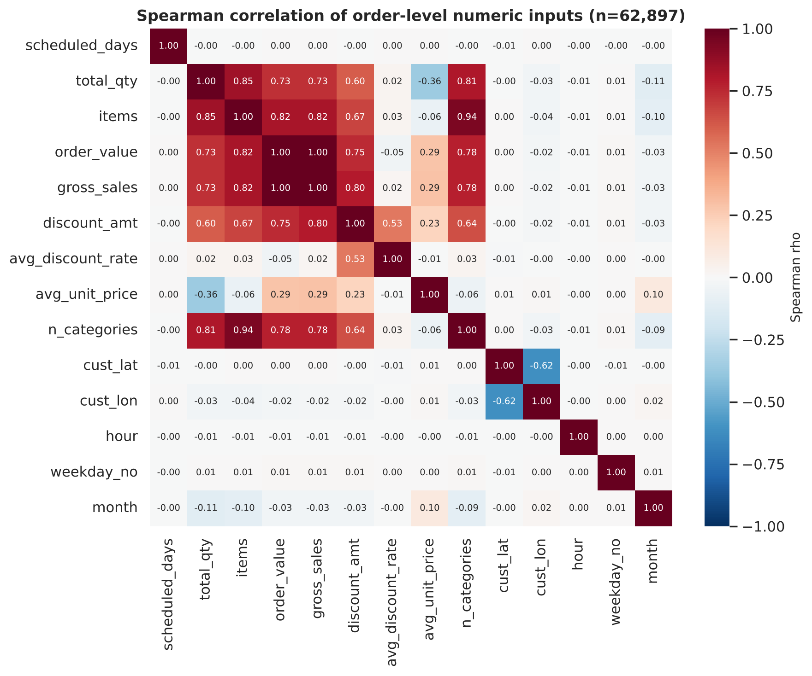
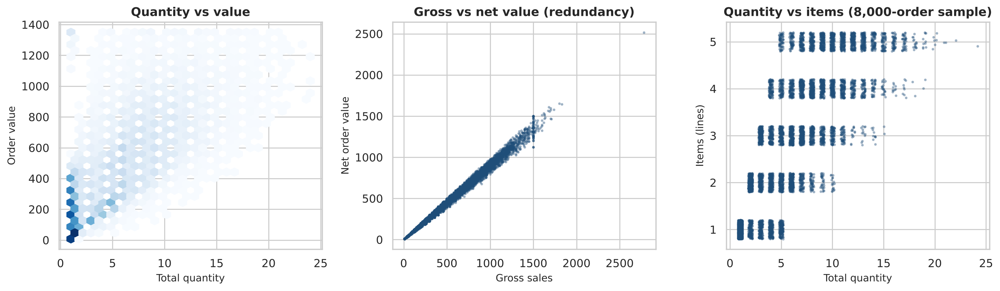
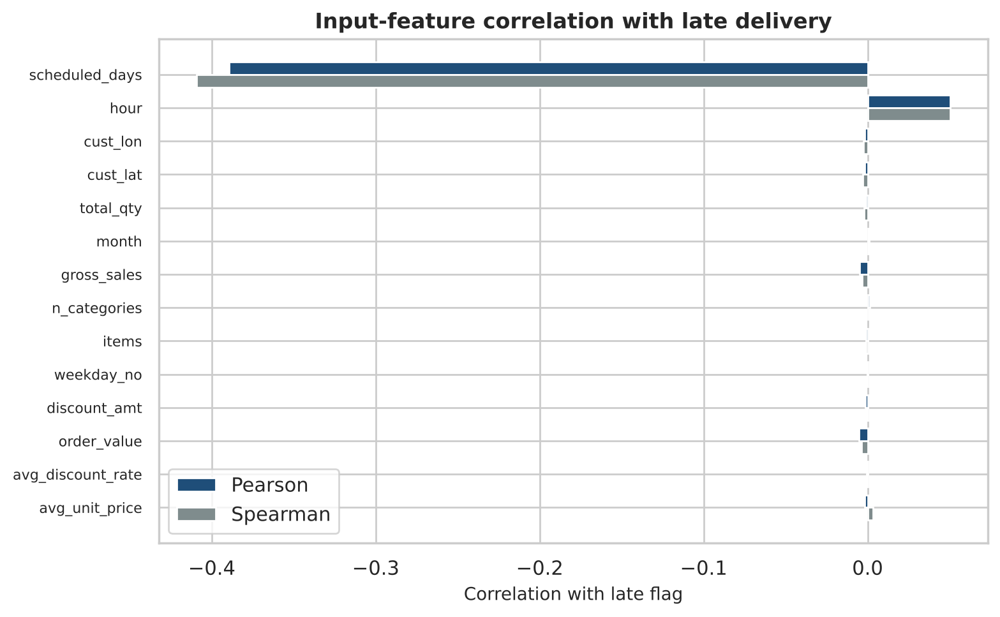

# Pattern 14: Feature-correlation patterns

## Definitions and data used

Unit: **order** (n = 62,897 valid orders); overall late rate = **57.31%**.

Inputs only (order-level): numeric order-creation fields. **Target-derived fields are excluded** (`Days for shipping (real)`, delay, `Delivery Status`, `Late_delivery_risk`). Profit fields excluded (post-sale). Customer latitude/longitude are customer residence. Correlation is not predictive importance or causation.

## Correlation with the late flag (Pearson, Spearman, mutual information)

Mutual information captures non-linear dependence (estimated with sklearn; random_state=0).

| feature           |   Pearson vs late |   Spearman vs late |   p (Pearson) |   Mutual information (nats) |   p_BH |
|:------------------|------------------:|-------------------:|--------------:|----------------------------:|-------:|
| scheduled_days    |           -0.3892 |            -0.4092 |        0.0000 |                      0.1451 | 0.0000 |
| hour              |            0.0504 |             0.0503 |        0.0000 |                      0.0021 | 0.0000 |
| cust_lon          |           -0.0017 |            -0.0027 |        0.6675 |                      0.0020 | 0.9606 |
| cust_lat          |           -0.0016 |            -0.0030 |        0.6804 |                      0.0007 | 0.9606 |
| total_qty         |           -0.0008 |            -0.0021 |        0.8354 |                      0.0002 | 0.9606 |
| month             |            0.0011 |             0.0011 |        0.7848 |                      0.0001 | 0.9606 |
| gross_sales       |           -0.0051 |            -0.0033 |        0.2050 |                      0.0001 | 0.7173 |
| n_categories      |            0.0012 |             0.0002 |        0.7648 |                      0.0000 | 0.9606 |
| items             |           -0.0009 |            -0.0011 |        0.8301 |                      0.0000 | 0.9606 |
| weekday_no        |           -0.0002 |            -0.0002 |        0.9606 |                      0.0000 | 0.9606 |
| discount_amt      |           -0.0014 |            -0.0007 |        0.7178 |                      0.0000 | 0.9606 |
| order_value       |           -0.0054 |            -0.0036 |        0.1765 |                      0.0000 | 0.7173 |
| avg_discount_rate |           -0.0003 |            -0.0008 |        0.9401 |                      0.0000 | 0.9606 |
| avg_unit_price    |           -0.0019 |             0.0032 |        0.6373 |                      0.0000 | 0.9606 |

## Redundant pairs (|r| >= 0.7)

| feature A   | feature B    |   Pearson |   Spearman |
|:------------|:-------------|----------:|-----------:|
| order_value | gross_sales  |     0.996 |      0.997 |
| items       | n_categories |     0.926 |      0.939 |
| total_qty   | items        |     0.816 |      0.849 |
| items       | gross_sales  |     0.788 |      0.824 |
| items       | order_value  |     0.784 |      0.823 |
| gross_sales | discount_amt |     0.772 |      0.795 |
| total_qty   | n_categories |     0.759 |      0.809 |
| gross_sales | n_categories |     0.728 |      0.780 |
| order_value | n_categories |     0.724 |      0.779 |
| order_value | discount_amt |     0.710 |      0.748 |
| total_qty   | gross_sales  |     0.683 |      0.727 |
| total_qty   | order_value  |     0.680 |      0.728 |

## Multicollinearity (VIF; values >10 indicate serious collinearity)

| feature           |            VIF |
|:------------------|---------------:|
| gross_sales       | 20039770617.72 |
| order_value       | 16331111625.72 |
| discount_amt      |   343811888.86 |
| items             |          10.96 |
| n_categories      |           7.05 |
| total_qty         |           4.00 |
| avg_unit_price    |           2.55 |
| avg_discount_rate |           2.12 |
| cust_lat          |           1.39 |
| cust_lon          |           1.39 |
| month             |           1.03 |
| weekday_no        |           1.00 |
| scheduled_days    |           1.00 |
| hour              |           1.00 |

## Categorical redundancy checks (exact)

- `Order Customer Id` = `Customer Id` (100% of rows). `Category Id` = `Product Category Id`; `Order Item Cardprod Id` = `Product Card Id`; `Product Price` = `Order Item Product Price` (100%).
- `Sales per customer` = `Order Item Total` (100%); `Benefit per order` = `Order Profit Per Order` (100%).
- `Days for shipment (scheduled)` is a function of `Shipping Mode` (1 value per mode): keep one of the two.
- `Department Id/Name` and `Category Id/Name` are 1:1 with their names.

*Pearson heatmap*

*Spearman heatmap*

*Selected scatter plots*

*Correlation with target*

## Interpretation

- Strongest numeric signal by mutual information: `scheduled_days` (MI 0.1451; Pearson -0.389). `scheduled_days` is a proxy for shipping mode; `hour` carries signal only through Same Day orders (Patterns 2 and 9).
- Quantity, value, discount and location variables correlate with late at |r| < 0.02.
- Redundant: value/gross/discount; quantity/items; plus the exact duplicates listed. Drop duplicates before modelling.

## Candidate ML features

Keep `scheduled_days` OR `Shipping Mode`; keep one of `order_value` / `gross_sales`; drop exact duplicate columns. No numeric feature other than scheduled days/hour shows signal.

## Limitations

Linear and rank correlations on mostly weak variables; mutual information estimates have noise around 0.
