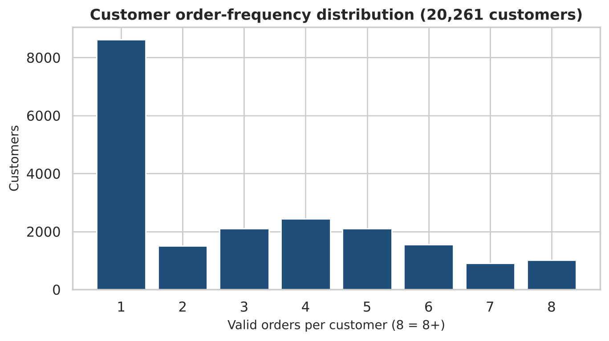
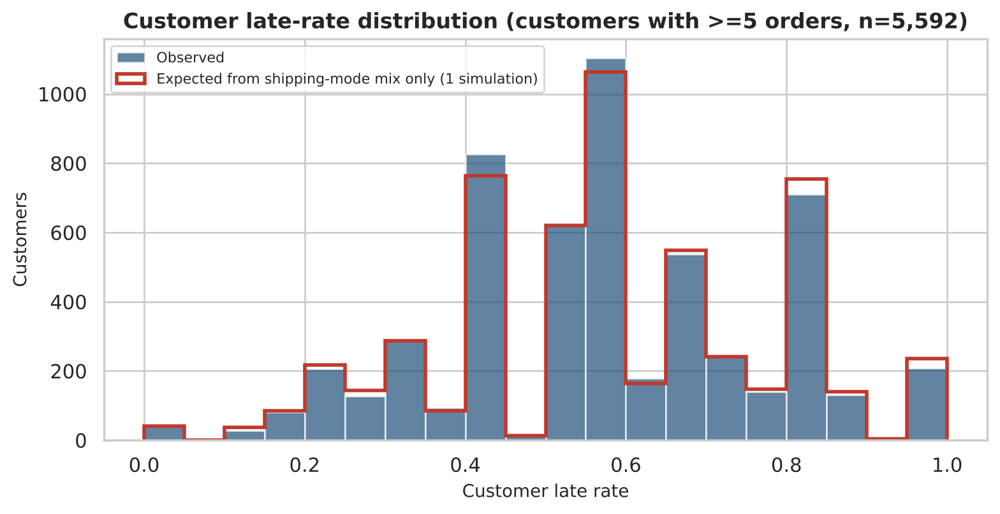
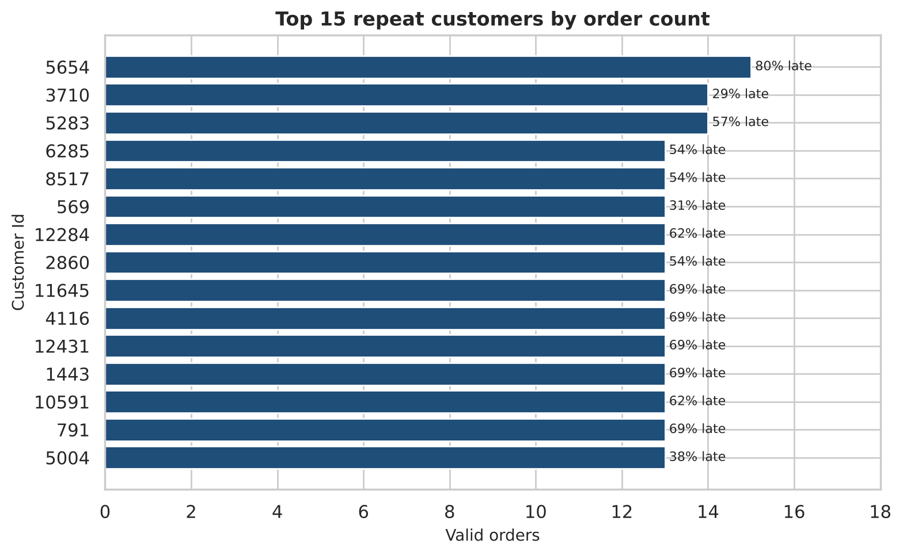
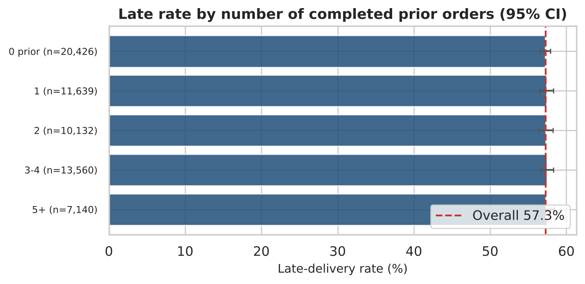

# Pattern 8: Customer historical patterns

## Definitions and data used

Unit: **order** (n = 62,897 valid orders; 'Shipping canceled' excluded); overall late rate = **57.31%**.

Customers with >=1 valid order: **20,261**. Descriptive customer statistics use all of a customer's orders (full period); **history features** (below) use only the customer's earlier orders whose `shipping date` (used as completion time) is strictly before the current order's creation time, so no future outcomes are used.

## Order frequency

Mean orders/customer 3.10, median 3, max 15. Repeat customers (>=2 orders): 11,644 (57.5%).

|   orders per customer (8 = 8+) |   customers |     % |
|-------------------------------:|------------:|------:|
|                           1.00 |     8617.00 | 42.50 |
|                           2.00 |     1506.00 |  7.40 |
|                           3.00 |     2102.00 | 10.40 |
|                           4.00 |     2444.00 | 12.10 |
|                           5.00 |     2108.00 | 10.40 |
|                           6.00 |     1554.00 |  7.70 |
|                           7.00 |      909.00 |  4.50 |
|                           8.00 |     1021.00 |  5.00 |

## Order value and size per customer

Mean of customers' average order value = 431.01 (median 436.45); mean of customers' average quantity = 4.37. 11,567 customers (57.1%) ordered to more than one destination country.

## Do customers differ in lateness? (overdispersion test)

Customers with >=5 valid orders: **5,592** (orders: 35,186). If lateness were driven only by shipping mode (no customer effect), the dispersion statistic sum((k-E)^2/Var) would be about 5,592. Observed = **5,548** (ratio 0.992), p = 0.659. The observed spread is consistent with chance: there is no evidence of persistent customer-level lateness beyond the shipping-mode mix. Customers with >=2 late orders: 8,995.

## Customer history feature (past-only)

Univariate discrimination of the customer's prior late rate (AUC 0.5 = no information). This is a descriptive check, not model performance.

| History feature             |   min prior orders |   orders covered |   coverage % |   univariate AUC |   mean within-mode AUC |   Spearman vs late |
|:----------------------------|-------------------:|-----------------:|-------------:|-----------------:|-----------------------:|-------------------:|
| prior late rate by customer |                  1 |            42471 |       67.500 |            0.498 |                  0.507 |             -0.004 |
| prior late rate by customer |                  3 |            20700 |       32.900 |            0.496 |                  0.501 |             -0.007 |
| prior late rate by customer |                  5 |             7140 |       11.400 |            0.494 |                  0.498 |             -0.010 |

## Current late rate by customer's prior late-rate bucket (customers with >=3 completed prior orders)

| bk        |    n |   late_rate_% |   ci95_low_% |   ci95_high_% |
|:----------|-----:|--------------:|-------------:|--------------:|
| 0% late   |  869 |         58.34 |        55.04 |         61.58 |
| 1-34%     | 4416 |         57.77 |        56.30 |         59.22 |
| 35-67%    | 9666 |         57.36 |        56.37 |         58.34 |
| 68-99%    | 3369 |         56.28 |        54.60 |         57.94 |
| 100% late | 2380 |         57.98 |        55.99 |         59.95 |

## Current late rate by number of completed prior orders

| pb      |     n |   late_rate_% |   ci95_low_% |   ci95_high_% |
|:--------|------:|--------------:|-------------:|--------------:|
| 0 prior | 20426 |         57.22 |        56.54 |         57.89 |
| 1       | 11639 |         57.40 |        56.50 |         58.30 |
| 2       | 10132 |         57.26 |        56.30 |         58.22 |
| 3-4     | 13560 |         57.44 |        56.61 |         58.27 |
| 5+      |  7140 |         57.27 |        56.12 |         58.41 |

## Top repeat customers (Customer Id only; names are not shown)

|     cust |   orders |   late |   late_rate_% |   total_value |
|---------:|---------:|-------:|--------------:|--------------:|
|  5654.00 |    15.00 |  12.00 |         80.00 |       7919.00 |
|  3710.00 |    14.00 |   4.00 |         28.60 |       8112.00 |
|  5283.00 |    14.00 |   8.00 |         57.10 |       6788.00 |
|  6285.00 |    13.00 |   7.00 |         53.80 |       6383.00 |
|  8517.00 |    13.00 |   7.00 |         53.80 |       6975.00 |
|   569.00 |    13.00 |   4.00 |         30.80 |       4612.00 |
| 12284.00 |    13.00 |   8.00 |         61.50 |       6561.00 |
|  2860.00 |    13.00 |   7.00 |         53.80 |       5686.00 |
| 11645.00 |    13.00 |   9.00 |         69.20 |       6355.00 |
|  4116.00 |    13.00 |   9.00 |         69.20 |       6423.00 |
| 12431.00 |    13.00 |   9.00 |         69.20 |       6614.00 |
|  1443.00 |    13.00 |   9.00 |         69.20 |       7411.00 |
| 10591.00 |    13.00 |   8.00 |         61.50 |       7146.00 |
|   791.00 |    13.00 |   9.00 |         69.20 |       9437.00 |
|  5004.00 |    13.00 |   5.00 |         38.50 |       7499.00 |

*Frequency*

*Late-rate distribution vs expectation*

*Top customers*

*Performance vs prior orders*

## Interpretation

- 20,261 customers place 62,897 valid orders (mean 3.10 per customer).
- Customer prior late rate has univariate AUC 0.496 (>=3 prior completed orders); this is essentially chance level. Dispersion ratio 0.992.
- Repeat-customer lateness cannot be distinguished from the shipping-mode mix alone.

## Candidate ML features

`customer_prior_order_count` (conditional), `customer_prior_late_rate` (conditional: only past-completed orders; null when no history), `customer_avg_order_value` (past-only). Evidence is weak; test on held-out time-split data before approval.

## Limitations

Completion time is approximated by `shipping date`; ~3.2 orders per customer limits history depth; early-period orders have no history.
