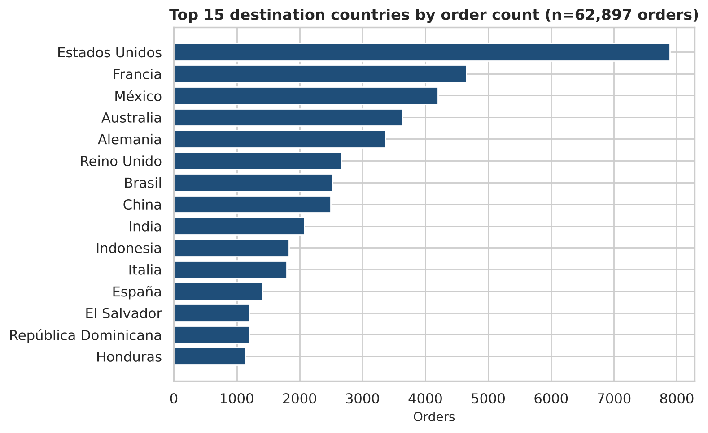
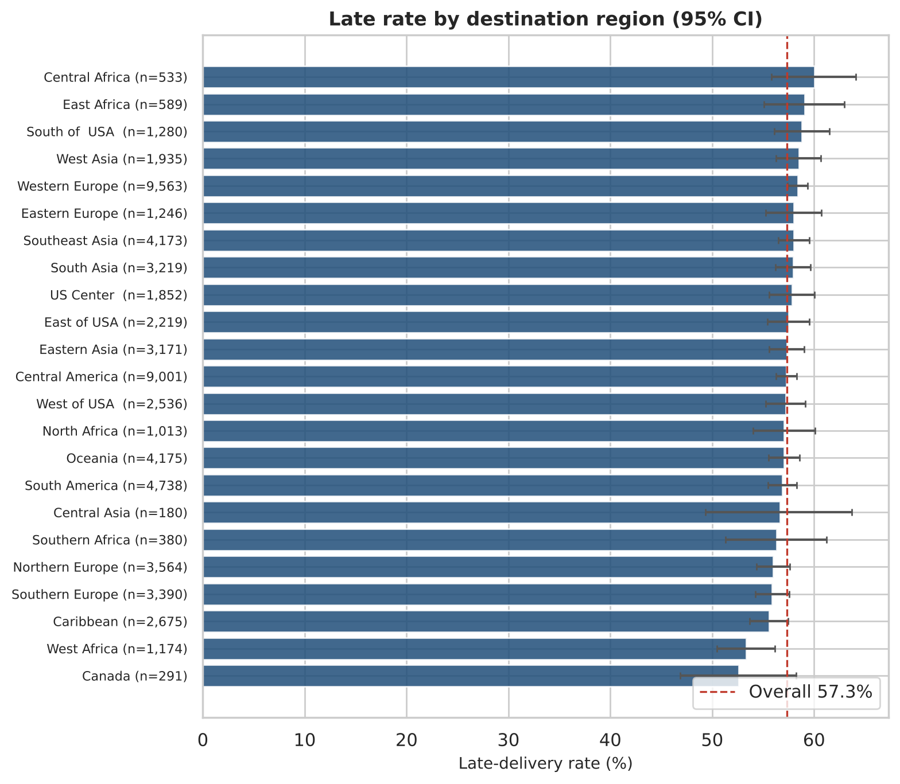
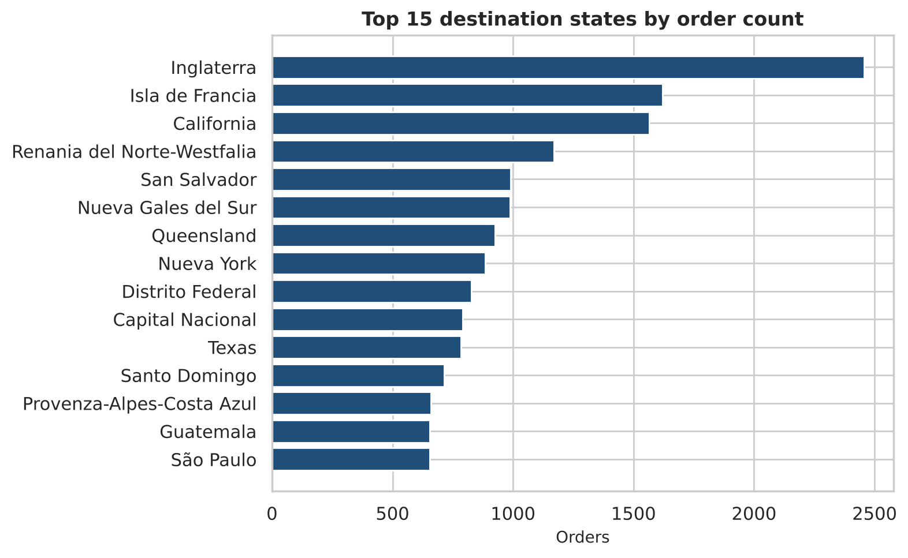
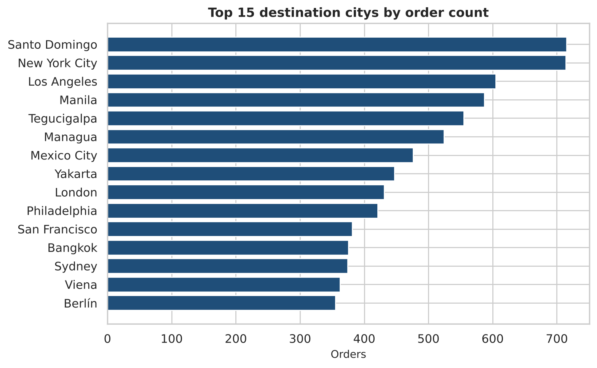
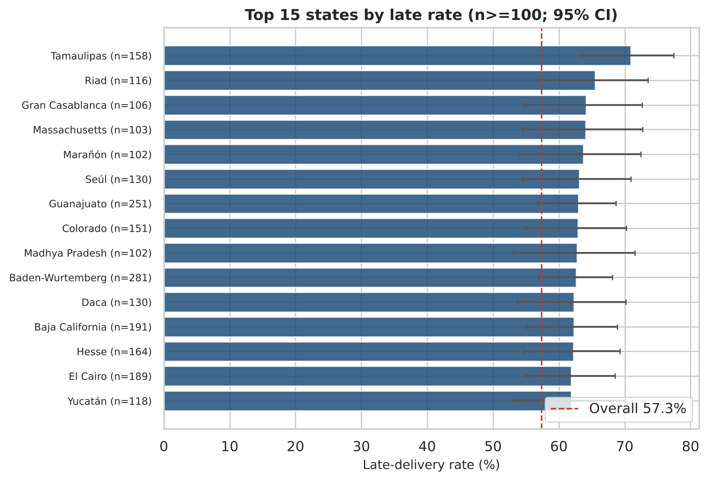
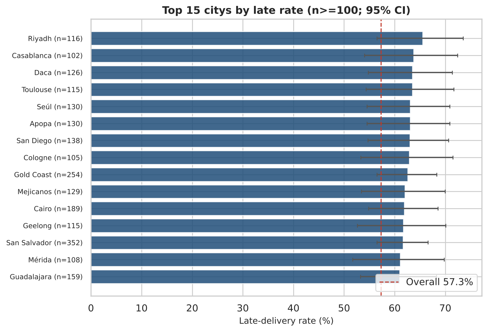
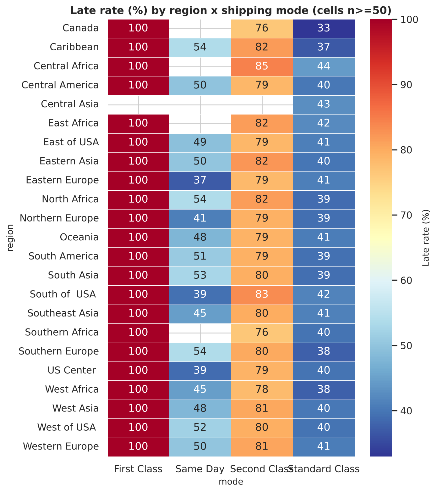

# Pattern 3: Geographical patterns

## Definitions and data used

Unit: **order** (n = 62,897 orders excluding 2,855 'Shipping canceled'); overall late rate = **57.31%**.

Minimum group size for ranking = 100 orders. `Order Country/State/City/Region/Market` describe the **delivery destination**. Because mode strongly affects lateness, each location's observed late count is also compared with the count **expected from its shipping-mode mix** (O/E); p-values are Benjamini-Hochberg adjusted within each level.

**Data-quality caveat:** a country can map to several 'Order Region' values (12.6% of orders), so region is not a clean aggregation of country. Country names are in Spanish.

## Market-level summary (top 15 by volume)

| market       |     n |   late |   late_rate_% |   ci95_low_% |   ci95_high_% |   mean_delay |   expected_given_mode_% |   O/E |   p_BH |
|:-------------|------:|-------:|--------------:|-------------:|--------------:|-------------:|------------------------:|------:|-------:|
| Europe       | 17763 |  10199 |         57.42 |        56.69 |         58.14 |         0.56 |                   57.44 |  1.00 |   0.99 |
| Pacific Asia | 16853 |   9720 |         57.68 |        56.93 |         58.42 |         0.58 |                   57.34 |  1.01 |   0.99 |
| LATAM        | 16414 |   9339 |         56.90 |        56.14 |         57.65 |         0.55 |                   57.18 |  0.99 |   0.99 |
| USCA         |  8178 |   4704 |         57.52 |        56.45 |         58.59 |         0.58 |                   57.59 |  1.00 |   0.99 |
| Africa       |  3689 |   2086 |         56.55 |        54.94 |         58.14 |         0.55 |                   56.56 |  1.00 |   0.99 |

## Region-level summary (top 15 by volume)

| region          |    n |   late |   late_rate_% |   ci95_low_% |   ci95_high_% |   mean_delay |   expected_given_mode_% |   O/E |   p_BH |
|:----------------|-----:|-------:|--------------:|-------------:|--------------:|-------------:|------------------------:|------:|-------:|
| Western Europe  | 9563 |   5585 |         58.40 |        57.41 |         59.39 |         0.59 |                   57.70 |  1.01 |   0.88 |
| Central America | 9001 |   5156 |         57.28 |        56.26 |         58.30 |         0.56 |                   57.32 |  1.00 |   0.98 |
| South America   | 4738 |   2696 |         56.90 |        55.49 |         58.31 |         0.55 |                   57.11 |  1.00 |   0.98 |
| Oceania         | 4175 |   2382 |         57.05 |        55.55 |         58.55 |         0.57 |                   56.71 |  1.01 |   0.98 |
| Southeast Asia  | 4173 |   2421 |         58.02 |        56.51 |         59.51 |         0.57 |                   57.44 |  1.01 |   0.98 |
| Northern Europe | 3564 |   1996 |         56.00 |        54.37 |         57.63 |         0.53 |                   56.97 |  0.98 |   0.88 |
| Southern Europe | 3390 |   1895 |         55.90 |        54.22 |         57.56 |         0.51 |                   56.93 |  0.98 |   0.88 |
| South Asia      | 3219 |   1865 |         57.94 |        56.22 |         59.63 |         0.59 |                   58.14 |  1.00 |   0.98 |
| Eastern Asia    | 3171 |   1818 |         57.33 |        55.60 |         59.04 |         0.57 |                   56.76 |  1.01 |   0.98 |
| Caribbean       | 2675 |   1487 |         55.59 |        53.70 |         57.46 |         0.53 |                   56.83 |  0.98 |   0.88 |
| West of USA     | 2536 |   1451 |         57.22 |        55.28 |         59.13 |         0.56 |                   57.20 |  1.00 |   0.98 |
| East of USA     | 2219 |   1276 |         57.50 |        55.44 |         59.55 |         0.58 |                   57.10 |  1.01 |   0.98 |
| West Asia       | 1935 |   1132 |         58.50 |        56.29 |         60.68 |         0.59 |                   58.18 |  1.00 |   0.98 |
| US Center       | 1852 |   1071 |         57.83 |        55.57 |         60.06 |         0.58 |                   58.59 |  0.99 |   0.98 |
| South of  USA   | 1280 |    753 |         58.83 |        56.11 |         61.49 |         0.62 |                   57.66 |  1.02 |   0.98 |

*(showing 15 of 23 rows; full table in `region_rates.csv`)*

## Country-level summary (top 15 by volume)

| country              |    n |   late |   late_rate_% |   ci95_low_% |   ci95_high_% |   mean_delay |   expected_given_mode_% |   O/E |   p_BH |
|:---------------------|-----:|-------:|--------------:|-------------:|--------------:|-------------:|------------------------:|------:|-------:|
| Estados Unidos       | 7887 |   4551 |         57.70 |        56.61 |         58.79 |         0.58 |                   57.57 |  1.00 |   0.98 |
| Francia              | 4648 |   2715 |         58.41 |        56.99 |         59.82 |         0.61 |                   57.78 |  1.01 |   0.98 |
| México               | 4201 |   2428 |         57.80 |        56.30 |         59.28 |         0.59 |                   57.59 |  1.00 |   0.98 |
| Australia            | 3633 |   2077 |         57.17 |        55.55 |         58.77 |         0.57 |                   56.66 |  1.01 |   0.98 |
| Alemania             | 3368 |   1966 |         58.37 |        56.70 |         60.03 |         0.57 |                   57.46 |  1.02 |   0.98 |
| Reino Unido          | 2661 |   1479 |         55.58 |        53.69 |         57.46 |         0.51 |                   57.18 |  0.97 |   0.98 |
| Brasil               | 2520 |   1423 |         56.47 |        54.52 |         58.39 |         0.55 |                   56.98 |  0.99 |   0.98 |
| China                | 2495 |   1436 |         57.56 |        55.61 |         59.48 |         0.56 |                   56.64 |  1.02 |   0.98 |
| India                | 2070 |   1207 |         58.31 |        56.17 |         60.42 |         0.62 |                   58.24 |  1.00 |   0.99 |
| Indonesia            | 1833 |   1065 |         58.10 |        55.83 |         60.34 |         0.59 |                   57.93 |  1.00 |   0.98 |
| Italia               | 1793 |    997 |         55.61 |        53.30 |         57.89 |         0.50 |                   56.24 |  0.99 |   0.98 |
| España               | 1408 |    798 |         56.68 |        54.07 |         59.24 |         0.54 |                   57.69 |  0.98 |   0.98 |
| El Salvador          | 1195 |    692 |         57.91 |        55.09 |         60.68 |         0.62 |                   56.38 |  1.03 |   0.98 |
| República Dominicana | 1194 |    679 |         56.87 |        54.04 |         59.65 |         0.57 |                   57.02 |  1.00 |   0.99 |
| Honduras             | 1130 |    628 |         55.58 |        52.66 |         58.45 |         0.49 |                   56.02 |  0.99 |   0.98 |

*(showing 15 of 164 rows; full table in `country_rates.csv`)*

## State-level summary (top 15 by volume)

| state                       |    n |   late |   late_rate_% |   ci95_low_% |   ci95_high_% |   mean_delay |   expected_given_mode_% |   O/E |   p_BH |
|:----------------------------|-----:|-------:|--------------:|-------------:|--------------:|-------------:|------------------------:|------:|-------:|
| Inglaterra                  | 2456 |   1370 |         55.78 |        53.81 |         57.74 |         0.52 |                   56.98 |  0.98 |   1.00 |
| Isla de Francia             | 1621 |    952 |         58.73 |        56.31 |         61.10 |         0.58 |                   57.75 |  1.02 |   1.00 |
| California                  | 1565 |    886 |         56.61 |        54.14 |         59.05 |         0.53 |                   57.13 |  0.99 |   1.00 |
| Renania del Norte-Westfalia | 1170 |    682 |         58.29 |        55.44 |         61.08 |         0.60 |                   56.19 |  1.04 |   1.00 |
| San Salvador                |  991 |    579 |         58.43 |        55.33 |         61.46 |         0.62 |                   56.71 |  1.03 |   1.00 |
| Nueva Gales del Sur         |  988 |    548 |         55.47 |        52.35 |         58.54 |         0.56 |                   56.21 |  0.99 |   1.00 |
| Queensland                  |  926 |    542 |         58.53 |        55.33 |         61.66 |         0.63 |                   56.92 |  1.03 |   1.00 |
| Nueva York                  |  885 |    520 |         58.76 |        55.48 |         61.96 |         0.58 |                   56.61 |  1.04 |   1.00 |
| Distrito Federal            |  828 |    486 |         58.70 |        55.31 |         62.00 |         0.64 |                   58.69 |  1.00 |   1.00 |
| Capital Nacional            |  790 |    461 |         58.35 |        54.88 |         61.74 |         0.56 |                   57.06 |  1.02 |   1.00 |
| Texas                       |  784 |    460 |         58.67 |        55.19 |         62.07 |         0.61 |                   59.21 |  0.99 |   1.00 |
| Santo Domingo               |  715 |    412 |         57.62 |        53.97 |         61.19 |         0.58 |                   56.74 |  1.01 |   1.00 |
| Provenza-Alpes-Costa Azul   |  660 |    386 |         58.48 |        54.69 |         62.18 |         0.64 |                   58.08 |  1.01 |   1.00 |
| Guatemala                   |  655 |    361 |         55.11 |        51.29 |         58.88 |         0.48 |                   56.75 |  0.97 |   1.00 |
| São Paulo                   |  655 |    368 |         56.18 |        52.36 |         59.94 |         0.55 |                   56.70 |  0.99 |   1.00 |

*(showing 15 of 1083 rows; full table in `state_rates.csv`)*

## City-level summary (top 15 by volume)

| city          |   n |   late |   late_rate_% |   ci95_low_% |   ci95_high_% |   mean_delay |   expected_given_mode_% |   O/E |   p_BH |
|:--------------|----:|-------:|--------------:|-------------:|--------------:|-------------:|------------------------:|------:|-------:|
| Santo Domingo | 715 |    412 |         57.62 |        53.97 |         61.19 |         0.58 |                   56.74 |  1.01 |   0.96 |
| New York City | 714 |    416 |         58.26 |        54.61 |         61.83 |         0.57 |                   56.31 |  1.03 |   0.92 |
| Los Angeles   | 605 |    324 |         53.55 |        49.57 |         57.49 |         0.40 |                   54.94 |  0.97 |   0.96 |
| Manila        | 587 |    338 |         57.58 |        53.55 |         61.52 |         0.56 |                   57.36 |  1.00 |   1.00 |
| Tegucigalpa   | 555 |    314 |         56.58 |        52.42 |         60.64 |         0.45 |                   56.28 |  1.00 |   0.99 |
| Managua       | 524 |    311 |         59.35 |        55.09 |         63.47 |         0.62 |                   59.86 |  0.99 |   0.97 |
| Mexico City   | 476 |    276 |         57.98 |        53.50 |         62.34 |         0.61 |                   58.26 |  0.99 |   0.99 |
| Yakarta       | 447 |    261 |         58.39 |        53.77 |         62.87 |         0.60 |                   58.47 |  1.00 |   1.00 |
| London        | 431 |    258 |         59.86 |        55.17 |         64.38 |         0.59 |                   58.23 |  1.03 |   0.96 |
| Philadelphia  | 421 |    221 |         52.49 |        47.72 |         57.22 |         0.51 |                   56.81 |  0.92 |   0.92 |
| San Francisco | 381 |    228 |         59.84 |        54.85 |         64.64 |         0.67 |                   59.76 |  1.00 |   1.00 |
| Bangkok       | 375 |    220 |         58.67 |        53.62 |         63.54 |         0.61 |                   58.35 |  1.00 |   0.99 |
| Sydney        | 374 |    209 |         55.88 |        50.82 |         60.83 |         0.59 |                   58.12 |  0.96 |   0.92 |
| Viena         | 362 |    212 |         58.56 |        53.42 |         63.52 |         0.55 |                   57.02 |  1.03 |   0.96 |
| Berlín        | 355 |    212 |         59.72 |        54.54 |         64.69 |         0.54 |                   58.95 |  1.01 |   0.97 |

*(showing 15 of 3585 rows; full table in `city_rates.csv`)*

## Geographic effect summary

Spread of late rates across sufficiently large groups, and whether any group deviates from its shipping-mode expectation:

| Level   |   Groups |   Groups n>=100 |   Orders in n>=100 groups |   Min late % |   Max late % |   Chi2 p (groups n>=100) |   Cramer V (groups n>=100) |   Groups sig. vs mode-expected (BH<.05) |
|:--------|---------:|----------------:|--------------------------:|-------------:|-------------:|-------------------------:|---------------------------:|----------------------------------------:|
| Market  |        5 |               5 |                     62897 |        56.55 |        57.68 |                   0.5289 |                   0.007105 |                                       0 |
| Region  |       23 |              23 |                     62897 |        52.58 |        60.04 |                   0.1031 |                   0.02208  |                                       0 |
| Country |      164 |              62 |                     60087 |        49.06 |        63.13 |                   0.2113 |                   0.03403  |                                       0 |
| State   |     1083 |             151 |                     44554 |        44.31 |        70.89 |                   0.2457 |                   0.06021  |                                       0 |
| City    |     3585 |              91 |                     21063 |        44    |        65.52 |                   0.3236 |                   0.06737  |                                       0 |

## Countrys deviating from mode-expected rate (n>=100, BH p<.05)

None.

## Regions deviating from mode-expected rate (n>=100, BH p<.05)

None.

*Country distribution*

*Region late rate*

*Top states by volume*

*Top cities by volume*

*Top states by late rate (n>=100)*

*Top cities by late rate (n>=100)*

*Region x mode heatmap (geographic heatmap substitute)*

## Interpretation

- Region late rates span only 52.6%-60.0% across 23 regions with n>=100; Cramer's V for region is 0.022 (negligible).
- Country/state/city extremes are mostly small-sample noise: the table above counts how many groups deviate from the mode-expected rate after multiple-testing correction.
- A geographic ranking should be used only where n>=100 and the BH-adjusted deviation is significant.

## Candidate ML features

`Order Country`, `Order Region`, `Market` (conditional: weak evidence); `Order State`/`Order City` (conditional: high cardinality, needs target-encoding fitted on training data only); destination historical late rate (see Pattern 12). ZIP codes: rejected (86% missing).

## Limitations

No origin/warehouse and no destination coordinates (Latitude/Longitude are the customer's residence). A true map and distance features are not possible. Region labels are inconsistent with country.
