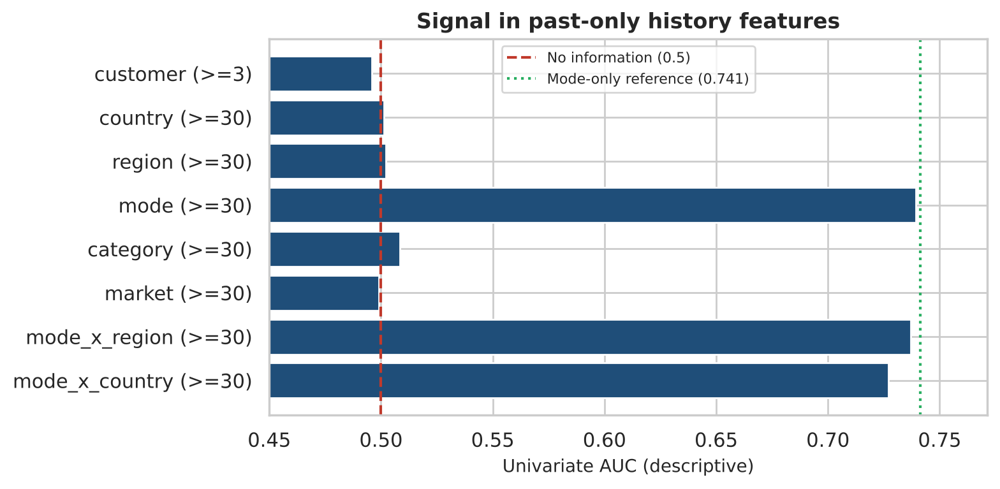
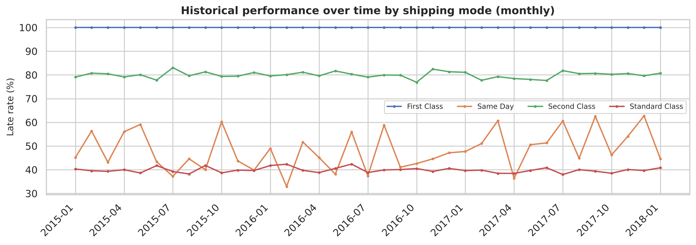
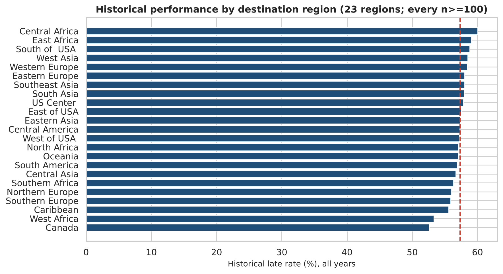
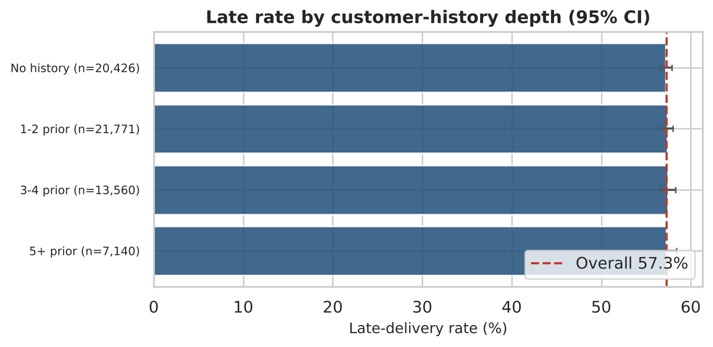

# Pattern 12: Historical delivery-performance patterns

## Definitions and data used

Unit: **order** (n = 62,897 valid orders; 'Shipping canceled' excluded); overall late rate = **57.31%**.

Every history feature is **past-only**: for an order created at time T, only earlier orders of the same group whose `shipping date` (used as the completion time) is strictly before T are counted. History is undefined (missing) when no completed prior order exists. Univariate AUC is used only to *describe* signal; it is **not** model performance.

Reference: AUC of the shipping-mode late rate alone (full-sample rates, 4 groups) = **0.741**.

## History features: coverage and univariate signal

| History feature                   |   min prior orders |   orders covered |   coverage % |   univariate AUC |   mean within-mode AUC |   Spearman vs late |
|:----------------------------------|-------------------:|-----------------:|-------------:|-----------------:|-----------------------:|-------------------:|
| prior late rate by customer       |                  1 |            42471 |       67.500 |            0.498 |                  0.507 |             -0.004 |
| prior late rate by customer       |                  3 |            20700 |       32.900 |            0.496 |                  0.501 |             -0.007 |
| prior late rate by customer       |                  5 |             7140 |       11.400 |            0.494 |                  0.498 |             -0.010 |
| prior late rate by country        |                 30 |            58198 |       92.500 |            0.501 |                  0.493 |              0.002 |
| prior late rate by region         |                 30 |            61257 |       97.400 |            0.502 |                  0.497 |              0.004 |
| prior late rate by mode           |                 30 |            62584 |       99.500 |            0.739 |                  0.490 |              0.411 |
| prior late rate by category       |                 30 |            58485 |       93.000 |            0.508 |                  0.502 |              0.014 |
| prior late rate by market         |                 30 |            62041 |       98.600 |            0.499 |                  0.503 |             -0.002 |
| prior late rate by mode_x_region  |                 30 |            59155 |       94.100 |            0.737 |                  0.495 |              0.407 |
| prior late rate by mode_x_country |                 30 |            52644 |       83.700 |            0.727 |                  0.498 |              0.391 |

## History depth

| Group         | orders with >=1 prior   |   median prior orders | orders with >=30 prior   |
|:--------------|:------------------------|----------------------:|:-------------------------|
| customer      | 67.5%                   |                  1.00 | 0.0%                     |
| country       | 98.5%                   |                742.00 | 92.5%                    |
| region        | 99.1%                   |               1719.00 | 97.4%                    |
| mode          | 99.8%                   |               9291.00 | 99.5%                    |
| category      | 97.9%                   |               1957.00 | 93.0%                    |
| mode_x_region | 98.7%                   |                555.00 | 94.1%                    |

## Stability over time: late rate (%) by mode and half-year

| mode           |   2015H1 |   2015H2 |   2016H1 |   2016H2 |   2017H1 |   2017H2 |   2018H1 |
|:---------------|---------:|---------:|---------:|---------:|---------:|---------:|---------:|
| First Class    |   100.00 |   100.00 |   100.00 |   100.00 |   100.00 |   100.00 |   100.00 |
| Same Day       |    50.30 |    43.90 |    45.60 |    44.90 |    50.00 |    55.60 |    44.60 |
| Second Class   |    79.50 |    80.60 |    80.40 |    79.90 |    78.70 |    80.50 |    80.70 |
| Standard Class |    39.90 |    39.60 |    40.90 |    39.80 |    39.50 |    39.30 |    40.80 |

## Stability over time: region x year

Mean across-year standard deviation of regional late rate = 2.75 pp (noise expectation for ~936 orders/cell ≈ 1.62 pp).

*History signal*

*Mode over time*

*Region history*

*Customer group*

## Interpretation

- Mode-only reference AUC is 0.741. The strongest history feature **within shipping mode** is `prior late rate by customer` with mean within-mode AUC 0.507; values near 0.5 mean the history adds little beyond mode.
- Customer/destination/category histories are noisy and, per Patterns 3, 7 and 8, mostly mirror chance variation.
- History features are valid only when built strictly past-only (as done here); building them over the full dataset would leak future outcomes.

## Candidate ML features

`mode_historical_late_rate` (conditional: nearly constant per mode), `mode_x_region_historical_late_rate` (conditional), `customer_prior_late_rate` and `category_historical_late_rate` (conditional / weak). All must be recomputed inside each training fold with the same past-only rule and a smoothing/minimum-count rule.

## Limitations

Completion time is approximated; no carrier or route history is available; history is sparse early in the period.
