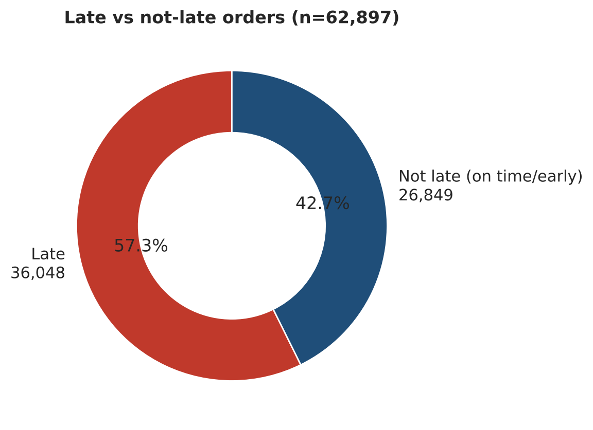
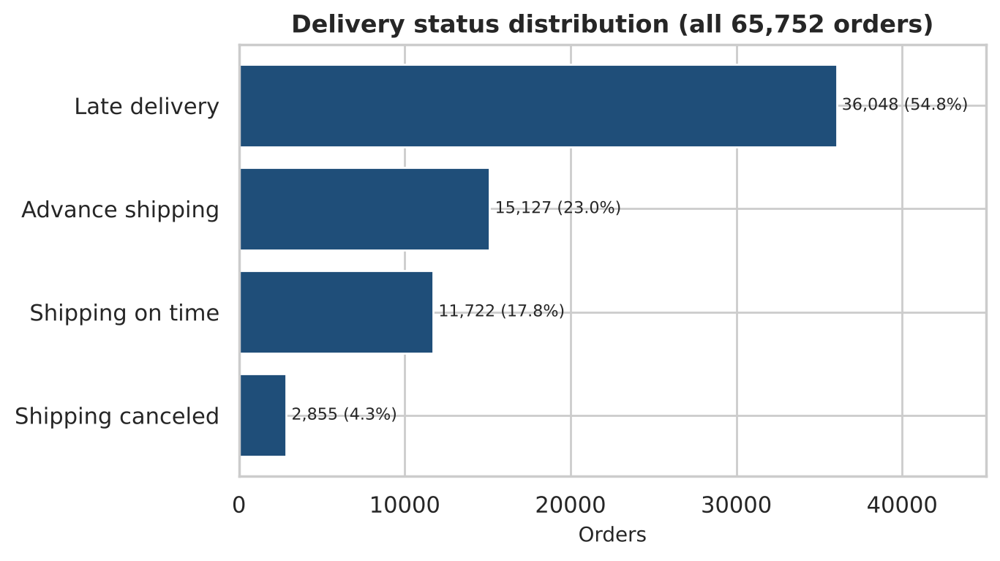
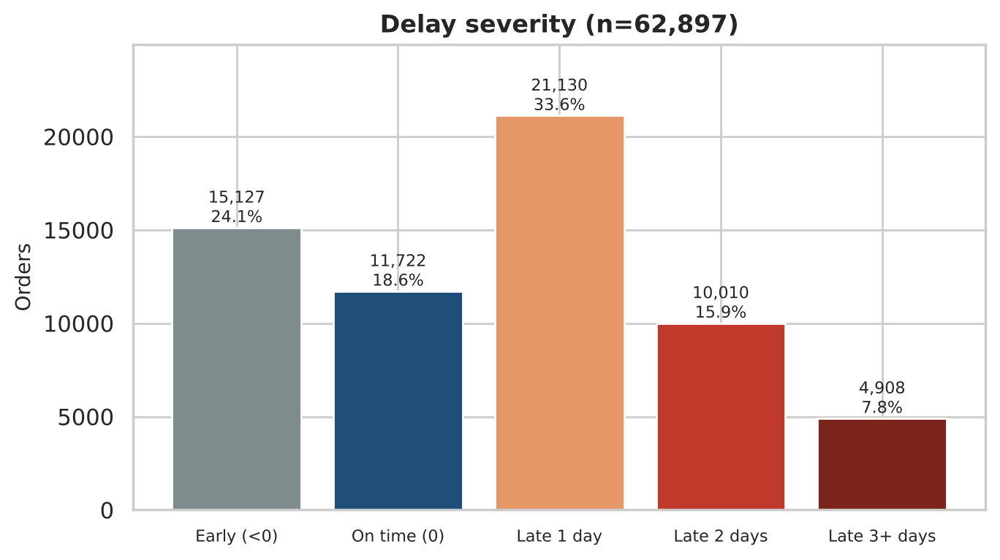
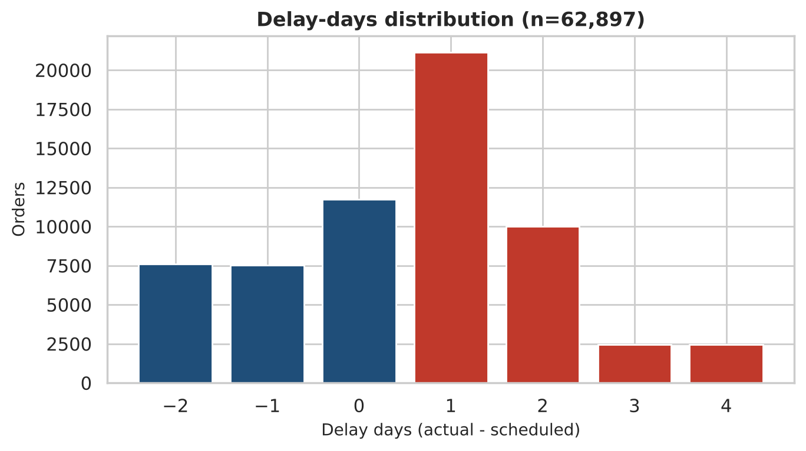
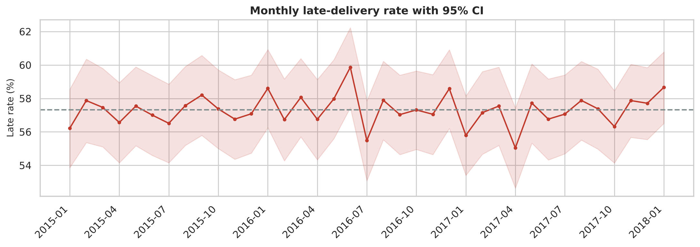
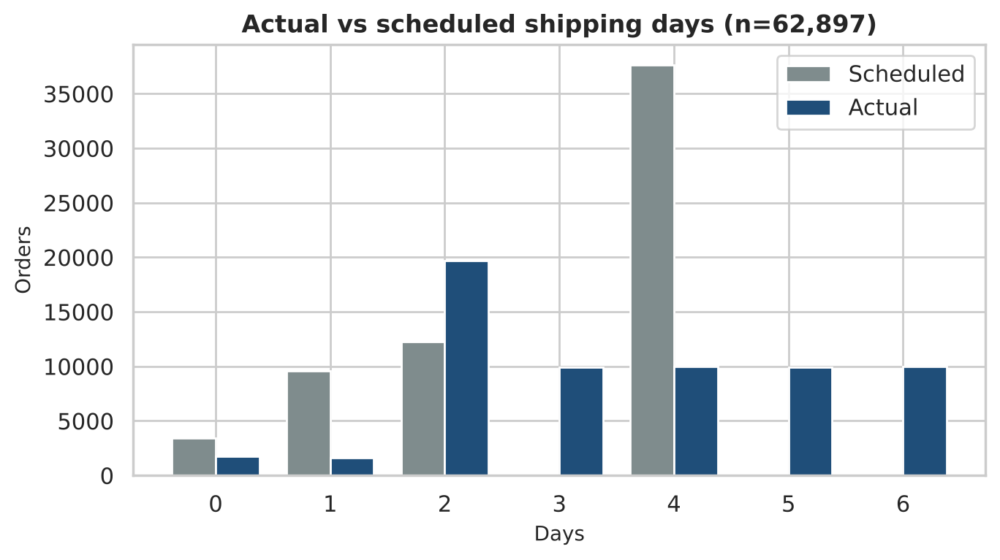
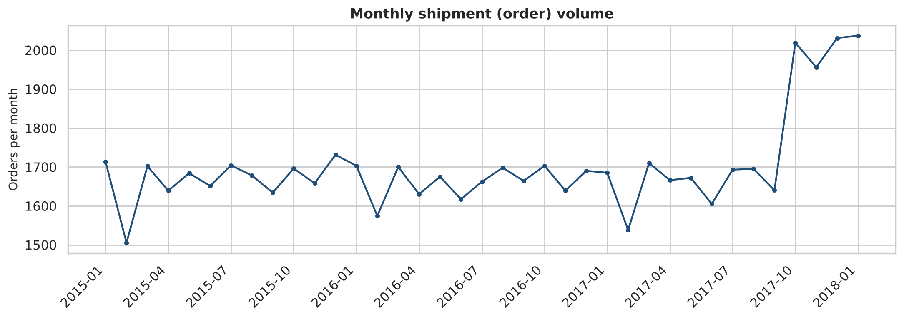

# Pattern 1: Late-delivery patterns

## Definitions and data used

Unit: **order** (n = 62,897 orders excluding 2,855 'Shipping canceled'); overall late rate = **57.31%**.

Delay Days = Actual days - Scheduled days (`Days for shipping (real)` - `Days for shipment (scheduled)`). Positive = late, 0 = on time, negative = early.

## Target validity check

Cross-tab (orders, **all** 65,752 incl. canceled) of Delivery Status against the sign of calculated delay and `Late_delivery_risk`:

| status            |   sign -1, flag 0 |   sign 0, flag 0 |   sign 1, flag 0 |   sign 1, flag 1 |
|:------------------|------------------:|-----------------:|-----------------:|-----------------:|
| Advance shipping  |             15127 |                0 |                0 |                0 |
| Late delivery     |                 0 |                0 |                0 |            36048 |
| Shipping canceled |               660 |              545 |             1650 |                0 |
| Shipping on time  |                 0 |            11722 |                0 |                0 |

**Result:** for the 3 delivery statuses other than 'Shipping canceled', calculated lateness agrees with `Delivery Status` and `Late_delivery_risk` in 100% of orders. For 'Shipping canceled' (2,855 orders) the flag is always 0 although the timing fields exist, so those orders are excluded.

## Late vs on-time vs early

Late: **36,048 (57.31%)**, 95% CI 56.93-57.70%. On time: 11,722 (18.64%). Early: 15,127 (24.05%). The binary target (`late`) therefore groups early and on-time as 'not late'.

| Outcome      |   orders |   % of valid orders |
|:-------------|---------:|--------------------:|
| Early (<0)   |    15127 |               24.05 |
| On time (0)  |    11722 |               18.64 |
| Late 1 day   |    21130 |               33.59 |
| Late 2 days  |    10010 |               15.91 |
| Late 3+ days |     4908 |                7.80 |

## Delay magnitude

- All valid orders (n=62,897): mean delay 0.57 days, median 1, min -2, max 4.
- Late orders only (n=36,048): mean 1.62, median 1, max 4.
- Actual shipping days: mean 3.50, median 3; scheduled days: mean 2.94, median 4.
- Skewness of delay = 0.03, excess kurtosis = -0.30.

## Delivery status (all orders)

| Delivery Status   |   orders |   % of all orders |
|:------------------|---------:|------------------:|
| Late delivery     |    36048 |             54.82 |
| Advance shipping  |    15127 |             23.01 |
| Shipping on time  |    11722 |             17.83 |
| Shipping canceled |     2855 |              4.34 |

## Repeated late deliveries

8,995 of 20,261 customers (44.4%) had >= 2 late orders; 16,018 had >= 1. Whether this exceeds chance is tested in Pattern 8.

*Late vs not late*

*Delivery status*

*Delay severity*

*Delay days*

*Monthly late rate*

*Actual vs scheduled*

*Volume over time*

## Interpretation

- Late delivery is the **majority outcome (57.3%)**; the target is moderately balanced (ratio late:not-late = 1.34:1), so no severe imbalance handling is indicated.
- Delays are small and discrete: 58% of late orders are exactly 1 day late; the maximum is 4 days.
- Because scheduled days take only 4 values (tied to mode), 'late' largely reflects whether the real duration exceeds a fixed promise (see Pattern 2/10).

## Candidate ML features

Target = `late` (order-level, valid orders). Do **not** use `Late_delivery_risk`, `Delivery Status`, `Days for shipping (real)` or `shipping date` as inputs.

## Limitations

Real days are integers (1-day resolution). 'Shipping canceled' orders are excluded; their true lateness is undefined. Delivery completion time is not given directly (`shipping date` behaves as a completion date).
