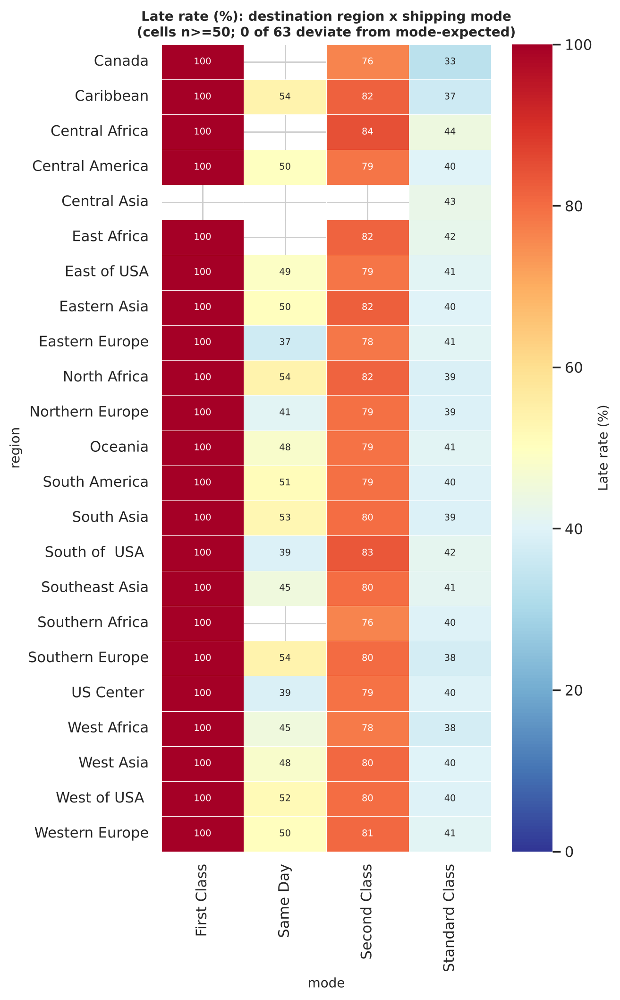
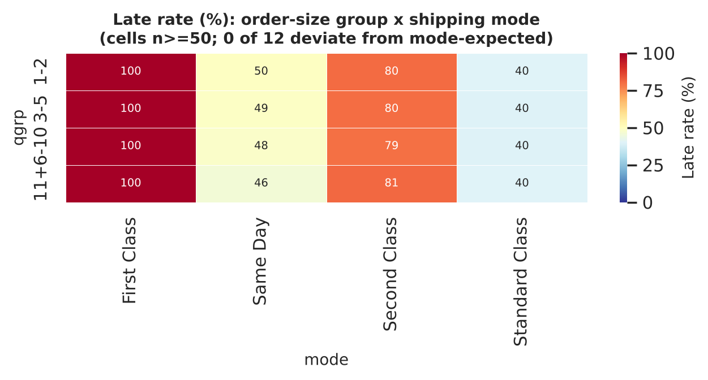
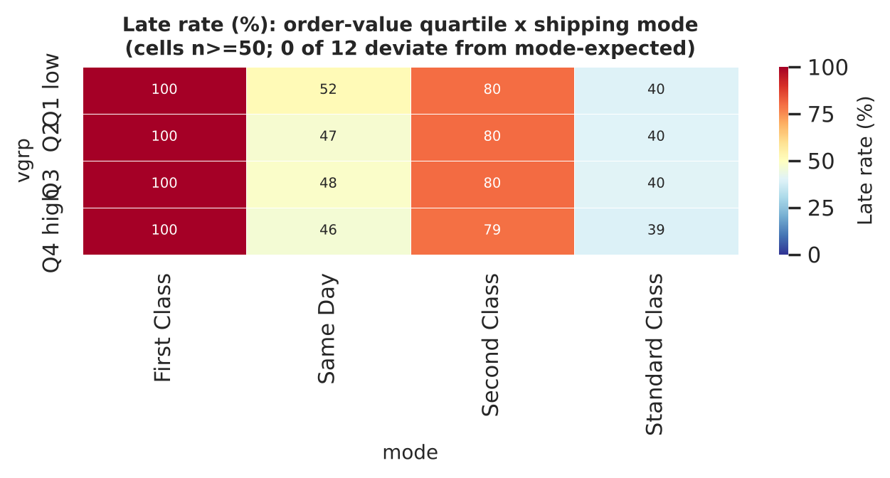
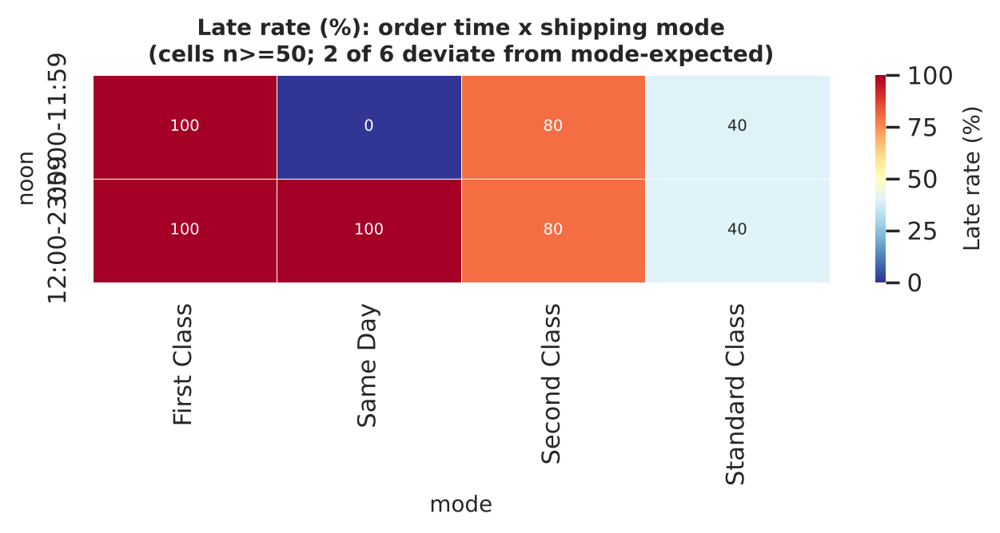
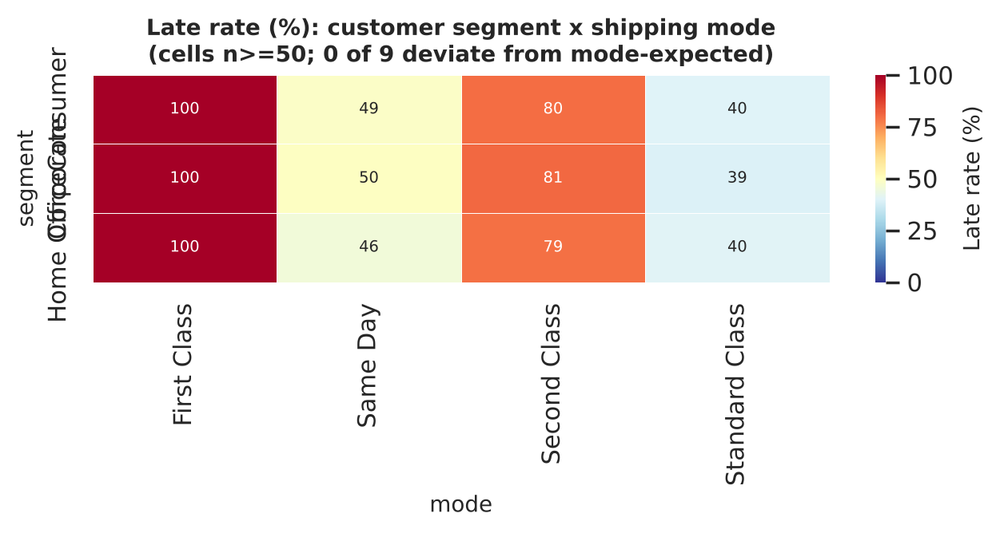
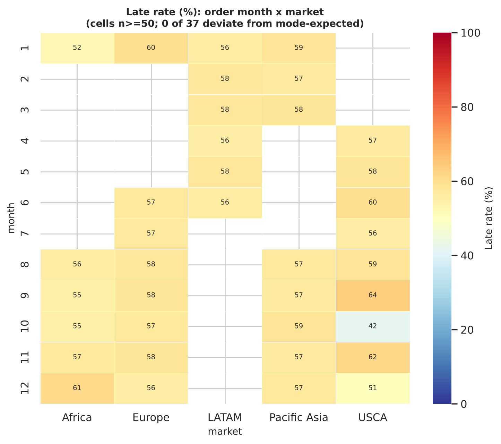
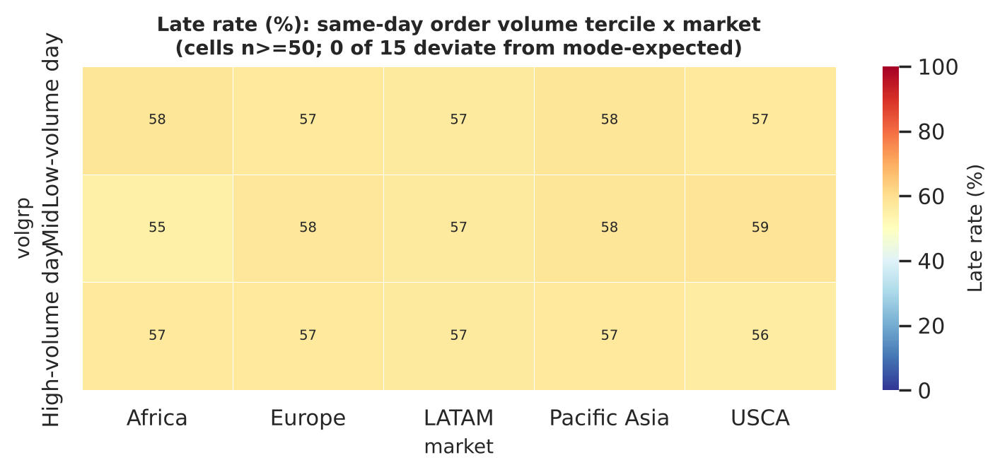
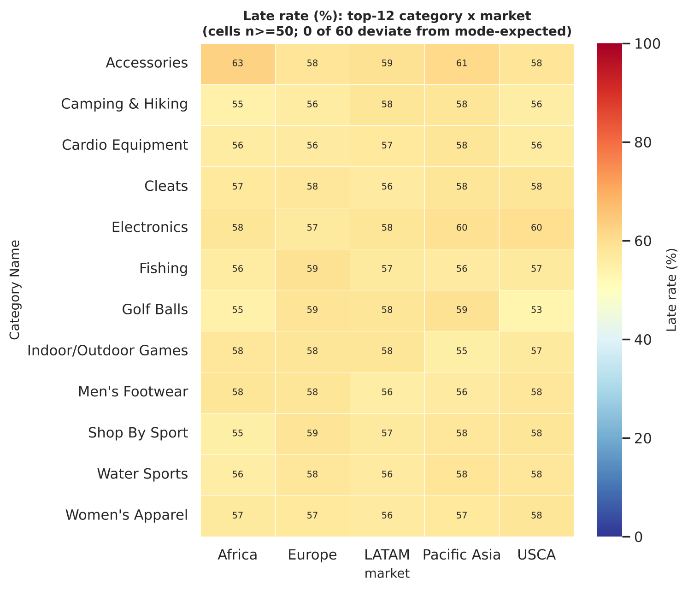

# Pattern 15: Multivariate patterns

## Definitions and data used

Unit: **order** (n = 62,897 valid orders); overall late rate = **57.31%**.

Combinations are tested **cell by cell against the late rate expected from shipping mode alone** (observed late count vs sum of mode rates; normal approximation; Benjamini-Hochberg across all cells of a combination). Cells with n < 50 are not reported. Priority-based combinations are **unavailable** (no priority column).

## A. Region + Shipping mode + Late

85 cells with n>=50 (62,725 orders); late-rate range 33.0-100.0%. Cells testable against mode expectation: 63; **significantly different after BH correction: 0**.

| region          | mode           |    n |   late_rate_% |   ci95_low_% |   ci95_high_% |   expected_% |   p_BH |
|:----------------|:---------------|-----:|--------------:|-------------:|--------------:|-------------:|-------:|
| Western Europe  | Standard Class | 5674 |         40.70 |        39.40 |         41.90 |        39.80 |   0.88 |
| Central America | Standard Class | 5401 |         40.00 |        38.70 |         41.40 |        39.80 |   0.96 |
| South America   | Standard Class | 2862 |         39.50 |        37.70 |         41.30 |        39.80 |   0.90 |
| Southeast Asia  | Standard Class | 2513 |         41.10 |        39.20 |         43.00 |        39.80 |   0.88 |
| Oceania         | Standard Class | 2494 |         40.80 |        38.90 |         42.70 |        39.80 |   0.88 |
| Northern Europe | Standard Class | 2149 |         39.10 |        37.10 |         41.20 |        39.80 |   0.88 |
| Southern Europe | Standard Class | 2045 |         37.60 |        35.50 |         39.70 |        39.80 |   0.78 |
| Eastern Asia    | Standard Class | 1933 |         39.90 |        37.70 |         42.10 |        39.80 |   0.98 |
| South Asia      | Standard Class | 1878 |         39.20 |        37.00 |         41.40 |        39.80 |   0.88 |
| Western Europe  | Second Class   | 1875 |         80.70 |        78.80 |         82.40 |        80.00 |   0.88 |
| Central America | Second Class   | 1748 |         78.80 |        76.80 |         80.60 |        80.00 |   0.88 |
| Caribbean       | Standard Class | 1623 |         36.70 |        34.40 |         39.10 |        39.80 |   0.64 |

*(showing 12 of 85 rows; full table in `A_region_mode_table.csv`)*

*Late rate (%): destination region x shipping mode*

## B. Quantity group + Shipping mode + Late

16 cells with n>=50 (62,897 orders); late-rate range 39.6-100.0%. Cells testable against mode expectation: 12; **significantly different after BH correction: 0**.

| qgrp   | mode           |     n |   late_rate_% |   ci95_low_% |   ci95_high_% |   expected_% |   p_BH |
|:-------|:---------------|------:|--------------:|-------------:|--------------:|-------------:|-------:|
| 6-10   | Standard Class | 12440 |         39.80 |        38.90 |         40.70 |        39.80 |   0.91 |
| 1-2    | Standard Class | 10854 |         40.00 |        39.10 |         41.00 |        39.80 |   0.91 |
| 3-5    | Standard Class |  8732 |         39.60 |        38.60 |         40.70 |        39.80 |   0.91 |
| 11+    | Standard Class |  5606 |         39.90 |        38.60 |         41.20 |        39.80 |   0.91 |
| 6-10   | Second Class   |  4051 |         79.40 |        78.20 |         80.70 |        80.00 |   0.91 |
| 1-2    | Second Class   |  3451 |         80.30 |        79.00 |         81.60 |        80.00 |   0.91 |
| 6-10   | First Class    |  3148 |        100.00 |        99.90 |        100.00 |       100.00 | nan    |
| 3-5    | Second Class   |  2899 |         79.90 |        78.40 |         81.30 |        80.00 |   0.91 |
| 1-2    | First Class    |  2757 |        100.00 |        99.90 |        100.00 |       100.00 | nan    |
| 3-5    | First Class    |  2213 |        100.00 |        99.80 |        100.00 |       100.00 | nan    |
| 11+    | Second Class   |  1855 |         80.80 |        78.90 |         82.50 |        80.00 |   0.91 |
| 11+    | First Class    |  1484 |        100.00 |        99.70 |        100.00 |       100.00 | nan    |

*(showing 12 of 16 rows; full table in `B_quantity_mode_table.csv`)*

*Late rate (%): order-size group x shipping mode*

## C. Order value + Shipping mode + Late (priority unavailable)

16 cells with n>=50 (62,897 orders); late-rate range 39.2-100.0%. Cells testable against mode expectation: 12; **significantly different after BH correction: 0**.

| vgrp    | mode           |    n |   late_rate_% |   ci95_low_% |   ci95_high_% |   expected_% |   p_BH |
|:--------|:---------------|-----:|--------------:|-------------:|--------------:|-------------:|-------:|
| Q2      | Standard Class | 9447 |         40.10 |        39.10 |         41.10 |        39.80 |   0.91 |
| Q4 high | Standard Class | 9427 |         39.20 |        38.20 |         40.20 |        39.80 |   0.88 |
| Q3      | Standard Class | 9389 |         40.40 |        39.40 |         41.40 |        39.80 |   0.88 |
| Q1 low  | Standard Class | 9369 |         39.80 |        38.80 |         40.80 |        39.80 |   0.93 |
| Q1 low  | Second Class   | 3078 |         79.90 |        78.50 |         81.30 |        80.00 |   0.93 |
| Q3      | Second Class   | 3070 |         80.30 |        78.80 |         81.70 |        80.00 |   0.91 |
| Q2      | Second Class   | 3068 |         80.30 |        78.80 |         81.70 |        80.00 |   0.91 |
| Q4 high | Second Class   | 3040 |         79.40 |        78.00 |         80.80 |        80.00 |   0.91 |
| Q4 high | First Class    | 2444 |        100.00 |        99.80 |        100.00 |       100.00 | nan    |
| Q2      | First Class    | 2426 |        100.00 |        99.80 |        100.00 |       100.00 | nan    |
| Q3      | First Class    | 2379 |        100.00 |        99.80 |        100.00 |       100.00 | nan    |
| Q1 low  | First Class    | 2353 |        100.00 |        99.80 |        100.00 |       100.00 | nan    |

*(showing 12 of 16 rows; full table in `C_value_mode_table.csv`)*

*Late rate (%): order-value quartile x shipping mode*

## D. Order time (before/after noon) + Shipping mode + Late (replaces scheduled-duration x mode, identical to mode)

8 cells with n>=50 (62,897 orders); late-rate range 0.0-100.0%. Cells testable against mode expectation: 6; **significantly different after BH correction: 2**.

| noon        | mode           |     n |   late_rate_% |   ci95_low_% |   ci95_high_% |   expected_% |   p_BH |
|:------------|:---------------|------:|--------------:|-------------:|--------------:|-------------:|-------:|
| 00:00-11:59 | Standard Class | 18876 |         39.60 |        38.90 |         40.30 |        39.80 |   0.72 |
| 12:00-23:59 | Standard Class | 18756 |         40.10 |        39.40 |         40.80 |        39.80 |   0.72 |
| 12:00-23:59 | Second Class   |  6132 |         80.00 |        78.90 |         80.90 |        80.00 |   0.96 |
| 00:00-11:59 | Second Class   |  6124 |         80.00 |        79.00 |         81.00 |        80.00 |   0.96 |
| 12:00-23:59 | First Class    |  4899 |        100.00 |        99.90 |        100.00 |       100.00 | nan    |
| 00:00-11:59 | First Class    |  4703 |        100.00 |        99.90 |        100.00 |       100.00 | nan    |
| 00:00-11:59 | Same Day       |  1759 |          0.00 |         0.00 |          0.20 |        48.40 |   0.00 |
| 12:00-23:59 | Same Day       |  1648 |        100.00 |        99.80 |        100.00 |        48.40 |   0.00 |

*Late rate (%): order time x shipping mode*

## E. Customer segment + Shipping mode + Late (priority unavailable)

12 cells with n>=50 (62,897 orders); late-rate range 39.1-100.0%. Cells testable against mode expectation: 9; **significantly different after BH correction: 0**.

| segment     | mode           |     n |   late_rate_% |   ci95_low_% |   ci95_high_% |   expected_% |   p_BH |
|:------------|:---------------|------:|--------------:|-------------:|--------------:|-------------:|-------:|
| Consumer    | Standard Class | 19587 |         40.10 |        39.40 |         40.70 |        39.80 |   0.63 |
| Corporate   | Standard Class | 11336 |         39.10 |        38.20 |         40.00 |        39.80 |   0.61 |
| Home Office | Standard Class |  6709 |         40.50 |        39.30 |         41.70 |        39.80 |   0.62 |
| Consumer    | Second Class   |  6299 |         79.70 |        78.70 |         80.70 |        80.00 |   0.63 |
| Consumer    | First Class    |  4938 |        100.00 |        99.90 |        100.00 |       100.00 | nan    |
| Corporate   | Second Class   |  3774 |         80.80 |        79.50 |         82.00 |        80.00 |   0.61 |
| Corporate   | First Class    |  2879 |        100.00 |        99.90 |        100.00 |       100.00 | nan    |
| Home Office | Second Class   |  2183 |         79.40 |        77.70 |         81.10 |        80.00 |   0.63 |
| Consumer    | Same Day       |  1790 |         48.60 |        46.30 |         50.90 |        48.40 |   0.84 |
| Home Office | First Class    |  1785 |        100.00 |        99.80 |        100.00 |       100.00 | nan    |
| Corporate   | Same Day       |  1028 |         49.50 |        46.50 |         52.60 |        48.40 |   0.63 |
| Home Office | Same Day       |   589 |         45.70 |        41.70 |         49.70 |        48.40 |   0.61 |

*Late rate (%): customer segment x shipping mode*

## F. Month + Market + Late

37 cells with n>=50 (62,772 orders); late-rate range 41.8-63.6%. Cells testable against mode expectation: 37; **significantly different after BH correction: 0**.

|   month | market       |    n |   late_rate_% |   ci95_low_% |   ci95_high_% |   expected_% |   p_BH |
|--------:|:-------------|-----:|--------------:|-------------:|--------------:|-------------:|-------:|
|      12 | Pacific Asia | 4300 |         57.40 |        55.90 |         58.90 |        57.40 |   0.97 |
|       1 | Pacific Asia | 4090 |         58.60 |        57.10 |         60.10 |        57.80 |   0.93 |
|      10 | Europe       | 3578 |         57.10 |        55.50 |         58.70 |        57.70 |   0.93 |
|       9 | Europe       | 3551 |         58.20 |        56.50 |         59.80 |        57.10 |   0.93 |
|      11 | Pacific Asia | 3473 |         57.00 |        55.30 |         58.60 |        56.90 |   0.97 |
|       8 | Europe       | 3413 |         57.60 |        55.90 |         59.20 |        58.30 |   0.93 |
|       3 | LATAM        | 3412 |         57.50 |        55.80 |         59.20 |        57.90 |   0.97 |
|       7 | Europe       | 3397 |         56.80 |        55.10 |         58.40 |        57.00 |   0.97 |
|       5 | LATAM        | 3316 |         57.60 |        55.90 |         59.20 |        57.80 |   0.97 |
|       4 | LATAM        | 3305 |         55.80 |        54.10 |         57.50 |        56.50 |   0.93 |
|       2 | LATAM        | 3043 |         57.50 |        55.70 |         59.30 |        57.40 |   0.97 |
|       1 | LATAM        | 2432 |         56.20 |        54.20 |         58.10 |        56.10 |   0.97 |

*(showing 12 of 37 rows; full table in `F_month_market_table.csv`)*

*Late rate (%): order month x market*

## G. Daily order volume + Market + Late

15 cells with n>=50 (62,897 orders); late-rate range 54.8-58.7%. Cells testable against mode expectation: 15; **significantly different after BH correction: 0**.

| volgrp          | market       |    n |   late_rate_% |   ci95_low_% |   ci95_high_% |   expected_% |   p_BH |
|:----------------|:-------------|-----:|--------------:|-------------:|--------------:|-------------:|-------:|
| High-volume day | Pacific Asia | 8307 |         57.40 |        56.30 |         58.50 |        57.20 |   0.91 |
| Low-volume day  | LATAM        | 7348 |         56.80 |        55.70 |         58.00 |        57.20 |   0.91 |
| Low-volume day  | Europe       | 6516 |         57.20 |        56.00 |         58.40 |        56.90 |   0.91 |
| High-volume day | Europe       | 5665 |         57.30 |        56.00 |         58.50 |        57.40 |   0.91 |
| Mid             | LATAM        | 5603 |         56.90 |        55.60 |         58.20 |        56.70 |   0.91 |
| Mid             | Europe       | 5582 |         57.80 |        56.50 |         59.10 |        58.00 |   0.91 |
| Low-volume day  | Pacific Asia | 4568 |         57.90 |        56.40 |         59.30 |        57.70 |   0.91 |
| Low-volume day  | USCA         | 4032 |         57.30 |        55.70 |         58.80 |        57.40 |   0.91 |
| Mid             | Pacific Asia | 3978 |         58.00 |        56.50 |         59.50 |        57.20 |   0.91 |
| High-volume day | LATAM        | 3463 |         57.00 |        55.40 |         58.70 |        57.90 |   0.91 |
| Mid             | USCA         | 2790 |         58.70 |        56.80 |         60.50 |        58.30 |   0.91 |
| Mid             | Africa       | 1468 |         54.80 |        52.30 |         57.40 |        55.30 |   0.91 |

*(showing 12 of 15 rows; full table in `G_volume_market_table.csv`)*

*Late rate (%): same-day order volume tercile x market*

## H. Product category (top 12) + Market + Late (line level)

60 cells with n>=50 (156,582 order lines); late-rate range 53.4-62.6%. Cells testable against mode expectation: 60; **significantly different after BH correction: 0**.

| Category Name        | market       |    n |   late_rate_% |   ci95_low_% |   ci95_high_% |   expected_% |   p_BH |
|:---------------------|:-------------|-----:|--------------:|-------------:|--------------:|-------------:|-------:|
| Cleats               | LATAM        | 6982 |         56.40 |        55.30 |         57.60 |        57.00 |   0.75 |
| Cleats               | Europe       | 6514 |         57.60 |        56.40 |         58.80 |        57.90 |   0.75 |
| Men's Footwear       | LATAM        | 6269 |         55.70 |        54.50 |         56.90 |        56.70 |   0.67 |
| Women's Apparel      | LATAM        | 5984 |         56.50 |        55.20 |         57.70 |        57.20 |   0.75 |
| Men's Footwear       | Europe       | 5867 |         58.20 |        56.90 |         59.40 |        57.80 |   0.75 |
| Women's Apparel      | Europe       | 5651 |         57.10 |        55.80 |         58.40 |        57.40 |   0.78 |
| Indoor/Outdoor Games | LATAM        | 5598 |         58.00 |        56.70 |         59.30 |        56.60 |   0.45 |
| Indoor/Outdoor Games | Europe       | 4978 |         58.00 |        56.60 |         59.40 |        57.40 |   0.75 |
| Fishing              | LATAM        | 4876 |         56.90 |        55.50 |         58.30 |        56.90 |   0.96 |
| Cleats               | Pacific Asia | 4875 |         57.90 |        56.60 |         59.30 |        57.00 |   0.75 |
| Fishing              | Europe       | 4609 |         59.20 |        57.80 |         60.60 |        57.80 |   0.45 |
| Water Sports         | LATAM        | 4486 |         56.40 |        54.90 |         57.80 |        57.30 |   0.75 |

*(showing 12 of 60 rows; full table in `H_category_market_table.csv`)*

*Late rate (%): top-12 category x market*

## Combinations not possible

Priority + shipping mode; order value + priority; customer segment + priority; any combination using origin or route.

## Interpretation

- Across all combinations, **2 of 214 testable cells** differ from the mode-expected late rate after multiple-testing correction.
- The only structured multivariate effect is **shipping mode x order time** (Same Day noon cutoff); every other combination is explained by shipping mode alone.
- Group sizes are shown in the CSV/tables; no cell below n=50 is interpreted.

## Candidate ML features

Interaction `mode x ordered_after_noon` (approved). No other multivariate feature is supported.

## Limitations

Cell-wise tests across many cells have limited power for small cells; absence of significance is not proof of no effect.
