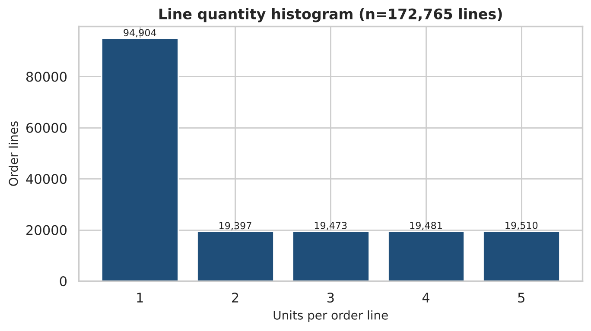
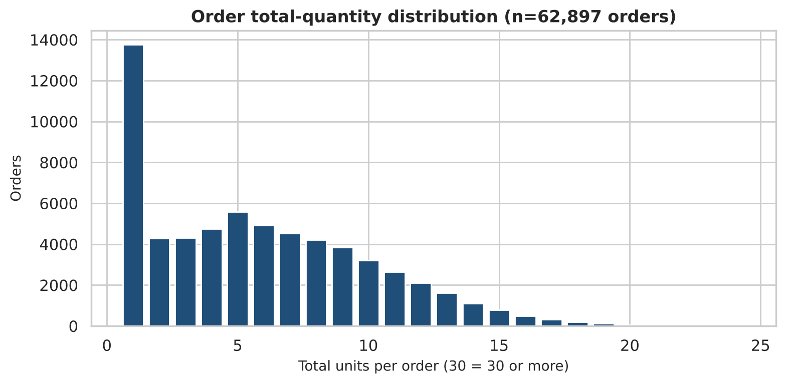
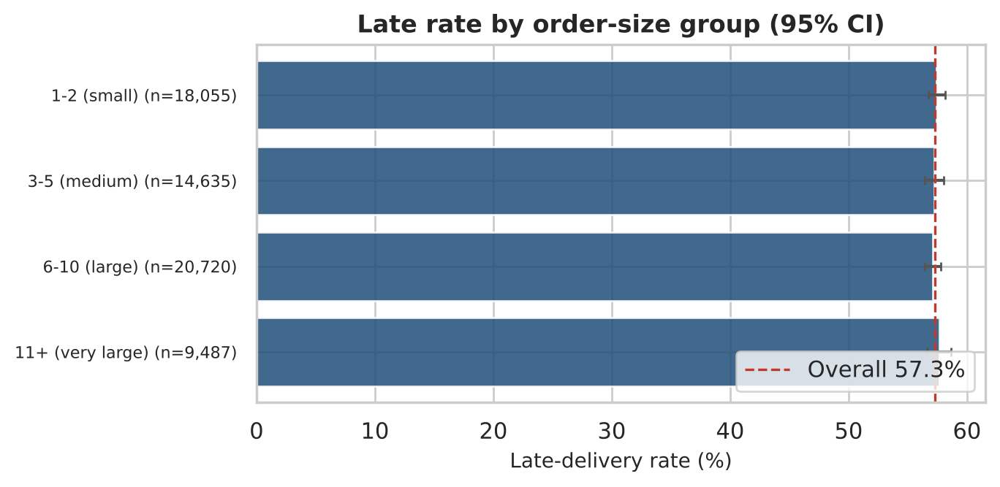
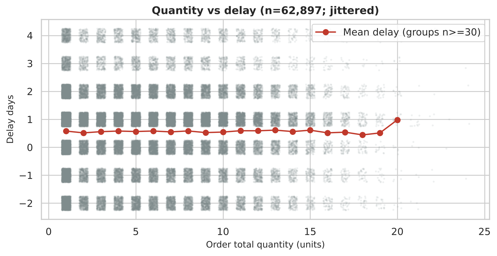

# Pattern 5: Order-quantity patterns

## Definitions and data used

Unit: **order** (n = 62,897 orders excluding 2,855 'Shipping canceled'); overall late rate = **57.31%**.

Line quantity = `Order Item Quantity` (per line, 1-5; line n=172,765). **Order quantity = sum of line quantities within the order** (each line counted once). Groups are fixed in advance: 1-2, 3-5, 6-10, 11+ units.

## Line quantity distribution

|   Line quantity |    lines |     % |
|----------------:|---------:|------:|
|            1.00 | 94904.00 | 54.90 |
|            2.00 | 19397.00 | 11.20 |
|            3.00 | 19473.00 | 11.30 |
|            4.00 | 19481.00 | 11.30 |
|            5.00 | 19510.00 | 11.30 |

## Order-size groups: late rate

| qgrp             |     n |   late |   late_rate_% |   ci95_low_% |   ci95_high_% |
|:-----------------|------:|-------:|--------------:|-------------:|--------------:|
| 1-2 (small)      | 18055 |  10369 |         57.43 |        56.71 |         58.15 |
| 3-5 (medium)     | 14635 |   8375 |         57.23 |        56.42 |         58.03 |
| 6-10 (large)     | 20720 |  11836 |         57.12 |        56.45 |         57.80 |
| 11+ (very large) |  9487 |   5468 |         57.64 |        56.64 |         58.63 |

## Items per order: late rate

|   items |     n |   late_rate_% |   ci95_low_% |   ci95_high_% |
|--------:|------:|--------------:|-------------:|--------------:|
|       1 | 18982 |         57.57 |        56.87 |         58.27 |
|       2 | 10937 |         57.06 |        56.13 |         57.99 |
|       3 | 10896 |         57.25 |        56.32 |         58.18 |
|       4 | 11189 |         56.77 |        55.85 |         57.69 |
|       5 | 10893 |         57.73 |        56.80 |         58.66 |

## Statistical tests

Chi-square test of `order-size group` vs late: chi2 = 0.9, dof = 3, p = 0.836, Cramer's V = 0.004 (negligible).

Spearman(order quantity, delay days) = -0.0004 (p=0.92); Spearman(order quantity, late flag) = -0.0021 (p=0.599). Mann-Whitney late vs not-late quantity: p = 0.599, rank-biserial effect = 0.002. Median qty late = 5, not late = 5.

## Order-size group vs shipping mode (% within group)

| qgrp             |   First Class |   Same Day |   Second Class |   Standard Class |
|:-----------------|--------------:|-----------:|---------------:|-----------------:|
| 1-2 (small)      |         15.30 |       5.50 |          19.10 |            60.10 |
| 3-5 (medium)     |         15.10 |       5.40 |          19.80 |            59.70 |
| 6-10 (large)     |         15.20 |       5.20 |          19.60 |            60.00 |
| 11+ (very large) |         15.60 |       5.70 |          19.60 |            59.10 |

## Order size within each shipping mode (late rate %, controls for mode)

| mode           |   1-2 (small) |   3-5 (medium) |   6-10 (large) |   11+ (very large) |
|:---------------|--------------:|---------------:|---------------:|-------------------:|
| First Class    |        100.00 |         100.00 |         100.00 |             100.00 |
| Same Day       |         49.60 |          48.90 |          48.10 |              45.80 |
| Second Class   |         80.30 |          79.90 |          79.40 |              80.80 |
| Standard Class |         40.00 |          39.60 |          39.80 |              39.90 |

*Line quantity*

*Order-size distribution*

*Late rate by size*

*Quantity vs delay*

## Interpretation

- Late rate across order-size groups ranges 57.1-57.6% (Cramer's V = 0.004, negligible). Spearman rho with delay = -0.000.
- Larger orders are NOT associated with more delays in a practically meaningful way. Significance with n=62,897 must be judged against the effect size, not p-value alone.

## Candidate ML features

`order_total_quantity`, `items_per_order`, `order_size_group` (conditional candidates: available at order creation; weak evidence).

## Limitations

Order sizes are capped by the dataset structure (<=5 lines, <=5 units per line). No weight/volume data.
