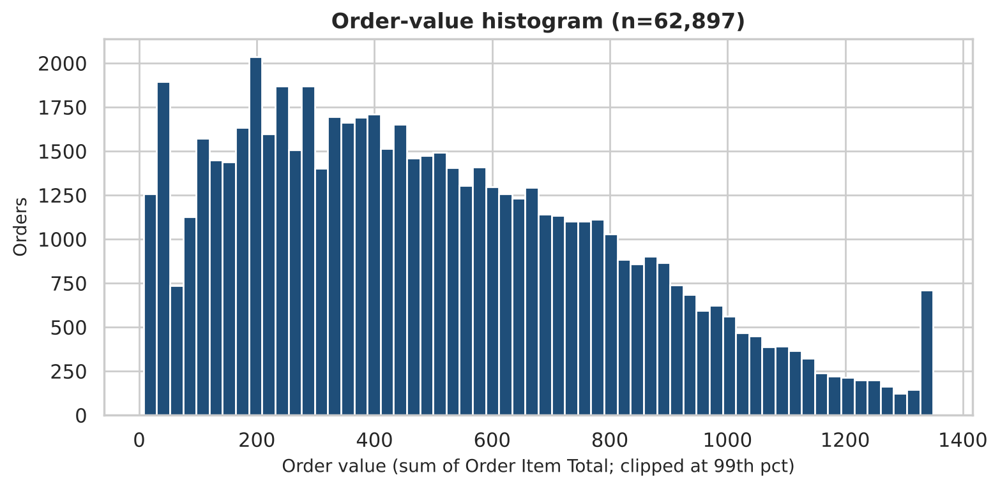
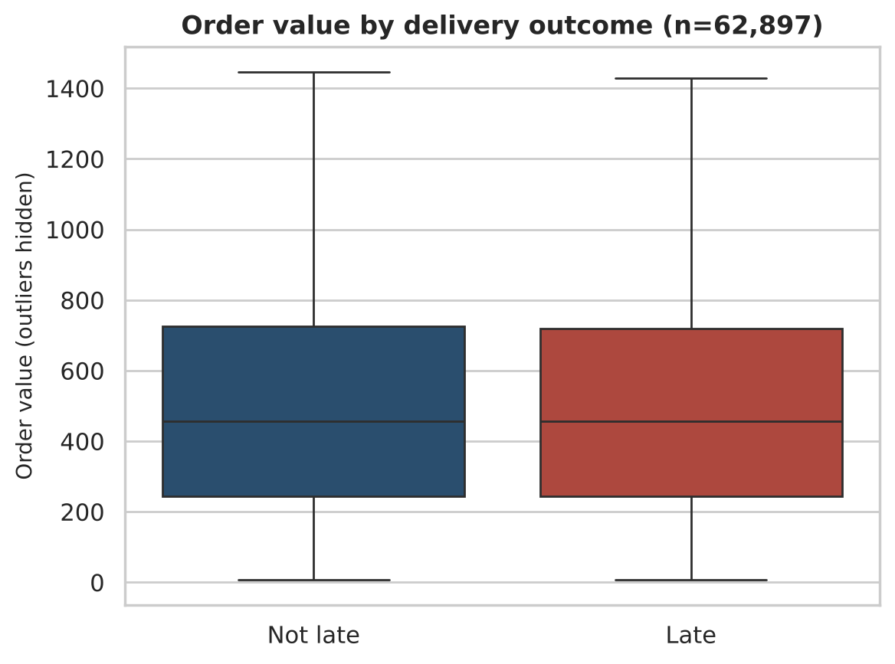
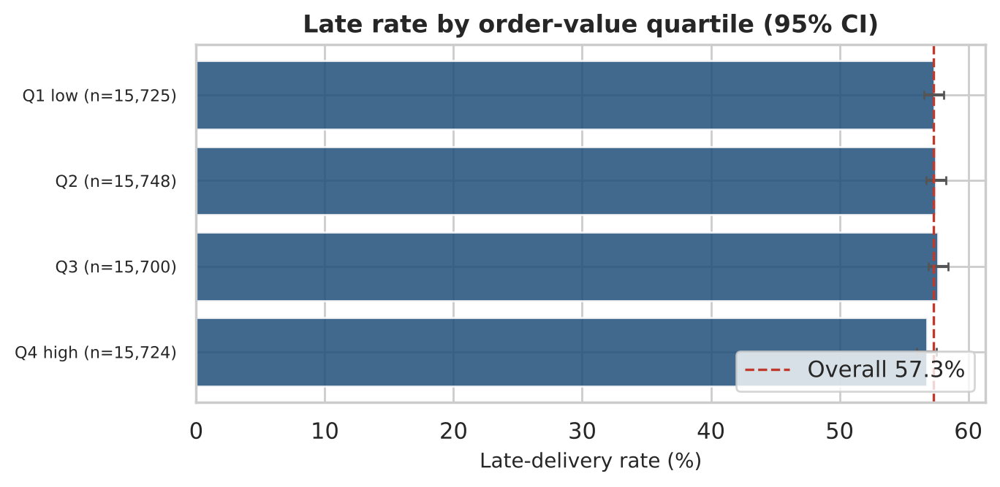
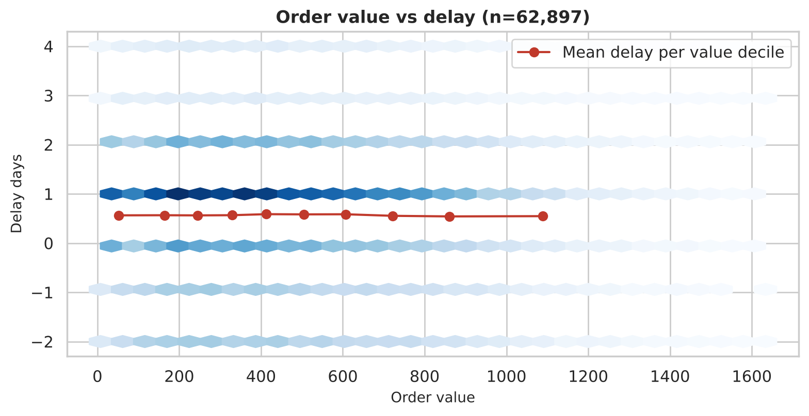

# Pattern 6: Order-value patterns

## Definitions and data used

Unit: **order** (n = 62,897 orders excluding 2,855 'Shipping canceled'); overall late rate = **57.31%**.

Monetary fields verified: `Sales` = unit price x quantity (100% of rows); `Order Item Total` = `Sales` - `Order Item Discount` (100%); `Sales per customer` is identical to `Order Item Total`. **Order value = sum of `Order Item Total` over the order's lines** (each line once; no repeated order totals exist in the file, so there is no double counting).

## Distribution

- Mean order value 503.12, median 456.87, SD 321.29, min 7.49, max 2,768.41. Skewness 0.62, excess kurtosis -0.03.
- IQR outliers (> Q3 + 1.5 IQR = 1,438.38): 292 orders (0.5%). Currency is not stated in the dataset.

## Value quartiles: late rate

| vgrp    |    min |     max |     n |   late_rate_% |   ci95_low_% |   ci95_high_% |
|:--------|-------:|--------:|------:|--------------:|-------------:|--------------:|
| Q1 low  |   7.49 |  244.35 | 15725 |         57.34 |        56.57 |         58.11 |
| Q2      | 244.36 |  456.87 | 15748 |         57.49 |        56.72 |         58.26 |
| Q3      | 456.88 |  721.96 | 15700 |         57.64 |        56.87 |         58.41 |
| Q4 high | 721.97 | 2768.41 | 15724 |         56.77 |        56.00 |         57.55 |

## Top 5% value vs rest

| top5         |     n |   late_rate_% |   ci95_low_% |   ci95_high_% |
|:-------------|------:|--------------:|-------------:|--------------:|
| Rest         | 59752 |         57.38 |        56.99 |         57.78 |
| Top 5% value |  3145 |         55.99 |        54.25 |         57.72 |

## Statistical tests

Chi-square test of `value quartile` vs late: chi2 = 2.8, dof = 3, p = 0.426, Cramer's V = 0.007 (negligible).

Spearman(value, delay) = -0.0032 (p=0.422); Spearman(value, quantity) = 0.728. Mann-Whitney value late vs not late: p = 0.367, rank-biserial = 0.004. Median value late = 455.95, not late = 457.56.

## Value quartile x shipping mode (late rate %)

| vgrp    |   First Class |   Same Day |   Second Class |   Standard Class |
|:--------|--------------:|-----------:|---------------:|-----------------:|
| Q1 low  |        100.00 |      51.60 |          79.90 |            39.80 |
| Q2      |        100.00 |      47.10 |          80.30 |            40.10 |
| Q3      |        100.00 |      48.10 |          80.30 |            40.40 |
| Q4 high |        100.00 |      46.20 |          79.40 |            39.20 |

## Value quartile vs mode mix (% within quartile)

| vgrp    |   First Class |   Same Day |   Second Class |   Standard Class |
|:--------|--------------:|-----------:|---------------:|-----------------:|
| Q1 low  |         15.00 |       5.90 |          19.60 |            59.60 |
| Q2      |         15.40 |       5.10 |          19.50 |            60.00 |
| Q3      |         15.20 |       5.50 |          19.60 |            59.80 |
| Q4 high |         15.50 |       5.20 |          19.30 |            60.00 |

*Value histogram*

*Value by outcome*

*Late by value*

*Value vs delay*

## Interpretation

- Late rate across value quartiles: 56.8-57.6% (V=0.007, negligible); Spearman(value, delay) = -0.003.
- No practically meaningful value effect.

## Candidate ML features

`order_total_value`, `value_group`, `avg_discount_rate` (conditional: available at order creation if prices/discounts are known then).

## Limitations

Currency and tax treatment unknown. Profit fields are excluded (post-sale).
