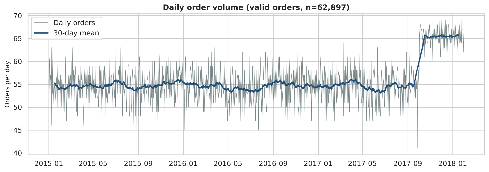
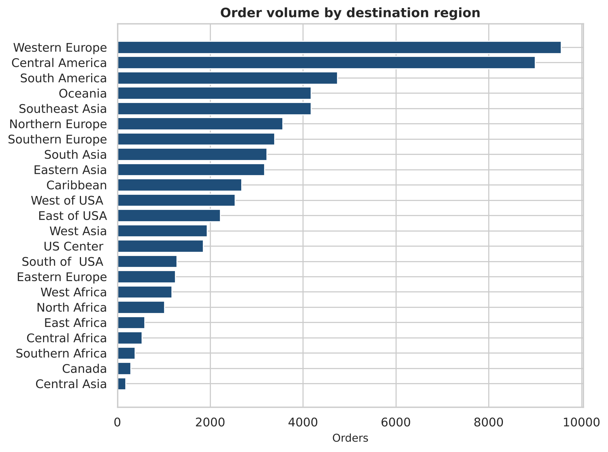
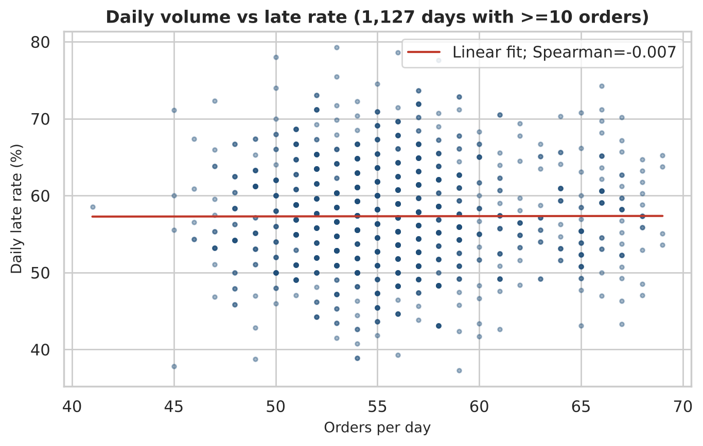
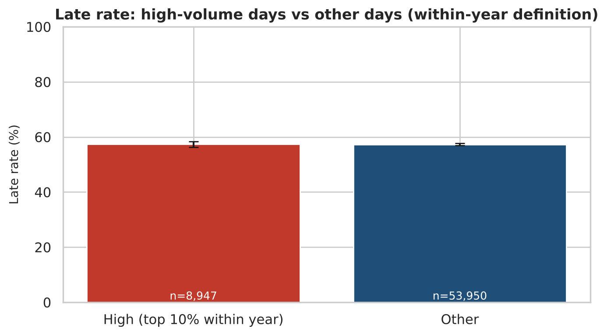

# Pattern 13: Order-volume patterns

## Definitions and data used

Unit: **order** (n = 62,897 valid orders; 'Shipping canceled' excluded); overall late rate = **57.31%**.

Volume = valid orders created per calendar day (n days = 1,127); late rate per day uses the same orders. **No capacity, staffing or warehouse-throughput data exists**, so any volume-delay relation is descriptive and cannot show cause.

## Daily/weekly/monthly volume

Daily orders: mean 55.8, median 55, SD 4.7, min 41, max 69; yearly mean daily volume: 2015 = 54.8, 2016 = 54.5, 2017 = 57.3, 2018 = 65.7.

## High-volume days: late rate

Definition A: day volume >= 63 orders (global 90th percentile). Chi-square p = 0.538, V = 0.002.

| hv                         |     n |   late_rate_% |   ci95_low_% |   ci95_high_% |
|:---------------------------|------:|--------------:|-------------:|--------------:|
| High-volume days (top 10%) |  8007 |         57.64 |        56.55 |         58.72 |
| Other days                 | 54890 |         57.27 |        56.85 |         57.68 |

Definition B (within-year 90th percentile, removes the year trend): chi-square p = 0.968, V = 0.000.

| hv_y                       |     n |   late_rate_% |   ci95_low_% |   ci95_high_% |
|:---------------------------|------:|--------------:|-------------:|--------------:|
| High (top 10% within year) |  8947 |         57.34 |        56.31 |         58.36 |
| Other                      | 53950 |         57.31 |        56.89 |         57.73 |

## Volume vs late rate (daily)

Days with >=10 orders: 1,127. Spearman(volume, daily late rate) = -0.007 (p=0.809). After removing the effect of each day's shipping-mode mix (late rate minus mode-expected rate): Spearman = -0.010 (p=0.733).

## Regional concentration

23 regions; top-3 regions hold 37.0% of orders; Herfindahl index = 0.077 (1/23 = 0.043 would be perfectly even).

| region          |   orders |   share_% |
|:----------------|---------:|----------:|
| Western Europe  |     9563 |     15.20 |
| Central America |     9001 |     14.30 |
| South America   |     4738 |      7.50 |
| Oceania         |     4175 |      6.60 |
| Southeast Asia  |     4173 |      6.60 |
| Northern Europe |     3564 |      5.70 |
| Southern Europe |     3390 |      5.40 |
| South Asia      |     3219 |      5.10 |
| Eastern Asia    |     3171 |      5.00 |
| Caribbean       |     2675 |      4.30 |
| West of USA     |     2536 |      4.00 |
| East of USA     |     2219 |      3.50 |
| West Asia       |     1935 |      3.10 |
| US Center       |     1852 |      2.90 |
| South of  USA   |     1280 |      2.00 |
| Eastern Europe  |     1246 |      2.00 |
| West Africa     |     1174 |      1.90 |
| North Africa    |     1013 |      1.60 |
| East Africa     |      589 |      0.90 |
| Central Africa  |      533 |      0.80 |
| Southern Africa |      380 |      0.60 |
| Canada          |      291 |      0.50 |
| Central Asia    |      180 |      0.30 |

## Volume by shipping mode

| mode           |   orders |   share_% |
|:---------------|---------:|----------:|
| First Class    |     9602 |     15.30 |
| Same Day       |     3407 |      5.40 |
| Second Class   |    12256 |     19.50 |
| Standard Class |    37632 |     59.80 |

## Region-month volume vs mode-adjusted late rate

Region-month cells with >=20 orders: 181. Spearman(volume, late rate minus mode-expected) = 0.084 (p=0.259).

*Daily volume trend*

*Regional volume*

*Volume vs late*

*High vs normal*

## Interpretation

- High-volume vs other days: late rates 57.3% vs 57.3% (V = 0.000); daily Spearman -0.007, mode-adjusted -0.010.
- No evidence that busy days are later. Capacity data would be required to test a workload mechanism.

## Candidate ML features

`orders_same_day_count`, `orders_same_day_region_count`, rolling 7-day order count (conditional: must be computed from orders created before the prediction time only; at order creation use counts of earlier orders, not the whole day).

## Limitations

Same-day totals include orders created after a given order, so they are **future-derived** for early-day orders; any feature must use prior-only counts. No capacity data.
