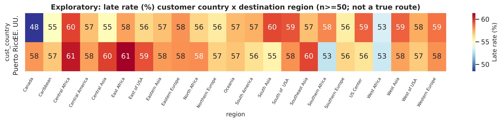
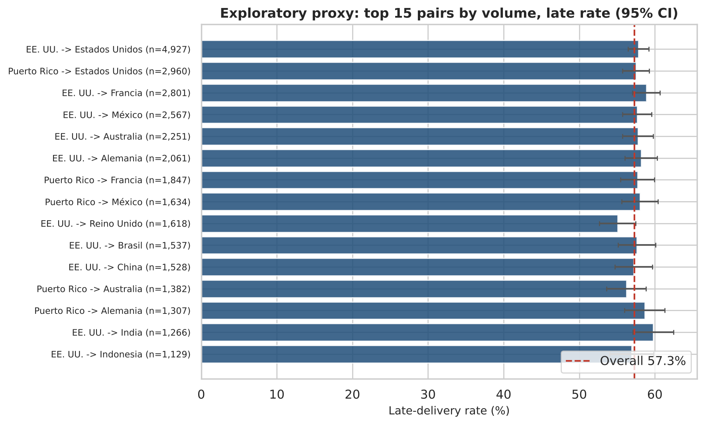

# Pattern 11: Origin-destination patterns

## Status

**True origin-destination (route) analysis cannot be completed reliably.** Searched all columns: there is **no origin, warehouse, depot, carrier, port or dispatch-location field**. `Latitude`/`Longitude` equal the **customer's residence** (country means: EE. UU. 36.8/-96.3; Puerto Rico 18.4/-66.6), not a shipping origin, and the customer country is never equal to the order country (0% of rows).

## Exploratory proxy (not a real route)

For transparency only: *customer residence country -> destination country* pairs. Pairs: 313 with n>=50; 98 with n>=100. Customer country has just 2 values, so this mostly repeats the destination-country analysis (Pattern 3). **Do not treat as route performance.**

| route                         |    n |   late_rate_% |   ci95_low_% |   ci95_high_% |
|:------------------------------|-----:|--------------:|-------------:|--------------:|
| EE. UU. -> Estados Unidos     | 4927 |         57.82 |        56.44 |         59.20 |
| Puerto Rico -> Estados Unidos | 2960 |         57.50 |        55.71 |         59.27 |
| EE. UU. -> Francia            | 2801 |         58.87 |        57.04 |         60.68 |
| EE. UU. -> México             | 2567 |         57.65 |        55.73 |         59.55 |
| EE. UU. -> Australia          | 2251 |         57.75 |        55.70 |         59.78 |
| EE. UU. -> Alemania           | 2061 |         58.18 |        56.03 |         60.29 |
| Puerto Rico -> Francia        | 1847 |         57.72 |        55.45 |         59.95 |
| Puerto Rico -> México         | 1634 |         58.02 |        55.61 |         60.39 |
| EE. UU. -> Reino Unido        | 1618 |         55.07 |        52.64 |         57.48 |
| EE. UU. -> Brasil             | 1537 |         57.64 |        55.16 |         60.09 |
| EE. UU. -> China              | 1528 |         57.20 |        54.70 |         59.66 |
| Puerto Rico -> Australia      | 1382 |         56.22 |        53.59 |         58.82 |
| Puerto Rico -> Alemania       | 1307 |         58.68 |        55.99 |         61.32 |
| EE. UU. -> India              | 1266 |         59.79 |        57.07 |         62.46 |
| EE. UU. -> Indonesia          | 1129 |         56.95 |        54.05 |         59.81 |

*(showing 15 of 98 rows; full table in `route_proxy_rates.csv`)*

Chi-square (pairs n>=100): chi2 = 102.2, dof = 97, p = 0.339, Cramer's V = 0.042.

*Proxy heatmap*

*Top proxy pairs*

## Not produced

Route map (no valid origin or destination coordinates), route volume/late-rate rankings, route consistency over time, mode-by-route analysis.

## Additional data required

Origin warehouse/depot ID and location, carrier, dispatch timestamp, and destination coordinates or standard postal codes.

## Candidate ML features

None approved. `route_historical_late_rate` is **unavailable** until origin data exists. A destination-based substitute (mode x region history) is evaluated in Pattern 12.
