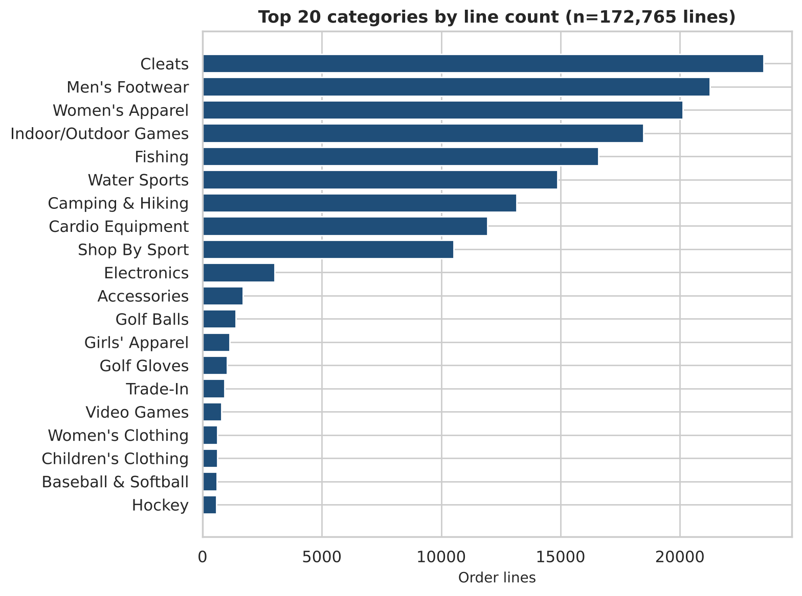
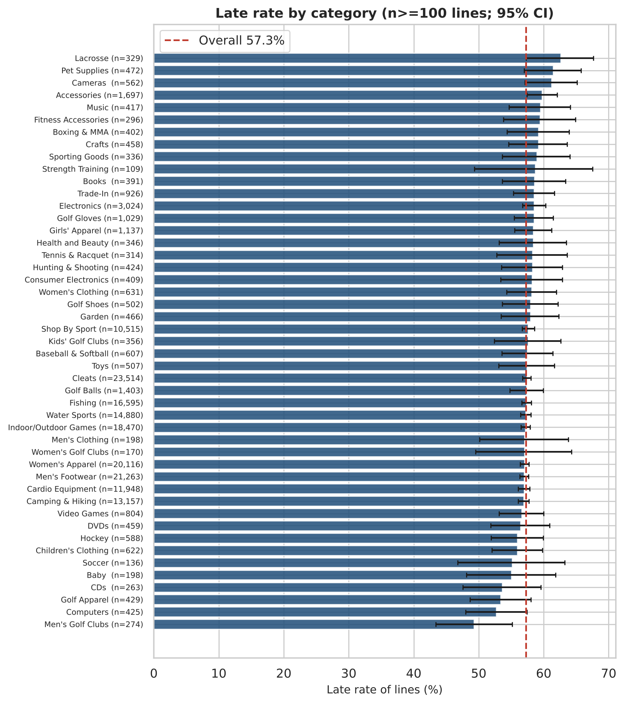
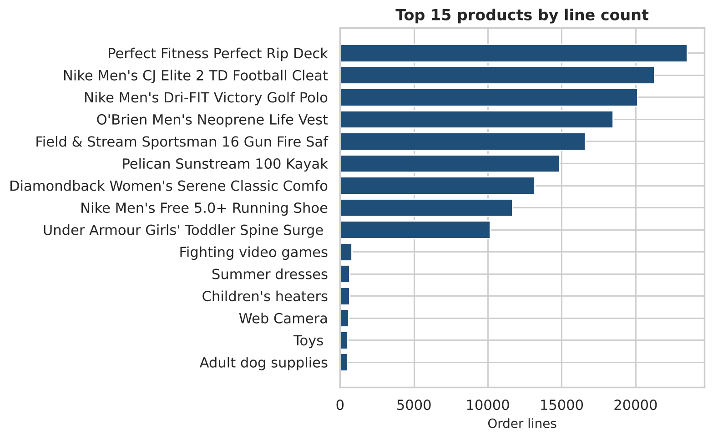
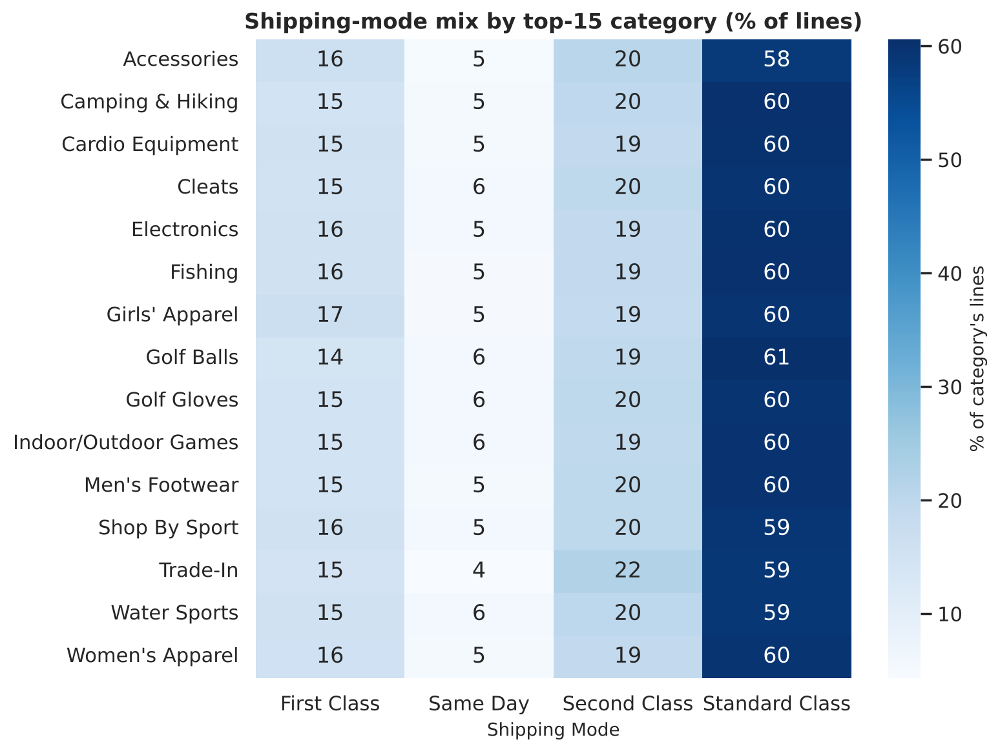

# Pattern 7: Product and category patterns

## Definitions and data used

Unit: **order line** (n = 172,765 lines in 62,897 valid orders), because categories/products belong to lines and an order can hold several (mean categories per order = 2.43). A line inherits its order's lateness, so late rates here are 'share of lines belonging to a late order'. Min group size 100 lines. 50 categories, 118 products, 11 departments. Overall line late rate = 57.29%.

## Category summary

50 groups; 47 with n>=100. Chi-square vs late: p = 0.581, Cramer's V = 0.016 (negligible). Groups deviating from the mode-expected late rate (BH p<.05, n>=100): **0**.

| Category Name        |     n |   qty |   late_rate_% |   ci95_low_% |   ci95_high_% |   mean_delay |   O/E |   p_BH |
|:---------------------|------:|------:|--------------:|-------------:|--------------:|-------------:|------:|-------:|
| Cleats               | 23514 | 70611 |         57.40 |        56.76 |         58.03 |         0.58 |  1.00 |   1.00 |
| Men's Footwear       | 21263 | 21263 |         57.01 |        56.34 |         57.67 |         0.57 |  1.00 |   1.00 |
| Women's Apparel      | 20116 | 60232 |         57.05 |        56.36 |         57.73 |         0.56 |  0.99 |   1.00 |
| Indoor/Outdoor Games | 18470 | 55333 |         57.20 |        56.49 |         57.91 |         0.56 |  1.00 |   1.00 |
| Fishing              | 16595 | 16595 |         57.34 |        56.59 |         58.09 |         0.56 |  1.00 |   1.00 |
| Water Sports         | 14880 | 14880 |         57.24 |        56.44 |         58.03 |         0.57 |  0.99 |   1.00 |
| Camping & Hiking     | 13157 | 13157 |         56.91 |        56.06 |         57.75 |         0.55 |  1.00 |   1.00 |
| Cardio Equipment     | 11948 | 35937 |         56.96 |        56.07 |         57.84 |         0.55 |  1.00 |   1.00 |
| Shop By Sport        | 10515 | 31329 |         57.61 |        56.67 |         58.55 |         0.57 |  1.00 |   1.00 |
| Electronics          |  3024 |  9061 |         58.53 |        56.77 |         60.28 |         0.57 |  1.02 |   1.00 |
| Accessories          |  1697 |  5125 |         59.75 |        57.40 |         62.06 |         0.60 |  1.03 |   1.00 |
| Golf Balls           |  1403 |  4159 |         57.38 |        54.77 |         59.94 |         0.55 |  1.01 |   1.00 |
| Girls' Apparel       |  1137 |  3414 |         58.40 |        55.51 |         61.23 |         0.58 |  1.01 |   1.00 |
| Golf Gloves          |  1029 |  2829 |         58.50 |        55.47 |         61.48 |         0.62 |  1.02 |   1.00 |
| Trade-In             |   926 |  2682 |         58.53 |        55.33 |         61.66 |         0.63 |  1.01 |   1.00 |
| Video Games          |   804 |   804 |         56.59 |        53.14 |         59.98 |         0.59 |  1.02 |   1.00 |
| Women's Clothing     |   631 |   631 |         58.16 |        54.27 |         61.95 |         0.64 |  1.01 |   1.00 |
| Children's Clothing  |   622 |   622 |         55.95 |        52.02 |         59.80 |         0.57 |  1.00 |   1.00 |
| Baseball & Softball  |   607 |  1714 |         57.50 |        53.53 |         61.37 |         0.61 |  0.97 |   1.00 |
| Hockey               |   588 |  1641 |         55.95 |        51.91 |         59.91 |         0.46 |  1.00 |   1.00 |

*(showing 20 of 50 rows; full table in `category_rates.csv`)*

## Product summary

118 groups; 72 with n>=100. Chi-square vs late: p = 0.762, Cramer's V = 0.025 (negligible). Groups deviating from the mode-expected late rate (BH p<.05, n>=100): **0**.

| Product Name                                  |     n |   qty |   late_rate_% |   ci95_low_% |   ci95_high_% |   mean_delay |   O/E |   p_BH |
|:----------------------------------------------|------:|------:|--------------:|-------------:|--------------:|-------------:|------:|-------:|
| Perfect Fitness Perfect Rip Deck              | 23478 | 70575 |         57.39 |        56.75 |         58.02 |         0.58 |  1.00 |   1.00 |
| Nike Men's CJ Elite 2 TD Football Cleat       | 21263 | 21263 |         57.01 |        56.34 |         57.67 |         0.57 |  1.00 |   1.00 |
| Nike Men's Dri-FIT Victory Golf Polo          | 20116 | 60232 |         57.05 |        56.36 |         57.73 |         0.56 |  0.99 |   1.00 |
| O'Brien Men's Neoprene Life Vest              | 18470 | 55333 |         57.20 |        56.49 |         57.91 |         0.56 |  1.00 |   1.00 |
| Field & Stream Sportsman 16 Gun Fire Safe     | 16595 | 16595 |         57.34 |        56.59 |         58.09 |         0.56 |  1.00 |   1.00 |
| Pelican Sunstream 100 Kayak                   | 14840 | 14840 |         57.22 |        56.43 |         58.02 |         0.57 |  0.99 |   1.00 |
| Diamondback Women's Serene Classic Comfort Bi | 13157 | 13157 |         56.91 |        56.06 |         57.75 |         0.55 |  1.00 |   1.00 |
| Nike Men's Free 5.0+ Running Shoe             | 11646 | 35079 |         56.92 |        56.02 |         57.82 |         0.55 |  0.99 |   1.00 |
| Under Armour Girls' Toddler Spine Surge Runni | 10164 | 30380 |         57.70 |        56.74 |         58.66 |         0.58 |  1.00 |   1.00 |
| Fighting video games                          |   804 |   804 |         56.59 |        53.14 |         59.98 |         0.59 |  1.02 |   1.00 |
| Summer dresses                                |   631 |   631 |         58.16 |        54.27 |         61.95 |         0.64 |  1.01 |   1.00 |
| Children's heaters                            |   622 |   622 |         55.95 |        52.02 |         59.80 |         0.57 |  1.00 |   1.00 |
| Web Camera                                    |   562 |   562 |         61.21 |        57.12 |         65.15 |         0.62 |  0.97 |   1.00 |
| Toys                                          |   507 |   507 |         57.40 |        53.05 |         61.63 |         0.54 |  1.00 |   1.00 |
| Adult dog supplies                            |   472 |   472 |         61.44 |        56.97 |         65.72 |         0.70 |  1.02 |   1.00 |
| Lawn mower                                    |   466 |   466 |         57.94 |        53.41 |         62.34 |         0.58 |  1.02 |   1.00 |
| DVDs                                          |   459 |   459 |         56.43 |        51.86 |         60.89 |         0.53 |  1.02 |   1.00 |
| Porcelain crafts                              |   458 |   458 |         59.17 |        54.61 |         63.58 |         0.62 |  1.01 |   1.00 |
| Dell Laptop                                   |   425 |   425 |         52.71 |        47.96 |         57.41 |         0.46 |  0.97 |   1.00 |
| Rock music                                    |   417 |   417 |         59.47 |        54.69 |         64.08 |         0.58 |  1.02 |   1.00 |

*(showing 20 of 118 rows; full table in `product_rates.csv`)*

**Categories with the highest / lowest late rate (n>=100):** see `category_rates.csv`.

*Category distribution*

*Category late rate*

*Top products*

*Category x mode*

## Interpretation

- Category late rates span 49.3-62.6% (n>=100). Cramer's V = 0.016 (negligible). After adjusting for shipping mode and multiple testing, **0 categories** and **0 products** deviate.
- Category/product frequency is concentrated in a few items, but concentration is not risk. No product or category is declared high risk unless it passes both the size filter and the adjusted test.

## Candidate ML features

`Category Name`, `Department Name` (conditional); `Product Name` (conditional, high cardinality: use frequency or target encoding fitted on training data only); category historical late rate (Pattern 12).

## Limitations

Line-level rates double-count an order's lateness once per line; order-level inference needs the Pattern 12 history features.
