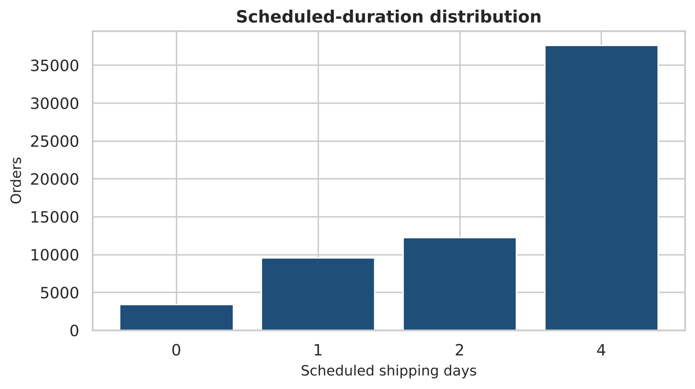
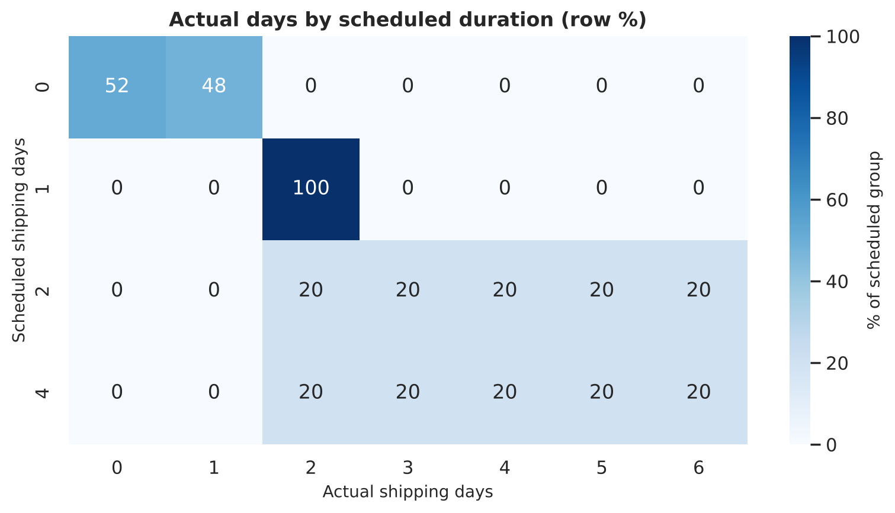
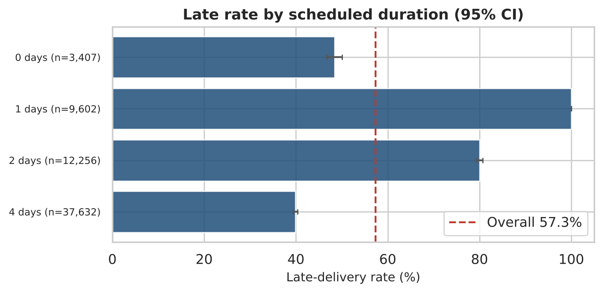
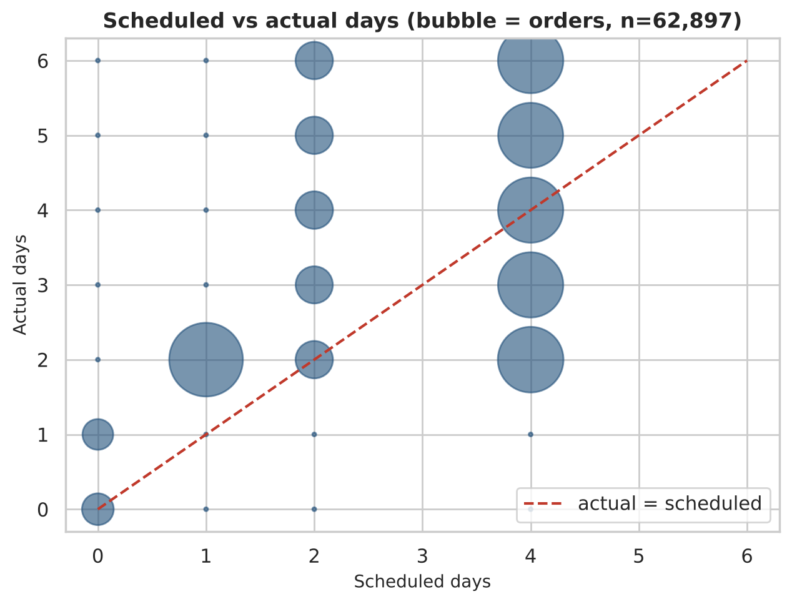
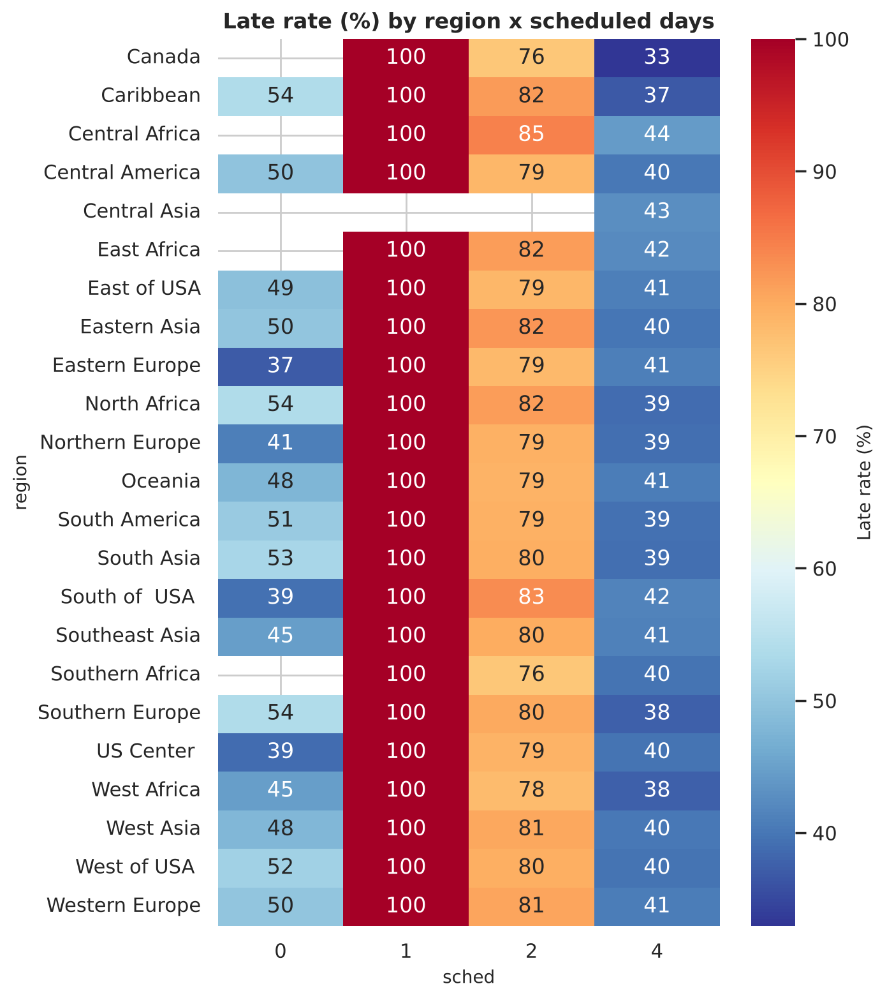

# Pattern 10: Scheduled-shipping patterns

## Definitions and data used

Unit: **order** (n = 62,897 valid orders; 'Shipping canceled' excluded); overall late rate = **57.31%**.

Scheduled = `Days for shipment (scheduled)` (promise); actual = `Days for shipping (real)`. Scheduled days are a **function of shipping mode** (verified: 1 distinct value per mode), so every 'by scheduled days' table is the same grouping as 'by mode'.

## Late rate and delay by scheduled duration

|   sched |        n |   late_rate_% |   ci95_low_% |   ci95_high_% |   mean_actual |   median_actual |   mean_delay |
|--------:|---------:|--------------:|-------------:|--------------:|--------------:|----------------:|-------------:|
|    0.00 |  3407.00 |         48.37 |        46.70 |         50.05 |          0.48 |            0.00 |         0.48 |
|    1.00 |  9602.00 |        100.00 |        99.96 |        100.00 |          2.00 |            2.00 |         1.00 |
|    2.00 | 12256.00 |         79.99 |        79.27 |         80.68 |          4.00 |            4.00 |         2.00 |
|    4.00 | 37632.00 |         39.85 |        39.35 |         40.34 |          3.99 |            4.00 |        -0.01 |

## Counts: scheduled days (rows) x actual days (columns)

|   sched |    0 |    1 |    2 |    3 |    4 |    5 |    6 |
|--------:|-----:|-----:|-----:|-----:|-----:|-----:|-----:|
|       0 | 1759 | 1648 |    0 |    0 |    0 |    0 |    0 |
|       1 |    0 |    0 | 9602 |    0 |    0 |    0 |    0 |
|       2 |    0 |    0 | 2453 | 2422 | 2473 | 2452 | 2456 |
|       4 |    0 |    0 | 7610 | 7517 | 7510 | 7458 | 7537 |

## Row %: distribution of actual days within each scheduled duration

|   sched |     0 |     1 |      2 |     3 |     4 |     5 |     6 |
|--------:|------:|------:|-------:|------:|------:|------:|------:|
|    0.00 | 51.60 | 48.40 |   0.00 |  0.00 |  0.00 |  0.00 |  0.00 |
|    1.00 |  0.00 |  0.00 | 100.00 |  0.00 |  0.00 |  0.00 |  0.00 |
|    2.00 |  0.00 |  0.00 |  20.00 | 19.80 | 20.20 | 20.00 | 20.00 |
|    4.00 |  0.00 |  0.00 |  20.20 | 20.00 | 20.00 | 19.80 | 20.00 |

## Scheduled duration vs shipping mode

| mode           |    0 |    1 |     2 |     4 |
|:---------------|-----:|-----:|------:|------:|
| First Class    |    0 | 9602 |     0 |     0 |
| Same Day       | 3407 |    0 |     0 |     0 |
| Second Class   |    0 |    0 | 12256 |     0 |
| Standard Class |    0 |    0 |     0 | 37632 |

## Statistical tests

Chi-square test of `scheduled days` vs late: chi2 = 14,530.8, dof = 3, p = 0, Cramer's V = 0.481 (strong).

Spearman(scheduled, actual) = 0.497 (p=0); Spearman(scheduled, delay) = -0.354. Kruskal-Wallis of actual days by scheduled days: H = 24,581.

## Scheduled duration vs destination region

Late rate (%) by region x scheduled days (cells with n>=50) is in the heatmap below.

*Scheduled distribution*

*Actual vs scheduled*

*Late by scheduled*

*Scatter*

*Region x scheduled*

## Interpretation

- Actual shipping time is similar across modes (see row % table), but the promise differs by mode (0, 1, 2 or 4 days). Lateness therefore mainly reflects **how tight the promise is**, not how slow the actual shipping is.
- Important checks for the business: a 100% late rate for a mode means actual days always exceeded the promise; confirm that scheduled days for this mode are realistic and not a data-definition artefact.
- This pattern describes *commitments* (known at order creation if mode is chosen) vs *outcomes* (known only after delivery).

## Candidate ML features

`Days for shipment (scheduled)` / `scheduled_duration_group`: approved candidate for order-creation (if known at creation), but fully redundant with `Shipping Mode`: keep one for linear models. Never include actual days.

## Limitations

Only 4 distinct scheduled values; no continuous variation to learn from.
