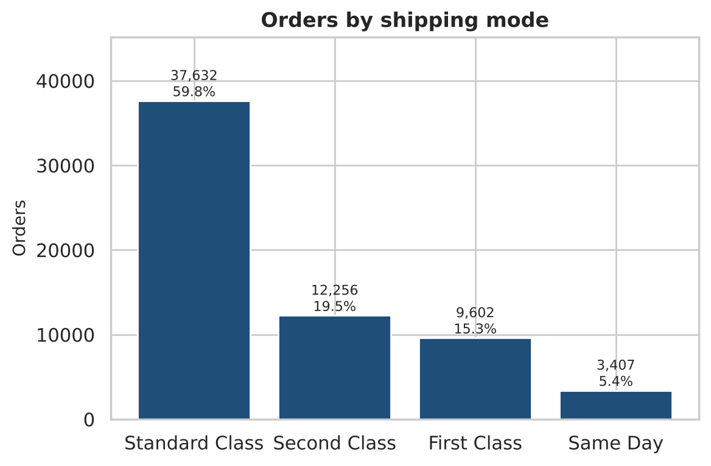
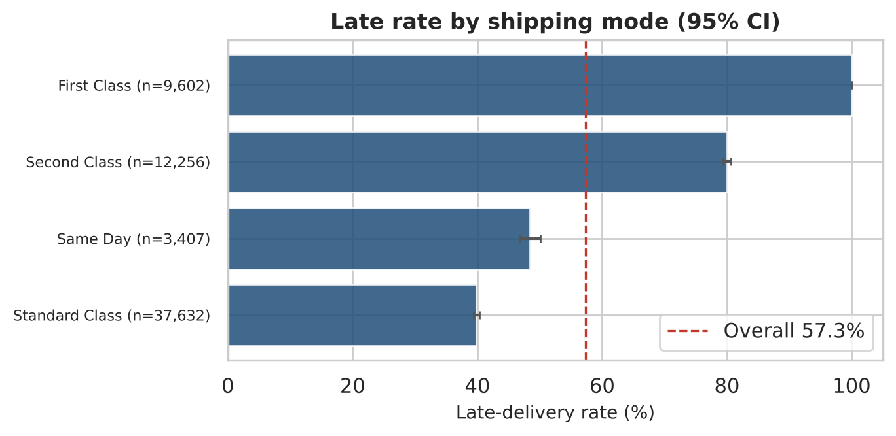
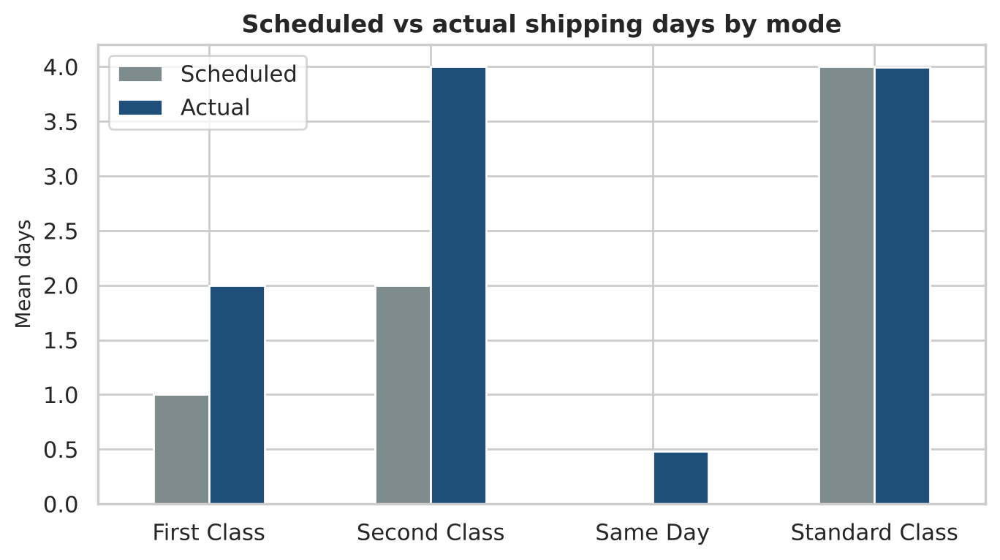
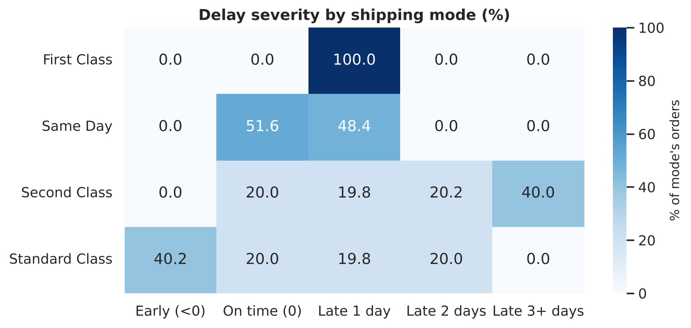

# Pattern 2: Shipping-mode patterns

## Definitions and data used

Unit: **order** (n = 62,897 orders excluding 2,855 'Shipping canceled'); overall late rate = **57.31%**.

## Late rate and durations by shipping mode

| mode           |     n |   share_% |   late |   late_rate_% |   ci95_low_% |   ci95_high_% |   mean_actual |   mean_sched |   mean_delay |   median_delay |
|:---------------|------:|----------:|-------:|--------------:|-------------:|--------------:|--------------:|-------------:|-------------:|---------------:|
| First Class    |  9602 |     15.27 |   9602 |        100.00 |        99.96 |        100.00 |          2.00 |         1.00 |         1.00 |           1.00 |
| Second Class   | 12256 |     19.49 |   9803 |         79.99 |        79.27 |         80.68 |          4.00 |         2.00 |         2.00 |           2.00 |
| Same Day       |  3407 |      5.42 |   1648 |         48.37 |        46.70 |         50.05 |          0.48 |         0.00 |         0.48 |           0.00 |
| Standard Class | 37632 |     59.83 |  14995 |         39.85 |        39.35 |         40.34 |          3.99 |         4.00 |        -0.01 |           0.00 |

## Delay severity by mode (% of mode's orders)

| mode           |   Early (<0) |   On time (0) |   Late 1 day |   Late 2 days |   Late 3+ days |
|:---------------|-------------:|--------------:|-------------:|--------------:|---------------:|
| First Class    |         0.00 |          0.00 |       100.00 |          0.00 |           0.00 |
| Same Day       |         0.00 |         51.60 |        48.40 |          0.00 |           0.00 |
| Second Class   |         0.00 |         20.00 |        19.80 |         20.20 |          40.00 |
| Standard Class |        40.20 |         20.00 |        19.80 |         20.00 |           0.00 |

## Statistical test

Chi-square test of `Shipping Mode` vs late: chi2 = 14,530.8, dof = 3, p = 0, Cramer's V = 0.481 (strong).

Kruskal-Wallis on delay days across modes: H = 14,653.6, p = 0.

## Mode vs order size (% within mode)

| mode           |   1-2 |   3-5 |   6-10 |   11+ |
|:---------------|------:|------:|-------:|------:|
| First Class    | 28.70 | 23.00 |  32.80 | 15.50 |
| Same Day       | 29.10 | 23.20 |  31.70 | 15.90 |
| Second Class   | 28.20 | 23.70 |  33.10 | 15.10 |
| Standard Class | 28.80 | 23.20 |  33.10 | 14.90 |

## Mode vs market (% within mode)

| mode           |   Africa |   Europe |   LATAM |   Pacific Asia |   USCA |
|:---------------|---------:|---------:|--------:|---------------:|-------:|
| First Class    |     5.60 |    28.70 |   26.00 |          26.50 |  13.20 |
| Same Day       |     6.50 |    27.90 |   25.50 |          26.90 |  13.10 |
| Second Class   |     5.60 |    28.20 |   25.80 |          27.20 |  13.20 |
| Standard Class |     6.00 |    28.20 |   26.30 |          26.70 |  12.90 |

## Mode vs top-8 categories (% of lines)

| Category Name        |   First Class |   Same Day |   Second Class |   Standard Class |
|:---------------------|--------------:|-----------:|---------------:|-----------------:|
| Camping & Hiking     |         14.90 |       5.40 |          19.60 |            60.20 |
| Cardio Equipment     |         15.40 |       5.30 |          19.30 |            60.10 |
| Cleats               |         15.20 |       5.50 |          19.70 |            59.50 |
| Fishing              |         15.50 |       5.00 |          19.20 |            60.30 |
| Indoor/Outdoor Games |         15.00 |       5.60 |          19.50 |            59.90 |
| Men's Footwear       |         15.10 |       5.30 |          19.90 |            59.80 |
| Water Sports         |         15.50 |       5.50 |          20.00 |            59.00 |
| Women's Apparel      |         15.80 |       5.30 |          19.20 |            59.70 |

**Order priority:** the dataset has no priority column, so mode-vs-priority cannot be analysed.

*Mode distribution*

*Late rate by mode*

*Actual vs scheduled*

*Severity heatmap (substitute for priority heatmap)*

## Interpretation

- Late rate ranges from **39.9% (Standard Class, n=37,632)** to **100.0% (First Class, n=9,602)**.
- Scheduled days differ strongly by mode while actual days overlap, so the **promise, not the transit time, drives much of the apparent mode effect**.
- Mode is the strongest single categorical association found in this dataset (Cramer's V above). Causation is not implied: mode is chosen by the customer/system and tied to a fixed promise.

## Candidate ML features

`Shipping Mode` (approved if chosen at order creation); `Days for shipment (scheduled)` is a deterministic function of mode (redundant: keep one, or keep both only for tree models).

## Limitations

No carrier or dispatch data. Mode may not be known at order creation in the real system: confirm with RouteMind data.
