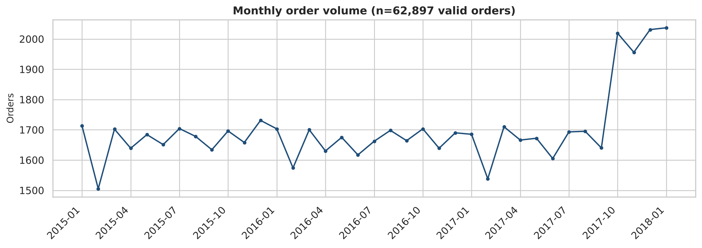
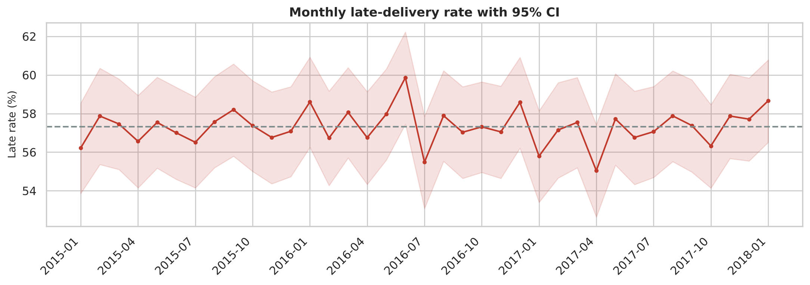
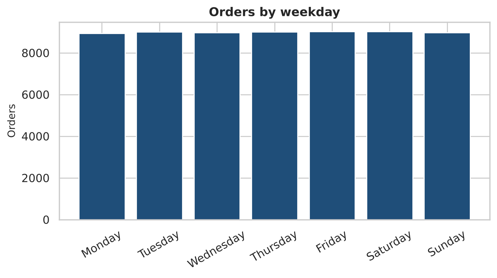
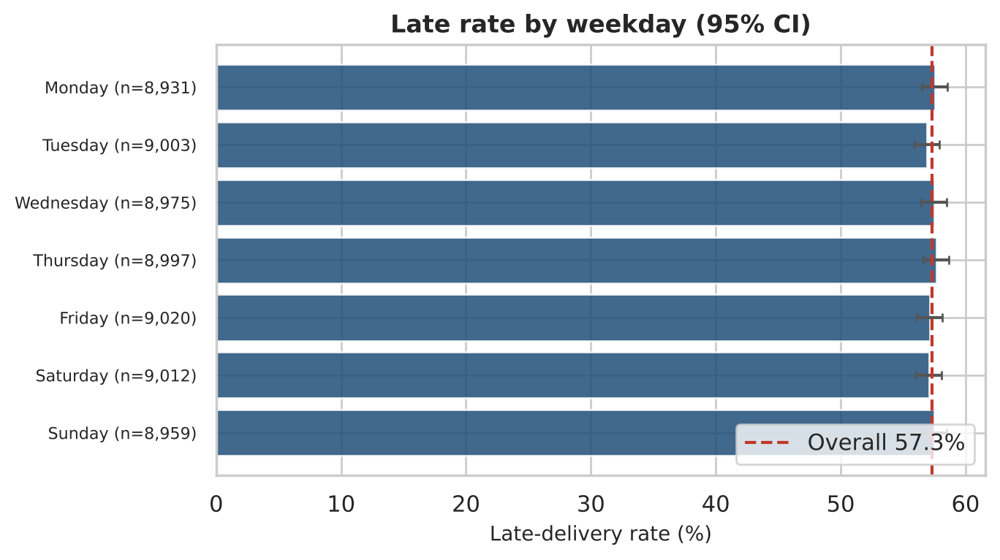
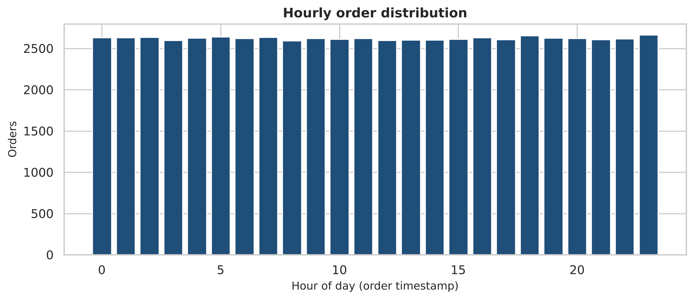
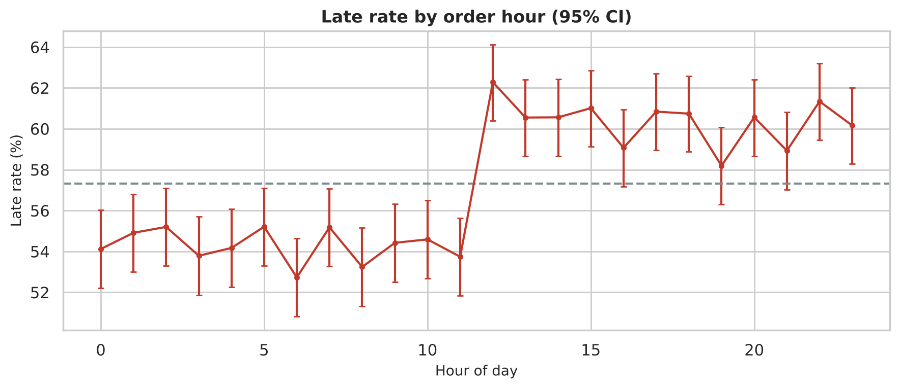
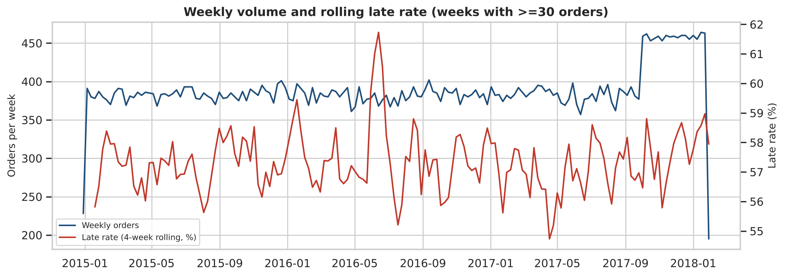
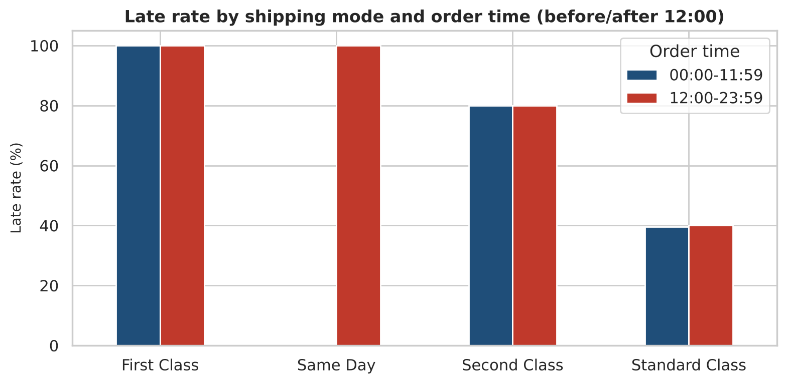

# Pattern 9: Time-based patterns

## Definitions and data used

Unit: **order** (n = 62,897 valid orders; 'Shipping canceled' excluded); overall late rate = **57.31%**.

Date coverage: orders from 2015-01-01 00:00:00 to 2018-01-31 23:38:00 (**37 calendar months**; January appears in 4 years, other months in 3). Time fields come from `order date (DateOrders)`.

## Weekday: orders and late rate

Chi-square test of `Weekday` vs late: chi2 = 1.7, dof = 6, p = 0.946, Cramer's V = 0.005 (negligible).

| weekday   |    n |   late |   late_rate_% |   ci95_low_% |   ci95_high_% |
|:----------|-----:|-------:|--------------:|-------------:|--------------:|
| Monday    | 8931 |   5137 |         57.52 |        56.49 |         58.54 |
| Tuesday   | 9003 |   5123 |         56.90 |        55.88 |         57.92 |
| Wednesday | 8975 |   5157 |         57.46 |        56.43 |         58.48 |
| Thursday  | 8997 |   5186 |         57.64 |        56.62 |         58.66 |
| Friday    | 9020 |   5153 |         57.13 |        56.10 |         58.15 |
| Saturday  | 9012 |   5143 |         57.07 |        56.04 |         58.09 |
| Sunday    | 8959 |   5149 |         57.47 |        56.45 |         58.49 |

## Month of year: orders and late rate

Chi-square test of `Month of year` vs late: chi2 = 7.4, dof = 11, p = 0.762, Cramer's V = 0.011 (negligible).

|   month |       n |    late |   late_rate_% |   ci95_low_% |   ci95_high_% |
|--------:|--------:|--------:|--------------:|-------------:|--------------:|
|    1.00 | 7138.00 | 4096.00 |         57.38 |        56.23 |         58.53 |
|    2.00 | 4617.00 | 2643.00 |         57.24 |        55.81 |         58.67 |
|    3.00 | 5112.00 | 2949.00 |         57.69 |        56.33 |         59.04 |
|    4.00 | 4935.00 | 2769.00 |         56.11 |        54.72 |         57.49 |
|    5.00 | 5031.00 | 2905.00 |         57.74 |        56.37 |         59.10 |
|    6.00 | 4873.00 | 2820.00 |         57.87 |        56.48 |         59.25 |
|    7.00 | 5059.00 | 2851.00 |         56.36 |        54.98 |         57.72 |
|    8.00 | 5071.00 | 2930.00 |         57.78 |        56.41 |         59.13 |
|    9.00 | 4938.00 | 2841.00 |         57.53 |        56.15 |         58.91 |
|   10.00 | 5418.00 | 3086.00 |         56.96 |        55.64 |         58.27 |
|   11.00 | 5253.00 | 3008.00 |         57.26 |        55.92 |         58.59 |
|   12.00 | 5452.00 | 3150.00 |         57.78 |        56.46 |         59.08 |

## Quarter: orders and late rate

Chi-square test of `Quarter` vs late: chi2 = 0.2, dof = 3, p = 0.979, Cramer's V = 0.002 (negligible).

|   quarter |        n |    late |   late_rate_% |   ci95_low_% |   ci95_high_% |
|----------:|---------:|--------:|--------------:|-------------:|--------------:|
|      1.00 | 16867.00 | 9688.00 |         57.44 |        56.69 |         58.18 |
|      2.00 | 14839.00 | 8494.00 |         57.24 |        56.44 |         58.04 |
|      3.00 | 15068.00 | 8622.00 |         57.22 |        56.43 |         58.01 |
|      4.00 | 16123.00 | 9244.00 |         57.33 |        56.57 |         58.10 |

## Year: orders and late rate

Chi-square test of `Year` vs late: chi2 = 3.1, dof = 3, p = 0.374, Cramer's V = 0.007 (negligible).

|    year |        n |     late |   late_rate_% |   ci95_low_% |   ci95_high_% |
|--------:|---------:|---------:|--------------:|-------------:|--------------:|
| 2015.00 | 19995.00 | 11431.00 |         57.17 |        56.48 |         57.85 |
| 2016.00 | 19955.00 | 11497.00 |         57.61 |        56.93 |         58.30 |
| 2017.00 | 20910.00 | 11925.00 |         57.03 |        56.36 |         57.70 |
| 2018.00 |  2037.00 |  1195.00 |         58.66 |        56.51 |         60.78 |

## Hour of day: orders and late rate

Chi-square test of `Hour of day` vs late: chi2 = 259.5, dof = 23, p = 6.32e-42, Cramer's V = 0.064 (weak).

|   hour |       n |    late |   late_rate_% |   ci95_low_% |   ci95_high_% |
|-------:|--------:|--------:|--------------:|-------------:|--------------:|
|   0.00 | 2631.00 | 1424.00 |         54.12 |        52.22 |         56.02 |
|   1.00 | 2628.00 | 1443.00 |         54.91 |        53.00 |         56.80 |
|   2.00 | 2634.00 | 1454.00 |         55.20 |        53.30 |         57.09 |
|   3.00 | 2597.00 | 1397.00 |         53.79 |        51.87 |         55.70 |
|   4.00 | 2627.00 | 1423.00 |         54.17 |        52.26 |         56.07 |
|   5.00 | 2641.00 | 1458.00 |         55.21 |        53.30 |         57.09 |
|   6.00 | 2623.00 | 1383.00 |         52.73 |        50.81 |         54.63 |
|   7.00 | 2633.00 | 1453.00 |         55.18 |        53.28 |         57.07 |
|   8.00 | 2592.00 | 1380.00 |         53.24 |        51.32 |         55.16 |
|   9.00 | 2622.00 | 1427.00 |         54.42 |        52.51 |         56.32 |
|  10.00 | 2612.00 | 1426.00 |         54.59 |        52.68 |         56.50 |
|  11.00 | 2622.00 | 1409.00 |         53.74 |        51.83 |         55.64 |
|  12.00 | 2598.00 | 1618.00 |         62.28 |        60.40 |         64.12 |
|  13.00 | 2603.00 | 1576.00 |         60.55 |        58.65 |         62.41 |
|  14.00 | 2604.00 | 1577.00 |         60.56 |        58.67 |         62.42 |
|  15.00 | 2611.00 | 1593.00 |         61.01 |        59.13 |         62.86 |
|  16.00 | 2629.00 | 1553.00 |         59.07 |        57.18 |         60.94 |
|  17.00 | 2607.00 | 1586.00 |         60.84 |        58.95 |         62.69 |
|  18.00 | 2654.00 | 1612.00 |         60.74 |        58.87 |         62.58 |
|  19.00 | 2624.00 | 1527.00 |         58.19 |        56.30 |         60.07 |
|  20.00 | 2619.00 | 1586.00 |         60.56 |        58.67 |         62.41 |
|  21.00 | 2608.00 | 1537.00 |         58.93 |        57.03 |         60.81 |
|  22.00 | 2615.00 | 1604.00 |         61.34 |        59.46 |         63.19 |
|  23.00 | 2663.00 | 1602.00 |         60.16 |        58.28 |         62.00 |

## Volume summary

Orders (valid) per day: mean 55.8, median 55, min 41, max 69 over 1,127 days with orders. Per month: mean 1700, min 1505 (2015-02), max 2037 (2018-01). Weekly: mean 388.

## Peak periods

Highest-volume months:

| ym      |    n |   late_rate_% |
|:--------|-----:|--------------:|
| 2018-01 | 2037 |         58.66 |
| 2017-12 | 2031 |         57.71 |
| 2017-10 | 2019 |         56.32 |

Highest late-rate months:

| ym      |    n |   late_rate_% |   ci95_low_% |   ci95_high_% |
|:--------|-----:|--------------:|-------------:|--------------:|
| 2016-06 | 1617 |         59.86 |        57.45 |         62.23 |
| 2018-01 | 2037 |         58.66 |        56.51 |         60.78 |
| 2016-01 | 1703 |         58.60 |        56.25 |         60.92 |

## Seasonality check

Std. deviation of monthly late rates = 0.93 pp; expected from sampling noise alone with ~1700 orders/month = 1.20 pp. Monthly variation is consistent with noise: no evidence of seasonality. Only 3 full annual cycles exist, so seasonal conclusions are limited.

## Late rate (%) by month-of-year and year

|   month |   2015 |   2016 |   2017 |   2018 |
|--------:|-------:|-------:|-------:|-------:|
|    1.00 |  56.20 |  58.60 |  55.80 |  58.70 |
|    2.00 |  57.90 |  56.70 |  57.20 | nan    |
|    3.00 |  57.50 |  58.10 |  57.50 | nan    |
|    4.00 |  56.60 |  56.70 |  55.00 | nan    |
|    5.00 |  57.50 |  58.00 |  57.70 | nan    |
|    6.00 |  57.00 |  59.90 |  56.80 | nan    |
|    7.00 |  56.50 |  55.50 |  57.10 | nan    |
|    8.00 |  57.60 |  57.90 |  57.90 | nan    |
|    9.00 |  58.20 |  57.00 |  57.40 | nan    |
|   10.00 |  57.40 |  57.30 |  56.30 | nan    |
|   11.00 |  56.80 |  57.00 |  57.90 | nan    |
|   12.00 |  57.10 |  58.60 |  57.70 | nan    |

## Hour effect is confined to Same Day orders (within-mode check)

The overall hour pattern (a step at 12:00) is **not** a general time-of-day effect. Splitting by shipping mode and order time before/after noon:

| mode           | noon        |     n |   late |   late_rate_% |   ci95_low_% |   ci95_high_% |
|:---------------|:------------|------:|-------:|--------------:|-------------:|--------------:|
| First Class    | 00:00-11:59 |  4703 |   4703 |        100.00 |        99.92 |        100.00 |
| First Class    | 12:00-23:59 |  4899 |   4899 |        100.00 |        99.92 |        100.00 |
| Same Day       | 00:00-11:59 |  1759 |      0 |          0.00 |         0.00 |          0.22 |
| Same Day       | 12:00-23:59 |  1648 |   1648 |        100.00 |        99.77 |        100.00 |
| Second Class   | 00:00-11:59 |  6124 |   4900 |         80.01 |        78.99 |         81.00 |
| Second Class   | 12:00-23:59 |  6132 |   4903 |         79.96 |        78.94 |         80.94 |
| Standard Class | 00:00-11:59 | 18876 |   7474 |         39.60 |        38.90 |         40.29 |
| Standard Class | 12:00-23:59 | 18756 |   7521 |         40.10 |        39.40 |         40.80 |

In Same Day orders (n=3,407) the rule 'ordered at or after 12:00 => late' matches the Late flag in **100.0%** of orders. Other modes show no order-hour association (chi-square within mode: First Class constant; Second Class p=0.97; Standard Class p=0.86). The hour feature is therefore only useful *in interaction with shipping mode*.

*Monthly volume*

*Monthly late rate*

*Weekday orders*

*Weekday late rate*

*Hourly orders*

*Hourly late rate*

*Weekly trend*

*Mode x noon cutoff*

## Interpretation

- Cramer's V vs late: weekday 0.005, month 0.011, hour 0.064, year 0.007 (weekday, month, year negligible; hour weak overall because of the Same Day noon cutoff).
- Late-rate range by weekday 56.9-57.6%, by month 56.1-57.9%, by hour 52.7-62.3%.

## Candidate ML features

`order_hour` / `ordered_after_noon` x `Shipping Mode` (**approved candidate**: deterministic for Same Day); `order_month`, `order_weekday`, `is_weekend`, `quarter`: rejected/low value (no effect found). Use year only for time-split validation, not as a feature.

## Limitations

Three annual cycles only; timestamps have a synthetic-looking distribution if flat (check hourly chart); no holiday calendar.
